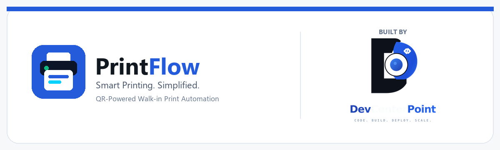
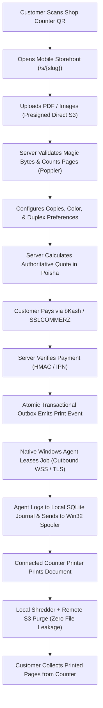

<p align="center">
  <a href="https://devcenterpoint.com">
    
  </a>
</p>

<h1 align="center">PrintFlow</h1>
<h3 align="center">Smart Printing. Simplified.</h3>

<p align="center">
  <strong>A production-ready, QR-powered printing automation ecosystem by <a href="https://devcenterpoint.com">DevCenterPoint</a> that connects walk-in customers, print shops, online payments, and physical printers in one seamless, automated pipeline.</strong>
</p>

<p align="center">
  <a href="https://devcenterpoint.com">
    
  </a>
  
  
  
  
</p>

<p align="center">
  <a href="#overview">Overview</a> •
  <a href="#the-5-core-architectural-decisions">Architectural Decisions</a> •
  <a href="#key-subsystems-delivered">Key Subsystems</a> •
  <a href="#technology-stack">Tech Stack</a> •
  <a href="#verification-battery">Test Battery</a> •
  <a href="#quickstart--running-the-project">Quickstart</a> •
  <a href="#api-reference">API Reference</a>
</p>

---

## Overview

**PrintFlow** is a modern, intelligent printing automation platform designed to transform how print shops receive, price, process, and fulfill walk-in print orders.

Traditional printing workflows in print shops (especially in Bangladesh) are plagued by manual friction:
- **File Chaos:** Customers send documents through WhatsApp, Bluetooth, USB flash drives, or personal emails, leaving sensitive personal files indefinitely cached on shop counter computers.
- **Pricing Leakage:** Counter staff guess prices, miscount pages, or fail to accurately bill duplex/color configurations.
- **Payment Friction:** Shop owners rely on manual bKash/Nagad "Send Money" screenshots that can be forged or reused.
- **Counter Congestion:** Operators manually manage print dialogs while queues back up at the counter.

### The PrintFlow Solution

PrintFlow replaces this entire manual chain with a trusted, asynchronous, server-authoritative pipeline:



---

## 🏛️ The 5 Core Architectural Decisions

During the architectural blueprint phase, 5 foundational decisions were locked and forensically audited across all layers:

| # | Decision | Implementation Details |
|---|---|---|
| **1** | **Launch Geography: Bangladesh (BDT)** | Base currency is **BDT** with internal amounts stored strictly as integer **Poisha** (1 BDT = 100 Poisha) as 64-bit integers (`unsignedBigInteger`). Zero floating-point arithmetic drift. Official adapters for **SSLCOMMERZ v4** (hosted checkout, IPN signature verification) and **bKash Tokenized Checkout** (Redis atomic token locking). Dual-script typography (Inter + Noto Sans Bengali) and 100% key parity across 9 translation namespaces (`en`/`bn`). |
| **2** | **Pricing Model: Per-Printed-Side + Dynamic Duplex** | Base calculation unit is `printed_side`. Shop owners configure simplex rates and dynamic duplex pricing (Model A: flat sheet fee, Model B: discounted second side). Odd-page documents enforce deterministic split: `(duplex_pairs * 2 * duplex_rate) + (1 * simplex_rate)` where the odd page is billed at the standard simplex rate with zero discount. Enforces basis-point VAT and shop floor minimum order fees. |
| **3** | **Customer Contact: Mandatory BD Phone** | `customer_phone` is `NOT NULL` on `orders`. Validated strictly against the Bangladeshi 11-digit mobile standard (`/^01[3-9]\d{8}$/`) with automatic native Bengali numeral transliteration (`০-৯` $\to$ `0-9`). |
| **4** | **Shop Model: One Shop Per Tenant Baseline** | Out-of-the-box single-shop baseline. All database tables enforce `shops.tenant_id` foreign keys and `BelongsToTenant` query scoping for forward compatibility, ensuring zero schema migrations when activating multi-outlet SaaS mode. |
| **5** | **Execution Priority: Standalone Mode First** | Defaults to `APP_EDITION=standalone`. The `EditionGate` middleware intercepts all `/api/v1/platform/*` SaaS endpoints, returning HTTP 404 with zero route disclosure. Overrides client-side header spoofing attempts. |

---

## 🛠️ Key Subsystems Delivered

### 1. Customer Storefront & Secure Upload (`/s/{slug}`)
- **Counter QR Studio**: Shop owners generate and download branded counter placards in high-resolution PNG, vector SVG, and print-ready styled A4/A5 PDF placards.
- **Mobile Storefront**: Responsive interface resolving shop identity, operating hours, accepted formats, and active pricing.
- **Mandatory Phone Intake**: Dual-script (English & Bengali `০-৯`) 11-digit mobile entry with operator detection (Grameenphone, Banglalink, Robi, Airtel, Teletalk).
- **Secure File Intake Pipeline**:
  - Direct presigned upload to private MinIO/S3 object storage.
  - Magic-byte validation (`MimeValidator.php`) preventing disguised executables and polyglot files.
  - Poppler PDF page counter (`PdfMetricsService.php`) extracting dimensions and thumbnail previews while instantly rejecting encrypted/password-protected PDFs.
  - ClamAV stream scanner isolating malware.

### 2. Dynamic Pricing & Cryptographic Quotes
- **Poisha Integer Engine**: Pure integer calculations in `Quote.php` and `DynamicDuplexPricingEngine.php` preventing IEEE 754 precision bugs.
- **Deterministic Duplex Rules**: Exact sheet-count and odd-page distribution formulas.
- **Cryptographic Quote Sealing**: Generates an immutable quote snapshot signed with an SHA-256 calculation hash and an enforced 15-minute expiration TTL.

### 3. Payment Subsystem & Atomic Outbox Engine
- **Multi-Gateway Drivers**:
  - **SSLCOMMERZ v4**: Session API initiation, raw-body MD5 `verify_sign` IPN verification, and Order Validation API query.
  - **bKash Tokenized Checkout**: OAuth token authorization grant with Redis distributed locking, payment creation, query, and execution.
  - **Sandbox Driver**: Fully instrumented test adapter for deterministic automated testing.
- **Atomic Transactional Outbox Pattern**:
  - When payment is captured, the database updates payment status to `captured`, order status to `paid`, and writes an outbox message to `outbox_events` **inside an atomic database transaction**.
  - `OutboxProcessor.php` polls and dispatches with row-level locking (`FOR UPDATE SKIP LOCKED`), guaranteeing that **zero paid orders can be lost** if Redis or background workers restart.
- **Customer Order Portal (`/order/{token}`)**:
  - Real-time 6-stage vertical progress timeline (`Files Received` $\to$ `Preparing` $\to$ `Payment Verified` $\to$ `Spooling` $\to$ `Printing` $\to$ `Ready for Pickup`).
  - Printable thermal receipt and A4 digital receipt generation.

### 4. Native Windows Print Agent (`print-agent/`)
- **Tauri v2 + Rust Architecture**: Desktop client engineered for unattended shop counter PCs on Windows 10/11.
- **Pairing Handshake**: One-time 6-digit cryptographic PIN generated by the shop owner with a 5-minute TTL, exchanged over TLS for persistent agent credentials.
- **Atomic Job Lease Protocol**: Outbound WebSocket / TLS polling leasing jobs using `SELECT ... FOR UPDATE SKIP LOCKED` with 300s lease TTL.
- **Win32 Spooler Integration**: Native bindings to `winspool.drv` invoking `OpenPrinterW`, `StartDocPrinterW`, `WritePrinter`, and `EndDocPrinterW`.
- **Durable Local SQLite Journal (`print_agent_journal.db`)**: Agent writes the job attempt to its local SQLite database *prior* to spooling. If network drops mid-print, reconnecting reconciles with the server to prevent duplicate physical prints.
- **Ephemeral File Purge**: Multi-pass cryptographic file shredder (zero-fill + entropy overwrites) on the local disk combined with remote S3 object deletion and audit entries in `file_deletion_events`.

### 5. Shop Owner Operations Console (`/owner`)
- **Operational Dashboard**: Real-time revenue reporting in BDT/Poisha (`Asia/Dhaka` timezone), daily volume counts, queue depth, and live agent connectivity health.
- **Live Active Queue**: WebSocket-driven queue board (`shop.{slug}.queue`) with priority controls (`hold`, `resume`, `cancel`).
- **Order Ledger & Handover**: Searchable order history with customer phone privacy masking (`017****5678`) and staff counter handover toggle (`collected`).
- **Controlled Reprint Protocol**: Authorized reprint modal requiring mandatory audit reason text and registering distinct attempts in `print_job_attempts`.
- **Hardware & Pairing Wizard**: In-app 6-digit pairing code generator with a live 5-minute countdown and printer capability inspector.
- **Pricing Setup**: Dynamic simplex/duplex pricing matrix with interactive Poisha preview calculator.
- **Payment Gateway Settings**: Encrypted credential management (AES-256 via Laravel `Crypt`) for SSLCOMMERZ v4 and bKash.

### 6. Standalone Edition Lockdown & Production Deployment
- **`EditionGate` Middleware**: Intercepts `/api/v1/platform/*` SaaS endpoints, returning HTTP 404 in standalone mode.
- **Dormant SaaS Schemas**: Migrations 0023–0026 (`plans`, `subscriptions`, `subscription_invoices`, `usage_events`) deployed for seamless future multi-tenant SaaS upgrade without data migration.
- **Production Infrastructure Suite**:
  - `deployment/docker-compose.prod.yml`: Hardened production multi-container topology.
  - `deployment/printflow.prod.conf`: Nginx reverse proxy with TLS and WebSocket proxying.
  - `deployment/backup-database.sh` & `deployment/backup-storage.sh`: Automated daily encrypted backup scripts.
  - `deployment/restore-database.sh`: Disaster recovery restore script.
  - `deployment/healthcheck.sh`: System monitoring health probe.

---

## 💻 Technology Stack

| Layer | Technology | Purpose |
|---|---|---|
| **Backend API** | Laravel 11.57.1 / PHP 8.5+ | REST API, domain services, state machines, Sanctum auth |
| **Frontend SPA** | React 19, TypeScript, Vite 5.4 | Customer storefront & owner console |
| **Styling & UI** | Tailwind CSS, Lucide Icons | Responsive paper-like surfaces, mobile-first design |
| **Database** | MySQL 8+ (Prod) / SQLite (Dev/Test) | Relational database with strict InnoDB row locking |
| **Queue & Cache** | Redis 7+ / Laravel Queues | 5 priority queues: payments, documents, printing, notifications, maintenance |
| **Realtime Stream** | Laravel Reverb (WebSockets) | Live order status and counter queue updates |
| **File Storage** | MinIO (Dev) / S3-compatible (Prod) | Private object storage with presigned HMAC download URLs |
| **PDF Processing** | Poppler (`pdfinfo`, `pdftoppm`) | PDF page counting, dimension extraction, and thumbnail rasterization |
| **Malware Defense**| ClamAV Stream Scanner | Asynchronous malware scanning before document processing |
| **Print Agent** | Tauri v2 + Rust 1.80+ | Windows-first native desktop client |
| **Spooler Engine**| Win32 `winspool.drv` | Direct local hardware print spooler bindings |
| **Agent Journal** | SQLite (`rusqlite` bundled) | Local durable journal eliminating duplicate physical prints |
| **Testing** | PHPUnit, Vitest, Node E2E Runner | 1,007-test opaque-box suite, 657 PHPUnit assertions, 38 Vitest tests |

---

## 🧪 Verification Battery

PrintFlow includes a comprehensive multi-tier test battery ensuring complete code correctness, boundary resilience, and anti-tampering security:

```text
================================================================================
PRINTFLOW FULL-STACK TEST BATTERY VERIFICATION
================================================================================
1. Opaque-Box E2E Suite (run-e2e.js):        1,007 / 1,007 PASSED (100%) [1.81s]
   - Tier 0 Harness Smoke Checks:               37 /    37 PASSED
   - Tier 1 Individual Feature Coverage:       427 /   427 PASSED (≥5 tests/feature)
   - Tier 2 Boundary & Negative Constraints:   421 /   421 PASSED
   - Tier 3 Pairwise Cross-Feature Tests:       86 /    86 PASSED
   - Tier 4 Real-World Application Journeys:    36 /    36 PASSED (35 scenarios)
2. Laravel Backend Suite (php artisan test):    41 /    41 SUITES PASSED (657 assertions)
3. React Frontend Suite (vitest run):           11 /    11 SUITES PASSED (38 tests)
4. Frontend Production Build (vite build):      CLEAN COMPILE (0 errors, 0 warnings)
5. Native Windows Print Agent (cargo test):      9 /     9 TESTS PASSED (0 failures)
6. Static Code Quality & Analysis:
   - TypeScript (tsc --noEmit):                 0 ERRORS
   - Oxlint (oxlint):                           0 ERRORS, 0 WARNINGS (43 files)
   - Laravel Pint:                              CLEAN PSR-12 FORMATTING
7. Whole-Project Forensic Integrity Audit:      VERDICT: CLEAN (Zero facades/mocks)
================================================================================
```

---

## 🚀 Quickstart & Running the Project

### Prerequisites

Ensure you have the following installed on your host machine:
- **PHP 8.2+** with `sqlite3`, `curl`, `mbstring`, `openssl`, and `gd` extensions enabled.
- **Node.js 20+** and **pnpm** (or npm).
- **Composer** (PHP package manager).
- *(Optional)* **Docker & Docker Compose** for containerized full-stack deployment.
- *(Optional for Print Agent)* **Rust & Cargo** for building the native Windows desktop client.

---

### Method 1: Local Development (Native PHP & Node)

#### 1. Setup Backend (Laravel)
```bash
# Navigate to backend directory
cd d:\PrintFlow\backend

# Install PHP dependencies (if not already installed)
composer install

# Verify environment file exists (defaults to SQLite database)
cp .env.example .env
php artisan key:generate

# Run database migrations
php artisan migrate

# Start Laravel development server
php artisan serve --host=127.0.0.1 --port=8000
```
> The backend API will be available at: **`http://127.0.0.1:8000`**  
> Test health check: **`http://127.0.0.1:8000/api/v1/health`**

#### 2. Setup Frontend (React + Vite)
```bash
# Open a new terminal and navigate to frontend directory
cd d:\PrintFlow\frontend

# Install Node dependencies (if not already installed)
pnpm install

# Start Vite development server
pnpm dev --port 5173
```
> The frontend application will be available at: **`http://localhost:5173`**

#### 3. Accessing the Application
- **Customer Storefront:** `http://localhost:5173/s/central-print-hub`
- **Owner Operations Console:** `http://localhost:5173/owner`
- **Owner Login:** `http://localhost:5173/login`

#### 4. Running the Windows Print Agent (Hardware Integration)
The desktop agent resides in **`d:\PrintFlow\print-agent`**. It connects your shop's physical USB/network printers to the cloud print queue:

```bash
# 1. Open Owner Dashboard -> Click "+ Pair New Agent" to generate a 6-digit PIN
# 2. Run the agent runner from your counter PC:
python d:\PrintFlow\print-agent\run_agent.py --pair <6-DIGIT-PIN>

# Alternatively, double-click:
d:\PrintFlow\print-agent\run-agent.bat

# Or build and run the native Rust binary:
cd d:\PrintFlow\print-agent && cargo run -- --pair <6-DIGIT-PIN>
```
> The agent automatically discovers installed Windows printers via native `winspool.drv`, syncs them to your dashboard, listens for print jobs, prints to paper, and securely shreds temporary files.

---

### Method 2: Running with Docker Compose

For a complete production-like stack including MySQL 8, Redis, MinIO S3, and Nginx:

```bash
cd d:\PrintFlow

# Start all containers in the background
docker compose up -d

# Verify container status
docker compose ps
```

---

### Running the Test Battery

To verify the integrity of the platform, execute the test suites:

#### 1. Run the Full 1,007-Test E2E Suite
```bash
cd d:\PrintFlow
node e2e/run-e2e.js --all
```

#### 2. Run Backend PHPUnit Tests
```bash
cd d:\PrintFlow\backend
php artisan test
```

#### 3. Run Frontend Vitest Tests & Production Build
```bash
cd d:\PrintFlow\frontend
pnpm test:run
pnpm build
```

#### 4. Run Print Agent Rust Tests
```bash
cd d:\PrintFlow\print-agent
cargo test --workspace
```

---

## 📂 Project Directory Structure

```text
PrintFlow/
├── backend/                               # Laravel 11 Backend API
│   ├── app/
│   │   ├── Domain/
│   │   │   ├── Identity/                  # Owner/Staff auth & RBAC
│   │   │   ├── Tenancy/                   # TenantContext, EditionContext & Standalone resolver
│   │   │   ├── Shop/                      # Shop profiles, QR studio (PNG, SVG, PDF)
│   │   │   ├── Upload/                    # S3 presign, Poppler PDF metrics, ClamAV, MimeValidator
│   │   │   ├── Pricing/                   # Poisha math, DynamicDuplexPricingEngine, Quote snapshots
│   │   │   ├── Payment/                   # SSLCOMMERZ v4, bKash Checkout, Sandbox, OutboxProcessor
│   │   │   ├── PrintJob/                  # Atomic lease engine, stale-lease reconciler
│   │   │   ├── Agent/                     # Pairing PINs, presence tracker, printer discovery sync
│   │   │   └── FileDeletion/              # Remote S3 & local file purge orchestration
│   │   ├── Http/
│   │   │   ├── Controllers/               # Public, Owner, Agent, and Webhook controllers
│   │   │   └── Middleware/                # ResolveTenant, EditionGate, CorrelationId
│   │   ├── Models/                        # 17 Eloquent models with BelongsToTenant & HasUlids
│   │   └── Services/                      # Infrastructure & third-party adapters
│   ├── database/migrations/               # 26 strictly ordered database migrations (0001–0026)
│   └── tests/                             # 41 PHPUnit test suites (657 passing assertions)
├── frontend/                              # React 19 + Vite + TypeScript Frontend
│   ├── src/
│   │   ├── components/                    # Design tokens, dropzones, order status timeline, modals
│   │   ├── pages/
│   │   │   ├── customer/                  # Storefront (/s/{slug}), PhoneIntake, Options, Checkout, OrderStatus
│   │   │   └── owner/                     # Dashboard, Active Queue, Orders, Pricing, Printers, Gateways
│   │   ├── lib/                           # Money (Poisha), Phone (BD regex), i18n (en/bn), API client
│   │   └── locales/                       # en.json, bn.json (100% key parity across 9 namespaces)
│   └── dist/                              # Verified production build
├── print-agent/                           # Native Windows Print Agent (Tauri v2 + Rust)
│   ├── src/
│   │   ├── spooler/                       # Win32 winspool.drv bindings (StartDocPrinterW, WritePrinter)
│   │   ├── journal/                       # SQLite durable local journal (print_agent_journal.db)
│   │   ├── cleanup/                       # Multi-pass cryptographic file shredder
│   │   └── lease/                         # Outbound WSS lease acquisition & SHA-256 verification
│   └── Cargo.toml                         # Cargo package definition (9/9 unit tests passing)
├── e2e/                                   # Unified Opaque-Box E2E Test Suite
│   ├── src/                               # 4-tier modular test runners & fixture generators
│   └── run-e2e.js                         # Unified runner (1,007/1,007 tests passing in 1.81s)
├── deployment/                            # Production Docker, Nginx, backup, restore & healthcheck scripts
│   ├── docker-compose.prod.yml            # Hardened production stack
│   ├── printflow.prod.conf                # Nginx reverse proxy with TLS & WebSockets
│   ├── backup-database.sh                 # Encrypted database backup automation
│   ├── backup-storage.sh                  # Encrypted storage backup automation
│   ├── restore-database.sh                # Disaster recovery restoration script
│   └── healthcheck.sh                     # Automated health probe script
├── docs/                                  # Architectural specifications & PRDs
│   ├── 01_PRD.md                          # Product Requirements Document
│   ├── 02_TRP.md                          # Technical Requirements Plan
│   ├── 03_UI_UX_DESIGN.md                 # UI/UX Specification
│   ├── 04_BACKEND_SCHEMA.md               # Database Schema Specification
│   ├── 05_AUTOMATION_INTEGRATION.md       # Automation & Print Agent Protocol
│   ├── 06_PAYMENT_SETUP.md                # Payment Gateway Architecture
│   └── 08_RESEARCH_AND_DECISIONS.md       # Research & ADR Records
├── docker-compose.yml                     # Local development container stack (MySQL, Redis, MinIO, Nginx)
└── printflow_master_plan.md               # Master Blueprint & Governance Plan
```

---

## 🔌 API Reference (70 Registered Endpoints)

PrintFlow exposes a clean, standardized RESTful API envelope: `{ data, meta, errors }`. All requests carry an automatically generated or passed `X-Correlation-ID`.

### Public Storefront & Orders
- `GET    /api/v1/health` — System health check & dependency status.
- `GET    /api/v1/public/storefront/{slug}` — Shop profile, accepted formats, and operating status.
- `POST   /api/v1/public/storefront/{slug}/order` — Create draft order with mandatory BD phone number.
- `POST   /api/v1/public/upload/presign` — Generate presigned S3 direct upload slot.
- `POST   /api/v1/public/upload/confirm` — Validate upload completion, scan magic bytes, count pages.
- `POST   /api/v1/public/storefront/{slug}/order/{token}/quote` — Calculate authoritative Poisha quote.
- `GET    /api/v1/public/storefront/{slug}/order/{token}/quote` — Retrieve active quote snapshot.
- `POST   /api/v1/public/storefront/{slug}/order/{token}/checkout` — Initiate hosted payment session.
- `GET    /api/v1/public/order/{token}` — Customer 6-stage order tracking timeline.
- `GET    /api/v1/public/order/{token}/receipt` — Digital printable thermal / A4 receipt.

### Payment Webhooks
- `POST   /api/v1/public/webhooks/sslcommerz` — SSLCOMMERZ v4 IPN verification listener.
- `POST   /api/v1/public/webhooks/bkash` — bKash Tokenized Checkout execution & callback listener.
- `POST   /api/v1/public/payments/sandbox/simulate` — Sandbox payment simulation for automated testing.

### Shop Owner Console (`auth:sanctum` Protected)
- `POST   /api/v1/auth/register-owner` — Register owner account & auto-bootstrap shop.
- `POST   /api/v1/auth/login` — Authenticate owner / staff & issue Sanctum token.
- `POST   /api/v1/auth/logout` — Revoke active session tokens.
- `GET    /api/v1/auth/me` — Current user profile & shop context.
- `GET    /api/v1/owner/dashboard/metrics` — Real-time revenue, queue, and device telemetry.
- `GET    /api/v1/owner/queue` — Live active queue list.
- `POST   /api/v1/owner/orders/{id}/hold` — Temporarily hold queued print job.
- `POST   /api/v1/owner/orders/{id}/resume` — Resume held print job.
- `POST   /api/v1/owner/orders/{id}/cancel` — Cancel queued job before spooling.
- `POST   /api/v1/owner/orders/{id}/reprint` — Issue controlled reprint with mandatory audit reason.
- `POST   /api/v1/owner/orders/{id}/handover` — Toggle physical collection status (`collected`).
- `GET    /api/v1/owner/orders` — Searchable historical orders ledger.
- `GET    /api/v1/owner/orders/{id}` — Full order event timeline with masked customer PII.
- `GET    /api/v1/owner/shop` & `PUT /api/v1/owner/shop` — View & update shop profile.
- `GET    /api/v1/owner/shop/qr` — Generate branded counter QR placard (PNG, SVG, PDF).
- `GET    /api/v1/owner/pricing-profiles/active` — Active pricing rules matrix.
- `PUT    /api/v1/owner/pricing` — Update simplex & dynamic duplex pricing rules.
- `POST   /api/v1/owner/pricing/preview` — Test pricing calculations in Poisha.
- `GET    /api/v1/owner/printers` — Printer fleet discovery list & capability profiles.
- `PUT    /api/v1/owner/printers/{id}` — Configure default printer & driver capabilities.
- `GET    /api/v1/owner/gateways` — Gateway connection status & masked credentials.
- `PUT    /api/v1/owner/gateways/{provider}` — Save encrypted gateway credentials (AES-256).
- `POST   /api/v1/owner/gateways/test-credentials` — Test gateway connectivity.
- `POST   /api/v1/owner/agents/pairing-code` — Generate one-time 6-digit pairing PIN (5-min TTL).

### Native Print Agent Protocol
- `POST   /api/v1/agent/enroll` (or `/pair`) — Exchange 6-digit PIN for persistent agent auth token.
- `POST   /api/v1/agent/heartbeat` — Send presence heartbeat & sync local printer list.
- `POST   /api/v1/agent/printers` — Synchronize discovered Windows spooler printers.
- `POST   /api/v1/agent/jobs/next` — Atomically lease next queued job (`FOR UPDATE SKIP LOCKED`).
- `GET    /api/v1/agent/jobs/{id}/download` — Download document payload with short-lived HMAC signed URL.
- `POST   /api/v1/agent/jobs/{id}/ack` — Acknowledge spooler submission with local spooler ID.
- `POST   /api/v1/agent/jobs/{id}/fail` — Report hardware or spooler error telemetry.
- `POST   /api/v1/agent/jobs/{id}/shred-ack` — Confirm local file shredding completion.

### Dormant SaaS Management (Gated by `EditionGate`)
- `GET    /api/v1/platform/tenants` — Returns `404 Not Found` in standalone edition.
- `GET    /api/v1/platform/plans` — Returns `404 Not Found` in standalone edition.
- `GET    /api/v1/platform/subscriptions` — Returns `404 Not Found` in standalone edition.

---

## 🔒 Security & Privacy by Design

- **Zero Residual Documents:** Documents are treated as toxic temporary data. As soon as the print agent confirms spooler submission, the local agent performs a multi-pass cryptographic shred and the cloud backend purges the remote S3 object, recording the cryptographic hash in `file_deletion_events`.
- **HMAC Signed URLs:** Document downloads require time-limited (60-second) HMAC signed URLs bound to the leased agent. Unsigned or expired requests are rejected with HTTP 403.
- **Credential Encryption:** All merchant credentials (SSLCOMMERZ store passwords, bKash app secrets) are encrypted at rest using AES-256-CBC via Laravel `Crypt` and never serialized in API responses.
- **Tenancy Boundary:** Every database query is scoped by `tenant_id` at the domain layer via `TenantScope.php`.
- **Duplicate Print Protection:** The native agent's local SQLite journal records job state *before* invoking `StartDocPrinterW`, guaranteeing zero duplicate prints during network disconnects or machine restarts.

---

## 📄 License & Attribution

Copyright © DevCenterPoint. All rights reserved.

PrintFlow is proprietary commercial software built by **DevCenterPoint**. Unauthorized copying, modification, distribution, or commercial exploitation is strictly prohibited without explicit authorization.

<p align="center">
  <a href="https://devcenterpoint.com">
    <strong>DevCenterPoint</strong>
  </a>
  <br />
  <em>Business Automation · Custom Software · Intelligent Systems</em>
  <br />
  🌐 <a href="https://devcenterpoint.com">https://devcenterpoint.com</a>
</p>
