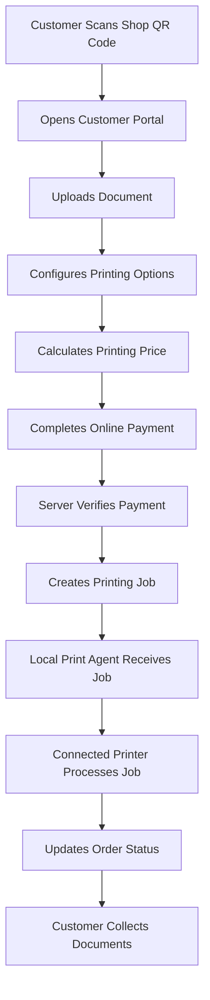

# PrintFlow

### Smart Printing. Simplified.

**A QR-powered printing automation platform that connects customers, print shops, online payments, and physical printers in one seamless ecosystem.**

<p align="center">
  <a href="https://devcenterpoint.com">
    
  </a>
  
  
</p>

<p align="center">
  <a href="#overview">Overview</a> •
  <a href="#features">Features</a> •
  <a href="#how-it-works">How It Works</a> •
  <a href="#architecture">Architecture</a> •
  <a href="#technology-stack">Tech Stack</a>
</p>

---

## Overview

**PrintFlow** is a modern, intelligent printing automation platform designed to transform how print shops receive, process, manage, and fulfill printing orders.

Traditional printing workflows often depend on WhatsApp conversations, USB drives, manual file transfers, cash handling, and disconnected order management.

PrintFlow replaces these fragmented processes with a unified digital printing ecosystem.

Customers simply scan a shop-specific QR code, upload their documents, configure printing preferences, complete payment, and submit their orders. The system handles the rest through automated order processing and a connected local printing agent.

From independent print shops to multi-location printing businesses, PrintFlow provides the infrastructure to digitize and scale printing operations.

**One platform. Multiple businesses. Seamless printing.**

## Features

### Customer Experience
- **QR-Based Access** — Unique QR codes and customer portals for individual shops and outlets.
- **Instant Document Upload** — Upload documents directly from smartphones and computers.
- **Document Preview** — Review supported files before submitting orders.
- **Print Customization** — Configure copies, page ranges, paper sizes, orientation, color, and duplex printing.
- **Dynamic Pricing** — Automatically calculate printing costs based on shop-defined pricing rules.
- **Online Payments** — Secure digital payment and automated transaction verification.
- **Order Tracking** — Follow order progress from submission to completion.
- **Digital Order Confirmation** — Unique order references and payment receipts.

### Automated Printing
- **Local Print Agent** — Connect cloud-based orders with physical printers.
- **Printer Discovery** — Detect and register available printing devices.
- **Automatic Job Dispatch** — Send eligible orders to the correct registered printer.
- **Print Queue Management** — Monitor, prioritize, retry, and manage printing jobs.
- **Print Status Synchronization** — Report job submission, completion signals, and errors.
- **Job Recovery** — Handle connectivity interruptions and recover eligible jobs safely.
- **Multi-Printer Support** — Manage multiple printers across business locations.

### Shop Management
- **Business Dashboard** — Centralized operational overview.
- **Order Management** — Manage incoming, processing, completed, and failed orders.
- **Printer Management** — Configure printers, capabilities, and availability.
- **Pricing Configuration** — Define page-wise rates and printing options.
- **Staff & Roles** — Manage employees and granular permissions.
- **Transaction Management** — Track payments, refunds, and financial records.
- **Reports & Analytics** — Monitor revenue, orders, printing activity, and business performance.
- **Shop Branding** — Customize customer-facing portals and QR experiences.

### SaaS Administration
- **Multi-Tenant Architecture** — Independently isolated business environments.
- **Tenant Management** — Create, configure, suspend, and manage businesses.
- **Subscription Management** — Monthly, quarterly, annual, and custom billing plans.
- **Feature Entitlements** — Control features and usage limits by subscription.
- **Centralized Monitoring** — Monitor platform-wide activity and system health.
- **White-Label Support** — Custom branding and configurable business identities.
- **Custom Domains** — Support branded customer-facing shop portals.
- **Usage Analytics** — Track tenants, orders, storage, printers, and platform utilization.

### Standalone Edition
- Independent deployment for individual businesses and organizations.
- Self-hosted database and document storage.
- Configurable business identity and branding.
- Independent payment gateway configuration.
- Dedicated printer and outlet management.
- License-based commercial distribution.

## How It Works



## Architecture

PrintFlow follows a modular architecture designed to support both standalone installations and centralized SaaS deployments.

| Component | Responsibility |
|---|---|
| Customer Portal | Document uploads, configuration, checkout, tracking |
| Shop Dashboard | Orders, printers, staff, pricing, reporting |
| SaaS Control Panel | Tenants, subscriptions, billing, platform management |
| Application API | Business logic, authentication, integrations |
| Payment Engine | Gateway connections and payment verification |
| Print Agent | Local printer communication and job execution |
| Job Processing Engine | Queues, dispatch, retries, and status synchronization |
| Storage Layer | Secure document and generated-file storage |

### Deployment Editions

**Standalone**

A dedicated installation for one business or organization, with independent infrastructure, configuration, storage, and payment credentials.

**SaaS**

A centrally managed multi-tenant platform where multiple independent printing businesses operate within isolated environments.

Both editions share the same core application and business logic.

## Technology Stack

| Layer | Technology |
|---|---|
| Backend | Laravel / PHP |
| Frontend | React + Vite |
| Database | MySQL |
| Local Development | SQLite |
| API | RESTful API |
| Real-Time Communication | WebSockets |
| Queue Processing | Laravel Queues + Redis |
| Frontend Styling | Modern CSS / Tailwind CSS |
| Print Integration | Native Print Agent / CUPS-compatible architecture |
| Document Processing | PDF processing and validation |
| Payments | Gateway abstraction architecture |
| Deployment | Linux / VPS / cPanel-compatible deployment where supported |

## Payment Integrations

PrintFlow separates customer printing payments from platform subscription payments.

**Printing Payments**
- Razorpay
- UPI
- SSLCOMMERZ
- bKash
- Configurable merchant payment integrations

**SaaS Subscription Payments**
- Subscription checkout
- Recurring or manually renewed billing
- Payment verification
- Subscription activation and expiry
- Invoice and transaction records

Gateway availability depends on merchant eligibility, country, and provider requirements.

## Security & Reliability

- Tenant-level data isolation.
- Role-based access control.
- Secure authentication and authorization.
- Signed and verified payment webhooks.
- Protected document storage.
- Time-limited document access.
- Print-agent authentication and device registration.
- Idempotent payment and print-job processing.
- Audit logs and operational monitoring.
- Configurable document retention policies.

## Project Structure

```text
PrintFlow/
├── backend/              # Laravel application and API
├── frontend/             # React + Vite application
├── print-agent/          # Local printing software
├── database/             # Schema, migrations and seeders
├── docs/                 # Project context and documentation
│   ├── PRD.md
│   ├── TRP.md
│   ├── UI_UX_DESIGN.md
│   ├── BACKEND_SCHEMA.md
│   ├── AUTOMATION_INTEGRATION.md
│   ├── PAYMENT_SETUP.md
│   └── DEVELOPMENT_PROMPT.md
├── deployment/           # Deployment and infrastructure
└── README.md
```

*The directory structure represents the intended modular organization and may evolve during development.*

## Development Philosophy

PrintFlow is built around five principles:

1. **Automation First** — Eliminate repetitive manual operations.
2. **Simplicity** — Make printing effortless for customers and shop owners.
3. **Reliability** — Prioritize secure transactions and dependable print-job handling.
4. **Scalability** — Support independent businesses and multi-tenant deployments.
5. **Ownership** — Provide a commercially deployable standalone product alongside SaaS.

## Project Roadmap

- [ ] Core application architecture
- [ ] Authentication and multi-tenancy
- [ ] Shop and outlet management
- [ ] Customer QR portal
- [ ] Document upload and processing
- [ ] Printing configuration and pricing engine
- [ ] Payment gateway integrations
- [ ] Windows Print Agent
- [ ] Printer discovery and management
- [ ] Automated print-job processing
- [ ] Shop owner dashboard
- [ ] SaaS administration panel
- [ ] Subscription and license management
- [ ] Standalone deployment package
- [ ] Security and production testing
- [ ] Commercial release

## About DevCenterPoint

<p align="center">
  <a href="https://devcenterpoint.com">
    <strong>DevCenterPoint</strong>
  </a>
</p>

We turn inefficient business processes into software.

DevCenterPoint is a software development studio focused on business automation, custom software, intelligent systems, and scalable digital products.

PrintFlow is part of our commitment to building practical software that simplifies real-world business operations.

**Business Automation · Custom Software · Intelligent Systems**

🌐 Website: https://devcenterpoint.com

---

## License

Copyright © DevCenterPoint. All rights reserved.

PrintFlow is a proprietary commercial software project. No license to use, modify, distribute, or commercially exploit the source code is granted unless explicitly authorized by DevCenterPoint.

---

<p align="center">
  <strong>PRINTFLOW</strong>
  <br />
  Smart Printing. Simplified.
  <br /><br />
  Built with precision by
  <a href="https://devcenterpoint.com"><strong>DevCenterPoint</strong></a>
</p>
