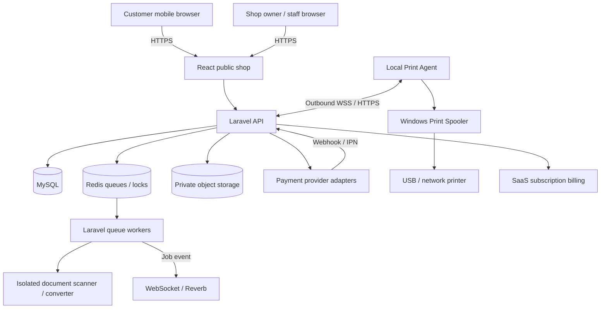

# 02 — Technical Requirements Plan (TRP)

**Product:** PrintFlow  
**Version:** 1.0  
**Date:** 24 November 2026

## 1. Technical objectives

- Deliver the QR-upload-pay-print workflow reliably in a web application.
- Support multi-tenant SaaS and self-hosted single-tenant deployments with one codebase.
- Isolate local printer access in a native agent rather than attempting unsafe browser/server printer access.
- Keep payment verification, job dispatch, file deletion and subscription changes server-authoritative.
- Make the system maintainable by a small engineering team and extensible to additional countries, gateways, printers and file types.

## 2. Recommended stack

| Layer | Recommendation | Notes |
|---|---|---|
| Backend API | Laravel (supported stable release at implementation time) | REST API, auth, domain services, webhook endpoints |
| Frontend | React + Vite + TypeScript | Customer storefront, tenant panel, platform panel |
| Database | MySQL 8+ in production | SQLite allowed for local unit tests where compatible; integration tests should also run on MySQL |
| Queue/cache | Redis | Queue workers, locks, rate limits, short-lived state, live presence |
| Queue dashboard | Laravel Horizon or equivalent | Monitor critical print/payment queues |
| Realtime | Laravel Reverb/WebSocket or managed WebSocket provider | Owner panel and customer order tracking |
| File storage | S3-compatible private object storage | Local MinIO for development; never public bucket by default |
| PDF processing | qpdf/Poppler/PDFium or vetted libraries | Validate, inspect, rasterize previews, count pages |
| Office conversion | Isolated LibreOffice headless worker | P1; sandbox and resource limits required |
| Malware scanning | ClamAV or managed scanner | Scan before conversion/printing |
| Print Agent | Tauri + Rust native service, Windows-first | Own agent provides pairing, spooler access, secure updates; Linux/CUPS adapter later |
| Optional print adapter | QZ Tray | Alternative for supported installations; silent-print certificate/licensing constraints apply |
| Deployment | Docker Compose on VPS; managed object storage/DB as needed | Shared hosting only if it supports queues, scheduler, WebSockets and agent signing endpoints reliably |

Do not upgrade or downgrade framework versions blindly. Inspect the repository and use the currently supported stable release compatible with its dependencies.

## 3. Logical architecture



## 4. Deployment editions

### 4.1 Shared codebase and runtime configuration

Use an explicit edition setting:

- `APP_EDITION=saas`
- `APP_EDITION=standalone`

Use a single tenant resolver contract:

- SaaS: resolve from verified host/domain or route slug; map to `tenant_id` and active `shop_id` when required.
- Standalone: resolve to the installation's configured tenant; reject tenant-switching parameters and platform-admin routes.

Do not scatter edition checks across controllers. Encapsulate them in `EditionContext`, `TenantResolver`, feature-entitlement services and route groups.

### 4.2 SaaS deployment

- One control plane and shared application services.
- Shared database with `tenant_id` on every tenant-owned record for MVP.
- Central Redis, worker fleet, private object storage and event monitoring.
- Tenant domains: `tenant.platform.example`, custom hostnames after domain ownership verification.
- Each Print Agent is registered to a tenant and shop and may be assigned one or more printers.
- Tenant's customer payment gateway credentials are encrypted and isolated.
- Platform subscription gateway credentials are separate from tenant gateway credentials.

### 4.3 Standalone deployment

- Same Laravel/React build and schema.
- One configured tenant; SaaS platform routes not mounted or are inaccessible.
- Local or S3-compatible file storage; own Redis/worker/scheduler.
- Agent may connect to a customer-owned domain/server using outbound TLS.
- Backup/export/restore must be documented and testable.

## 5. Runtime services and responsibilities

### Web/API service

- Authentication, tenant resolution, authorization, quote calculation, order lifecycle, payment session initiation, shop/QR settings, audit records and agent enrollment.
- No large document conversion or long polling work inside HTTP requests.

### Queue workers

Separate queues at minimum:

- `payments`: payment status reconciliation and subscription actions.
- `documents`: scanning, page count, preview, conversion and cleanup.
- `printing`: dispatch, lease renewal, timeout reconciliation and retry scheduling.
- `notifications`: email/SMS/in-app notifications.
- `maintenance`: subscription expiry, retention cleanup, usage aggregation and health checks.

Set retry/backoff policies per queue. Critical payment and print events need idempotency and dead-letter/failed-job monitoring.

### Local Print Agent

- Registers using a one-time enrollment token.
- Exchanges it for a long-lived device identity and rotating credential/certificate.
- Maintains outbound WSS connection or short-interval authenticated polling.
- Reports heartbeat, agent version, OS, printers, capabilities and status.
- Leases only jobs assigned to its tenant/shop/printer.
- Downloads a short-lived payload, verifies job signature/checksum and submits to the local spooler.
- Returns spooler job identifier, attempt ID and meaningful error state.
- Deletes its local source file after spooler handoff or after a bounded failure/retry window.
- Never exposes a general unauthenticated local HTTP print endpoint.

## 6. Domain boundaries / modules

1. Identity & Access
2. Tenancy & Editions
3. Shop & QR Management
4. Document Intake & Processing
5. Pricing & Quote Engine
6. Orders & Customer Tracking
7. Payment Gateway Abstraction
8. Print Agent & Device Registry
9. Print Job Orchestration
10. File Retention & Deletion
11. SaaS Plans & Subscriptions
12. Reports & Usage Metering
13. Notifications
14. Audit & Observability

Each module must expose application services/actions and domain events. Controllers should remain thin.

## 7. API conventions

- Base path: `/api/v1`.
- JSON responses use a consistent envelope and structured error codes.
- Use UUID/ULID external identifiers; never expose sequential internal primary keys as security tokens.
- All write actions that can be retried should accept an `Idempotency-Key` or have a domain uniqueness constraint.
- Pagination: cursor or page-based, consistent across endpoints.
- Store timestamps in UTC; render in tenant/shop timezone.
- Monetary amounts: integer minor units + ISO 4217 currency; include formatted display value only as a derived field.
- Version breaking contract changes under a new API major version.

### Suggested endpoint groups

```text
POST   /api/v1/auth/register
POST   /api/v1/auth/login
POST   /api/v1/auth/logout
GET    /api/v1/public/shops/{slug}
POST   /api/v1/public/shops/{slug}/uploads/presign
POST   /api/v1/public/shops/{slug}/files/complete
POST   /api/v1/public/shops/{slug}/quotes
POST   /api/v1/public/orders
GET    /api/v1/public/orders/{public_order_token}
POST   /api/v1/public/orders/{id}/payment-session

GET    /api/v1/owner/dashboard
GET    /api/v1/owner/orders
GET    /api/v1/owner/orders/{id}
POST   /api/v1/owner/orders/{id}/hold
POST   /api/v1/owner/orders/{id}/cancel
POST   /api/v1/owner/orders/{id}/retry-print
GET    /api/v1/owner/pricing
PUT    /api/v1/owner/pricing
GET    /api/v1/owner/agents
POST   /api/v1/owner/agents/enrollment-codes
POST   /api/v1/owner/printers/{id}/test-print
GET    /api/v1/owner/qr/{shop_id}/download

POST   /api/v1/agent/enroll
POST   /api/v1/agent/heartbeat
GET    /api/v1/agent/jobs/next
POST   /api/v1/agent/jobs/{id}/lease
POST   /api/v1/agent/jobs/{id}/events
POST   /api/v1/agent/jobs/{id}/ack
POST   /api/v1/agent/printers/sync

POST   /api/v1/webhooks/{provider}/{connection_id}
POST   /api/v1/platform/tenants
GET    /api/v1/platform/tenants
POST   /api/v1/platform/plans
GET    /api/v1/platform/subscriptions
```

The exact route design can differ, but every endpoint must be authenticated or intentionally public, tenant-scoped, validated and rate-limited.

## 8. Security requirements

### Authentication and authorization

- Use secure server-managed sessions or Sanctum/token approach appropriate to first-party React deployment.
- CSRF protection for cookie-authenticated requests.
- Password hashing with Argon2id/bcrypt supported by framework.
- Rate-limit login, upload presign, order creation, payment initiation and agent enrollment.
- Enforce RBAC server-side, not with frontend-only visibility.
- Use short-lived signed public order tokens; never expose raw order IDs for customer lookup.

### Tenant isolation

- Tenant context must be mandatory for all tenant-owned reads/writes.
- Apply model-level tenant scoping plus explicit authorization/policy checks.
- Include tenant ownership checks in jobs, file access, webhook mapping and agent commands.
- Add tests that attempt cross-tenant ID substitution for every critical resource type.
- Never trust a `tenant_id` supplied in a customer request body.

### Upload safety

- Validate declared MIME and detected file signature.
- Generate internal object keys; never use customer filenames as storage paths.
- Store outside web root/private bucket.
- Scan before parsing or converting.
- Apply size/page/decompression/time/memory limits.
- Do not execute macros, embedded scripts or active content.
- Use isolated worker/container with no unnecessary network access.
- Avoid serving untrusted HTML/SVG inline; sanitize or force download.

### Secret management

- Encrypt tenant gateway secrets using Laravel encrypted casts or envelope encryption backed by KMS/master key.
- Keep platform secrets and tenant secrets logically separate.
- Never return secrets to frontend after save; return masked connection status.
- Rotate credentials and agent tokens; store only token hashes where possible.
- Ensure logs never contain API secrets, access tokens, card data or full customer documents.

### Webhooks

- Verify provider signatures using raw request bytes before parsing.
- Use provider API validation/query where required.
- Enforce amount, currency, merchant, order reference and expected state checks.
- Record raw event in protected storage only as long as needed; redact secrets and sensitive payload fields.
- Use a provider event ID unique constraint and idempotent handlers.

### Agent security

- Pair with one-time, short expiry, single-use code.
- Bind agent to tenant/shop, allowed printer list and capabilities.
- Use TLS/WSS, signed job manifests, SHA-256 hashes and short-lived URLs.
- Agent accepts only known command types and exact file destinations.
- Restrict local file paths; defend against path traversal and arbitrary command execution.
- Sign releases; verify updates before installation.

## 9. Non-functional requirements

Targets to validate in pilot; not reference-site measurements.

| Area | Target |
|---|---|
| Availability | 99.5% monthly MVP target; mature SaaS target can rise after operations are established |
| Public shop responsiveness | p95 API response under 500 ms excluding upload/conversion/provider latency |
| Uploads | Resumable or multipart object upload for large files; progress reporting |
| Payment-to-dispatch | p95 under 10 seconds after verified payment while an agent is online |
| Queue | No lost paid jobs; at-least-once delivery with idempotent processing |
| Security | No cross-tenant access; HTTPS everywhere; secrets encrypted; audit trails |
| Data retention | Every file receives expiry; cleanup backlog visible and alerted |
| Recovery | Daily DB backups, point-in-time recovery where available, object lifecycle protection and restore drills |
| Observability | Structured logs, correlation IDs, error tracking, queue metrics, webhook health and agent heartbeats |
| Accessibility | WCAG 2.2 AA target for core public and owner workflows where practical |
| Localization | Locale and currency per tenant; English and Bangla initial support; India locale can use INR/UPI gateways |

## 10. Infrastructure/deployment blueprint

### MVP production topology

- Reverse proxy (Nginx/Caddy) with TLS.
- Laravel API/PHP-FPM container.
- React static assets served via CDN or web server.
- MySQL managed DB or persistent database container with tested backups.
- Redis.
- Queue worker containers (multiple queues).
- Scheduler process.
- Document-processing worker with strict CPU/memory/disk quotas.
- Private object storage.
- Reverb/WebSocket service if using live updates.
- Error monitoring and centralized logs.

A basic cPanel shared-hosting environment is not the preferred production target unless it demonstrably supports persistent queue workers, scheduler, Redis, WebSockets and secure signing services. A VPS/container deployment is more appropriate for the complete automation product.

### Local development

- Docker Compose or documented local services.
- SQLite can be used for quick unit tests, but CI must run MySQL integration tests to catch JSON, lock, collation and migration differences.
- MinIO or local private storage adapter.
- Redis service for queue/lock tests.
- Payment sandbox credentials stored in `.env`, never committed.
- Agent simulator for API tests plus physical printer test station before release.

## 11. Observability and operational controls

Track at minimum:

- Upload starts/completions/rejections and conversion failures.
- Payment session creation, pending duration, webhook signature failures, mismatched amount/currency and reconciliation outcome.
- Paid orders without a print job (must remain zero or alert).
- Queued jobs, oldest queue age, lease expiry, agent online status, print attempt result and unknown outcomes.
- File deletion due time, deletion success/failure and storage backlog.
- Tenant usage and subscription entitlement failures.
- Agent version distribution and update failure.

Every request/job should carry a correlation ID. Do not log document content or payment secrets.

## 12. Build and release gates

- Static analysis, formatter, frontend typecheck/lint and unit tests.
- MySQL integration suite.
- Tenant-isolation security suite.
- Payment adapter contract tests and signed webhook fixtures.
- Upload malicious-file and resource-limit tests.
- Agent pairing, device revoke, offline/online and retry tests.
- Printer acceptance matrix: at least one USB laser printer, one network laser printer and one inkjet model in the pilot.
- Backup restore test before production launch.
- Release notes and rollback plan for API and Print Agent.
