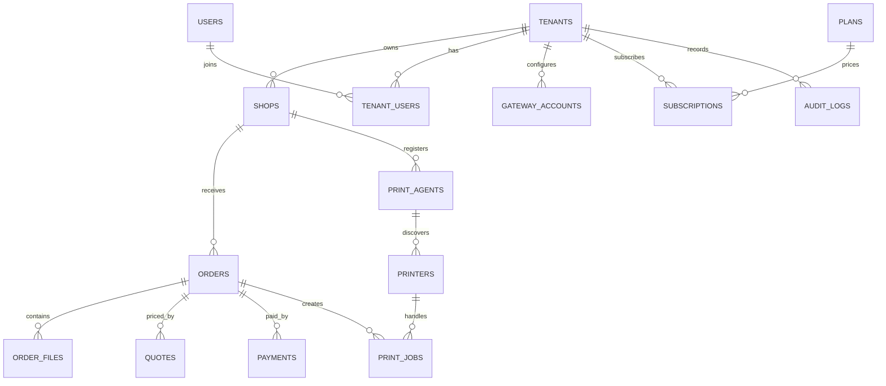

# 04 — Backend Schema and Domain Model

**Product:** PrintFlow  
**Version:** 1.0  
**Date:** 24 November 2026

## 1. Schema principles

- Use UUID/ULID public IDs; internal numeric keys are acceptable if never exposed as authorization tokens.
- Every tenant-owned table includes `tenant_id`, except global catalog/config tables.
- Use explicit foreign keys and deletion policies. Do not cascade-delete financial records or audit logs.
- Store money as integer minor units plus ISO currency code.
- Store timestamps UTC; retain shop timezone for presentation/report grouping.
- Use immutable snapshots for quotes, payment events and print settings.
- Store document bytes in private object storage, not in MySQL.
- Avoid a generic untyped `metadata` JSON column for core searchable fields. JSON is acceptable for provider-specific snapshots and capability payloads with a version.

## 2. Core entity map



## 3. Tables

Column types below are logical; map to the exact Laravel/MySQL types and naming style used in the repository.

### 3.1 `tenants`

- `id` (ULID/UUID primary key)
- `name`
- `slug` (unique platform identifier)
- `edition` (`saas|standalone`)
- `status` (`pending|active|grace|suspended|cancelled`)
- `default_currency` (ISO 4217)
- `default_locale`
- `timezone`
- `settings_json` (versioned non-sensitive configuration only)
- `created_at`, `updated_at`, `deleted_at` (soft delete only if policy supports it)

### 3.2 `tenant_domains`

- `id`, `tenant_id`
- `host` (normalized unique hostname)
- `type` (`platform_subdomain|custom_domain|standalone_host`)
- `verification_status`, `verification_token_hash`, `verified_at`
- `tls_status`, `is_primary`
- timestamps

Unique index on normalized `host`; one primary domain per tenant enforced by application/constraint strategy.

### 3.3 `users`

- `id`, `name`, `email`, `phone`
- `email_verified_at`, `phone_verified_at`
- `password`
- `is_platform_admin` (or separate platform role mapping)
- `last_login_at`, `status`
- timestamps

Global identity. Do not put one tenant's role directly on this global user row.

### 3.4 `tenant_users`

- `id`, `tenant_id`, `user_id`
- `status`, `invited_by`, `joined_at`
- Unique (`tenant_id`, `user_id`)

### 3.5 `roles`, `permissions`, `role_permissions`, `tenant_user_roles`

Use a proven RBAC package if already installed. Roles are tenant-scoped or global templates copied into tenant context. Permission examples: `orders.view`, `orders.cancel`, `orders.retry_print`, `payments.view`, `payments.refund`, `shop.manage`, `pricing.manage`, `devices.manage`, `staff.manage`, `subscription.manage`.

### 3.6 `shops`

- `id`, `tenant_id`
- `name`, `slug` (globally unique route slug or unique per domain as product design requires)
- `address`, `phone`, `email`, `logo_object_key`
- `locale`, `currency`, `timezone`
- `public_status` (`active|paused|closed`)
- `public_settings_json` (accepted formats, visible instructions, options)
- `default_price_profile_id`
- timestamps

Index (`tenant_id`, `slug`), public slug uniqueness rule and active status.

### 3.7 `shop_user_assignments` (optional if users are assigned to outlets)

- `id`, `tenant_id`, `shop_id`, `user_id`, `role_id`, `created_at`
- Unique (`shop_id`, `user_id`, `role_id`)

### 3.8 `price_profiles`

- `id`, `tenant_id`, `shop_id` nullable if tenant-wide
- `name`, `currency`, `status`, `effective_from`, `effective_until`
- `minimum_order_minor`, `service_fee_minor`, `tax_mode`, `tax_rate_basis_points`
- `calculation_version`, `created_by`, timestamps

### 3.9 `price_rules`

- `id`, `tenant_id`, `price_profile_id`
- `service_code` (`mono_page|color_page|paper_a4|paper_a3|duplex|finishing_*` etc.)
- `media_code`, `color_mode`, `sides_mode`, `unit_basis` (`printed_side|physical_sheet|job|copy`)
- `unit_price_minor`, `minimum_quantity`, `maximum_quantity`, `is_active`, `rule_json`
- timestamps

Define precedence and conflict validation. Avoid overlapping rules with ambiguous results.

### 3.10 `orders`

- `id`, `tenant_id`, `shop_id`
- `public_reference` (human-readable, unique within shop or tenant)
- `public_token_hash` (for unauthenticated order status lookup)
- `customer_name` nullable, `customer_phone` nullable, `customer_email` nullable
- `status` (`draft|uploaded|processing|quoted|awaiting_payment|paid|queued|printing|partially_complete|complete|failed|cancelled|expired|refunded|unknown`)
- `currency`, `subtotal_minor`, `tax_minor`, `fee_minor`, `discount_minor`, `total_minor`
- `quote_snapshot_json` (immutable calculation breakdown)
- `source` (`qr|direct_link|owner_created|api`)
- `ip_hash`/risk metadata only if justified by privacy policy
- `expires_at`, `paid_at`, `completed_at`, `cancelled_at`
- timestamps

Indexes: (`tenant_id`, `shop_id`, `created_at`), (`tenant_id`, `status`, `created_at`), `public_reference`, token hash.

### 3.11 `order_files`

- `id`, `tenant_id`, `shop_id`, `order_id`
- `original_name` (sanitized display only)
- `object_key`, `storage_disk`, `mime_type_detected`, `file_extension_detected`
- `size_bytes`, `sha256_hash`
- `scan_status` (`pending|clean|infected|error`)
- `processing_status` (`pending|processing|ready|failed|rejected`)
- `page_count`, `width_px`, `height_px`, `orientation`, `preview_object_key`
- `expires_at`, `deleted_at`, `deletion_status`, `deletion_error_code`
- `processing_json` (versioned output metadata, no content)
- timestamps

Do not make an `object_key` public. A deleted file's metadata may remain for order accounting if policy permits.

### 3.12 `quotes`

- `id`, `tenant_id`, `shop_id`, `order_id`
- `quote_version`, `currency`, `subtotal_minor`, `tax_minor`, `fee_minor`, `discount_minor`, `total_minor`
- `line_items_json` (immutable snapshot with quantity and unit price)
- `calculation_hash`, `expires_at`, `accepted_at`
- timestamps

Unique (`order_id`, `quote_version`).

### 3.13 `gateway_accounts`

- `id`, `tenant_id`, `shop_id` nullable for tenant-wide scope
- `purpose` (`customer_orders|saas_subscriptions` — SaaS platform account may be stored separately)
- `provider` (`sslcommerz|bkash|razorpay|other`)
- `country`, `currency`, `environment` (`sandbox|live`)
- `merchant_identifier` (non-secret)
- `credentials_ciphertext` (encrypted at rest; never serialized back)
- `webhook_secret_ciphertext` if provider uses one
- `status`, `last_verified_at`, `last_error_code`
- timestamps

Platform-owned subscription gateway credentials should use a separate platform configuration/secret store, not a tenant `gateway_accounts` row.

### 3.14 `payments`

- `id`, `tenant_id` nullable for platform subscription transaction or use separate ledger scope
- `shop_id` nullable
- `order_id` nullable
- `subscription_invoice_id` nullable
- `gateway_account_id` nullable for platform provider mapping
- `purpose` (`print_order|saas_subscription|refund|adjustment`)
- `provider`, `provider_order_id`, `provider_payment_id`, `provider_transaction_id`
- `internal_reference` unique
- `currency`, `amount_minor`, `fee_minor`, `net_minor`
- `status` (`created|pending|authorized|captured|failed|cancelled|refunded|partially_refunded|unknown|expired`)
- `verified_at`, `captured_at`, `failed_at`, `raw_result_redacted_json`
- timestamps

Enforce valid relation: one payment belongs to an order or subscription invoice according to `purpose`, not both. Unique provider identifiers within provider/merchant context.

### 3.15 `webhook_events`

- `id`, `provider`, `connection_scope_id`
- `provider_event_id` (unique per provider/connection where supported)
- `event_type`, `signature_valid`, `received_at`, `processed_at`
- `processing_status` (`received|verified|processed|ignored|failed`)
- `payload_hash`, `redacted_payload_json`, `failure_code`
- timestamps

Store raw body only when needed for signature verification and only within controlled transient handling. Do not store sensitive data indefinitely.

### 3.16 `print_agents`

- `id`, `tenant_id`, `shop_id`
- `device_name`, `platform`, `platform_version`, `agent_version`
- `device_public_key`, `credential_hash`, `status` (`pending|online|offline|revoked|needs_update`)
- `last_heartbeat_at`, `last_ip_hash`, `capabilities_json`
- `paired_at`, `revoked_at`, timestamps

Never store a reusable plaintext agent token.

### 3.17 `printers`

- `id`, `tenant_id`, `shop_id`, `print_agent_id`
- `system_printer_id`, `display_name`, `manufacturer`, `model`
- `connection_type` (`usb|network|shared|virtual|unknown`)
- `is_default`, `status`, `capabilities_json`
- `last_seen_at`, timestamps

Unique (`print_agent_id`, `system_printer_id`). Printer names are not necessarily unique globally.

### 3.18 `print_jobs`

- `id`, `tenant_id`, `shop_id`, `order_id`, `order_file_id`
- `printer_id`, `print_agent_id`
- `status` (`waiting_payment|queued|leased|downloading|printing|submitted_to_spooler|printer_confirmed|failed|cancelled|unknown|expired`)
- `settings_snapshot_json` (copies, page range, paper, color, sides, orientation)
- `source_sha256`, `output_sha256`
- `attempt_number`, `lease_token_hash`, `lease_expires_at`
- `spooler_job_id`, `spooler_status`, `error_code`, `error_message_safe`
- `submitted_at`, `confirmed_at`, `failed_at`, `cancelled_at`
- `idempotency_key`, timestamps

Unique/idempotency constraint prevents accidental duplicate dispatch creation for the same order-file/configuration unless a deliberate reprint is created with a new reprint parent/reference.

### 3.19 `print_job_attempts`

- `id`, `tenant_id`, `print_job_id`, `attempt_number`
- `print_agent_id`, `printer_id`, `started_at`, `finished_at`
- `outcome`, `spooler_job_id`, `error_code`, `agent_event_id`
- `request_hash`, timestamps

### 3.20 `order_events` and `audit_logs`

`order_events` is the customer-visible lifecycle timeline; `audit_logs` records security/business changes.

Order event fields: `tenant_id`, `order_id`, `event_type`, `from_state`, `to_state`, `source`, `safe_message`, `actor_id` nullable, `occurred_at`, `correlation_id`.

Audit fields: `tenant_id` nullable for platform, `actor_id`, `action`, `subject_type`, `subject_id`, `before_redacted_json`, `after_redacted_json`, `ip_hash`, `user_agent_hash`, `reason`, `created_at`.

### 3.21 SaaS plan/subscription tables

`plans` (platform global):
- `id`, `name`, `code`, `currency`, `amount_minor`, `billing_interval`, `billing_interval_count`, `trial_days`, `is_active`, `features_json`, `limits_json`, timestamps.

`subscriptions`:
- `id`, `tenant_id`, `plan_id`, `status`, `starts_at`, `current_period_start`, `current_period_end`, `grace_ends_at`, `cancel_at_period_end`, `platform_customer_ref`, timestamps.

`subscription_invoices`:
- `id`, `tenant_id`, `subscription_id`, `invoice_number`, `currency`, `subtotal_minor`, `tax_minor`, `total_minor`, `status`, `due_at`, `paid_at`, `period_start`, `period_end`, timestamps.

`usage_events` or aggregated usage ledger:
- `id`, `tenant_id`, `shop_id`, `event_type`, `quantity`, `unit`, `source_id`, `occurred_at`.
- Unique idempotency source prevents duplicate usage metering.

### 3.22 File deletion records

`file_deletion_events`:
- `id`, `tenant_id`, `order_file_id`, `target` (`remote_object|agent_local_file|preview|conversion_temp`), `requested_at`, `completed_at`, `status`, `attempts`, `result_code`, `correlation_id`.

Do not store the file contents or path secrets in this table.

### 3.23 `idempotency_records`

- `id`, `scope`, `idempotency_key`, `request_hash`, `response_reference`, `status`, `expires_at`, timestamps.
- Unique (`scope`, `idempotency_key`).

## 4. Relationship and deletion rules

- Tenant → shops/users/settings: soft delete/deactivate only after business data export/retention process.
- Orders → payments/events: financial and audit data should be retained under agreed policy; do not cascade-delete.
- Order files: delete object bytes, preserve minimal metadata/deletion record according to privacy/retention policy.
- Print jobs: preserve lifecycle/attempts for duplicate prevention and dispute handling.
- Gateway account: disable/revoke and securely purge credentials on tenant deletion; retain masked provider references only where legally required.
- Agent: revoke credentials, stop job delivery, retain audit metadata.

## 5. State machines

### Order

```text
draft -> uploaded -> processing -> quoted -> awaiting_payment
awaiting_payment -> paid | cancelled | expired | failed
paid -> queued | cancelled | refunded | failed
queued -> printing | cancelled | unknown
printing -> submitted_to_spooler | printer_confirmed | failed | unknown
submitted_to_spooler -> printer_confirmed | failed | complete
printer_confirmed -> complete
unknown -> complete | failed | operator_review
```

This is a suggested normalized state model; use `order_events` to represent granular sub-states. An order with several files may be partially complete. Do not force one scalar state to hide individual print-job states; calculate aggregate status from child jobs and payment state.

### Payment

```text
created -> pending -> authorized -> captured
pending -> failed | cancelled | unknown | expired
captured -> partially_refunded | refunded
unknown -> captured | failed | operator_review
```

Only server-side verified provider state transitions to captured.

### Print job

```text
queued -> leased -> downloading -> printing -> submitted_to_spooler
submitted_to_spooler -> printer_confirmed (if reliable telemetry) | complete
leased/downloading/printing -> failed | unknown
failed -> queued (controlled retry only)
queued/leased -> cancelled (if not yet physically submitted)
```

## 6. Multi-tenant isolation strategy

MVP: shared schema with `tenant_id`, composite indexes and a mandatory tenant context.

Required controls:
- Global middleware resolves tenant from host/route and attaches an immutable context.
- No API accepts tenant ID from untrusted clients to choose data scope.
- Eloquent global scopes are defense-in-depth, not the sole authorization mechanism.
- Domain services require tenant context for tenant-owned actions.
- Queue payloads include tenant ID, but worker revalidates record ownership before processing.
- File access and signed URLs are issued only after tenant/role/order checks.
- Print Agent token claims are bound to one tenant/shop and permitted device.
- Cross-tenant penetration tests cover orders, files, payment records, agents, printers and reports.

A future high-isolation tier can use database-per-tenant or schema separation without changing domain service contracts.

## 7. API response model examples

### Public order status

```json
{
  "data": {
    "reference": "PF-7K2M9A",
    "status": "printing",
    "payment": { "status": "captured", "amount_minor": 12500, "currency": "BDT" },
    "jobs": [
      { "status": "submitted_to_spooler", "printer_label": "Front Counter Printer" }
    ],
    "timeline": []
  }
}
```

The example is illustrative, not real data. Do not expose raw provider secrets, internal tenant IDs or storage keys.

### Quote request (illustrative)

```json
{
  "files": [
    {
      "file_id": "01J...",
      "copies": 2,
      "page_selection": { "mode": "all" },
      "paper_size": "A4",
      "color_mode": "mono",
      "sides_mode": "duplex"
    }
  ]
}
```

The server checks file ownership, current settings, shop rules and price profile; it returns a new quote version and expiration.

## 8. Required indexes and constraints

- `orders(tenant_id, shop_id, created_at)`
- `orders(tenant_id, status, created_at)`
- `orders(public_reference)` unique per defined scope
- `order_files(tenant_id, order_id)`
- `order_files(expires_at, deletion_status)`
- `payments(provider, provider_payment_id)` unique where non-null and provider semantics permit
- `payments(tenant_id, purpose, status, created_at)`
- `webhook_events(provider, connection_scope_id, provider_event_id)` unique
- `print_agents(tenant_id, shop_id, status, last_heartbeat_at)`
- `printers(print_agent_id, system_printer_id)` unique
- `print_jobs(tenant_id, status, created_at)`
- `print_jobs(lease_expires_at, status)`
- `subscriptions(tenant_id, status, current_period_end)`
- `usage_events(tenant_id, event_type, occurred_at)`

Add foreign keys, check constraints where supported and explicit enum/value validation in application code.

## 9. Migration and test requirements

- Migrations must run on MySQL and SQLite where practical; note platform-specific behavior.
- CI must run MySQL-specific integration tests.
- Seeders may provide plans/roles/demo fixtures only in non-production; never make a seeded demo order appear in production.
- Factories should generate tenant-owned records with correct relationships.
- Test state-transition validity, tenant isolation, webhook idempotency, quote immutability, file deletion and reprint history.
