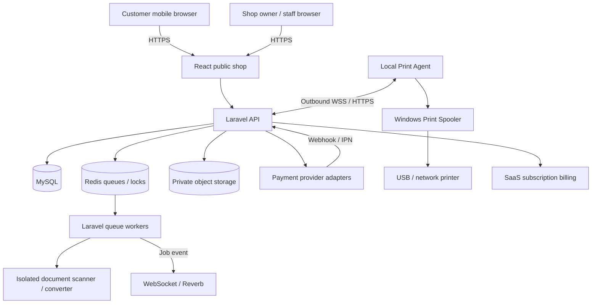
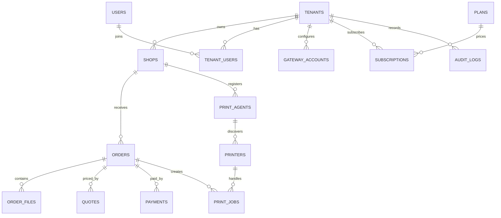

# PrintFlow — Full Project Context Documentation

Compiled edition of the project specifications. Individual source documents are also included in the ZIP pack.


---

# 01 — Product Requirements Document (PRD)

**Product:** PrintFlow (working name)  
**Version:** 1.0  
**Date:** 24 November 2026  
**Status:** Proposed product specification based on public reference audit + recommended implementation design.

## 1. Product vision

Turn a walk-in print shop's document intake and payment process into a self-service digital workflow. A customer scans a shop-specific QR code, uploads files from a phone, selects print settings, pays, and the shop computer receives the job for automatic printing. The owner manages orders, prices, devices, QR assets, staff and reports from one panel.

The product must be sellable in two ways:

- **Standalone:** one business deploys and operates its own instance, on its own infrastructure or managed server.
- **SaaS:** many independent businesses subscribe to one centrally operated platform, each with isolated data, storefront settings, payment configuration and devices.

## 2. Problem statement

Traditional print-shop intake often requires customers to send files through messaging apps, email, USB drives or direct transfer. Staff must locate the file, confirm the print settings, calculate a price, collect money, and manually send it to a printer. This increases queue time, file-handling exposure, manual effort, payment confusion and order-tracking friction.

PrintFlow centralizes the workflow and introduces a verified payment-to-print automation pipeline.

## 3. Reference evidence vs. product decisions

### 3.1 Publicly observed on the reference site

The public landing/registration page advertises: scan QR, upload document, pay online, automatic printing; no WhatsApp/pendrive/file transfer; online UPI payment to the shop owner; a shop-owner admin panel and order records; file deletion after print; shop account creation after package payment; and four subscription terms (1, 3, 6, 12 months). The separate owner login page shows username/password login in Bengali.

### 3.2 Not verified on the reference

The public pages did not expose authenticated owner pages, customer upload form fields, printer protocol, payment integration internals, staff controls, detailed reporting, printer status feedback, file-format limits, security implementation, APIs or schema. All detailed requirements below are proposed to produce a complete, reliable commercial product.

## 4. Target users and personas

### 4.1 Customer (no account required)

- Walks into a print shop and scans the QR code displayed at the counter.
- Uses a mobile browser; must not need to install an app or create an account.
- Uploads one or more supported files.
- Chooses copies, page range, paper size, color mode and simplex/duplex where enabled.
- Reviews a clear quote and pays through the shop's configured gateway.
- Sees a reference/order code and live status.

### 4.2 Shop owner / tenant administrator

- Creates or activates the shop account.
- Configures shop name, address, contact, public slug, language, currency, opening state and brand mark.
- Connects a payment gateway or enters approved merchant credentials.
- Installs/links one or more Print Agents and selects default printers.
- Sets print pricing and format limits.
- Monitors orders, reprints when needed, resolves failed jobs and reviews reports.
- Manages staff permissions and subscription status.

### 4.3 Shop staff / operator

- Views the active queue and order detail.
- Pauses, holds, cancels or retries jobs within permission limits.
- Can mark physical handoff as collected/complete where configured.
- Cannot change tenant ownership, payment credentials or subscription unless permitted.

### 4.4 Platform super administrator (SaaS only)

- Manages tenant accounts, plans, subscription invoices, feature entitlements and platform payment transactions.
- Monitors queue health, agent/device health, file-cleanup backlog, provider webhooks and failed jobs.
- Can suspend a tenant for policy or billing reasons with a recorded reason and audit trail.
- Must not browse tenant document content by default; access requires an audited support elevation and a documented business reason.

### 4.5 Standalone system administrator

Equivalent to tenant owner + deployment administrator. Platform-wide SaaS controls are disabled or hidden in standalone mode.

## 5. Goals and non-goals

### Goals

- Minimize customer steps from QR scan to paid print job.
- Remove manual file transfer from the normal happy path.
- Ensure a print job can only be dispatched after payment is verified, unless the owner explicitly enables an authorized manual/credit workflow.
- Support multiple shops/outlets, agents and printers per tenant.
- Isolate every tenant's data and gateway credentials.
- Offer a sellable SaaS plan and a self-hosted standalone edition from one codebase.
- Delete document files after completion or after a short configured expiry while retaining non-sensitive order/payment metadata.
- Make failures visible, recoverable and auditable.

### Non-goals for MVP

- Full graphic-design/editor suite.
- Public document storage or long-term cloud drive.
- WhatsApp bot ingestion as a required path.
- AI document understanding or OCR-based editing.
- Physical printer firmware management.
- Guaranteed physical-page detection on printers that do not expose trustworthy telemetry.
- Marketplace payout/split settlement without provider approval and merchant onboarding.
- Mobile native apps; responsive mobile web is sufficient for customers.

## 6. Product modes and commercial model

### 6.1 SaaS edition

- Central platform URL and optional tenant subdomains/custom domains.
- Each tenant has one subscription account and can have multiple shops/outlets according to plan.
- Tenant-specific customer payment gateway credentials (BYO merchant account) for print-order payments.
- Platform-owned gateway account for SaaS subscriptions.
- Plan limits: shops/outlets, staff seats, connected agents, printers, monthly pages/orders, storage/temporary upload limits, custom domain, white-label, reports and automation features.
- Usage metering must be calculated from auditable events, not frontend counters.

### 6.2 Standalone edition

- Same application modules and migrations.
- Configuration forces a single tenant context.
- No SaaS platform dashboard, tenant switching or public tenant registry.
- Merchant connects its own print-order gateway. The product seller may also bill a separate license/subscription if the commercial agreement requires it.
- Deployment supports customer-owned VPS/Docker or a managed installation.
- License checks must not disable access to already created records or prevent export during a billing dispute; apply the commercial license policy transparently.

### 6.3 Reference pricing (not recommended selling price)

The reference page displayed ₹99 / 1 month, ₹249 / 3 months, ₹399 / 6 months and ₹599 / 12 months. These are reference-site prices only. Define new plans, limits and prices independently after cost and market validation.

## 7. Primary customer journey

1. Customer scans the shop QR code.
2. Public shop page loads with shop identity, service availability, accepted formats and indicative price guidance.
3. Customer selects or drags files into the uploader.
4. Backend validates file type, size, malware status and page count; document is rendered for preview when supported.
5. Customer selects print options per file or grouped selection.
6. Server calculates and stores an immutable quote snapshot with currency, price rules, tax/fees and total.
7. Customer enters optional contact details (phone/name only if needed for order lookup or receipt).
8. Server creates an internal payment attempt and initializes the selected tenant gateway.
9. Customer completes hosted/embedded checkout.
10. Server verifies payment through the signed webhook/IPN and/or provider validation/query API; never trust a client-side success flag.
11. After successful verification, the order transitions to paid and an idempotent print dispatch event is enqueued.
12. A registered online Print Agent leases the job, downloads its short-lived encrypted/signed payload, validates the checksum and submits the document to the selected local printer.
13. Agent reports acceptance/error and printer/spooler metadata; dashboard/customer tracking is updated.
14. Remote and local temporary document files are removed according to the deletion policy; deletion is logged.
15. Customer sees a completion/error state and order reference. Shop staff hands over printed pages.

## 8. Owner onboarding journey

1. Choose edition or SaaS plan.
2. Register owner account with verified contact method.
3. Create organization/tenant and first shop.
4. Set shop slug, name, address, currency, locale and contact details.
5. Configure print services and price profile.
6. Connect the shop's gateway credentials in test mode.
7. Download/install Print Agent on the shop computer.
8. Pair the agent using a short-lived one-time pairing code.
9. Discover available OS printers; choose default printer and paper defaults.
10. Run a test page and a test payment/job in sandbox.
11. Generate/download shop QR code (PNG/SVG/PDF) and display it at the counter.
12. Switch payment to live after provider onboarding and successful end-to-end checklist.

## 9. Functional requirements and priority

Priority definitions: **P0** required for a sellable MVP; **P1** important follow-up; **P2** optional/advanced.

### 9.1 Identity, tenancy and access

- P0: owner registration/login/logout, password reset, session revocation, email/mobile verification option.
- P0: SaaS tenant provisioning and tenant resolution from route/domain.
- P0: standalone single-tenant resolver.
- P0: tenant-scoped authorization for every business record and API.
- P0: owner and operator roles with server-side permission checks.
- P1: multiple staff roles, invitations, 2FA, SSO.
- P1: custom tenant domain with DNS/HTTPS verification.

### 9.2 Shop profile and QR

- P0: unique public shop slug/URL.
- P0: editable shop display name, address, contact, logo, open/closed/paused state.
- P0: QR generator for canonical HTTPS URL.
- P0: QR exports in PNG, SVG and print-ready PDF; quiet zone and contrast checked.
- P1: separate QR tokens for outlet/counter/marketing source, while resolving to the correct shop.

### 9.3 Upload and document processing

- P0: PDF, JPEG, PNG support.
- P0: multi-file upload, progress, cancel/remove before submission.
- P0: private storage and MIME/signature validation, not filename-only validation.
- P0: configurable per-file and per-order size limits; page count and page thumbnails for PDF where feasible.
- P0: reject encrypted/invalid/malformed files with a useful message; no silent success.
- P0: safe conversion/render pipeline with resource/time limits.
- P1: DOCX/DOC/PPTX/XLSX conversion via isolated LibreOffice worker.
- P1: HEIC/TIFF and additional image formats.
- P1: customer document preview and per-page selection.

### 9.4 Print configuration and pricing

- P0: per-file or grouped selection of copies, page range, paper size, color/mono, single/double-sided.
- P0: server calculates authoritative quote using tenant price profile.
- P0: immutable quote snapshot linked to order; no client-side amount trust.
- P0: owner can enable/disable print options and accepted file types.
- P1: A3, photo paper, custom media, binding/stapling/lamination as configurable add-ons.
- P1: discounts, promo codes, tax profiles, minimum charge and service fee.

### 9.5 Payment and order flow

- P0: separate print-order and SaaS subscription payment purposes.
- P0: payment attempt and immutable ledger records.
- P0: payment provider adapter interface.
- P0: server-side transaction verification and signed webhook/IPN handling.
- P0: idempotent webhook processing.
- P0: pending/failed/cancelled/refund/unknown states; no false success.
- P0: paid order dispatches a print job only once.
- P1: refunds and partial refunds subject to provider capability.
- P1: provider transaction reconciliation report.

### 9.6 Printer and automation

- P0: Windows Print Agent enrollment and secure pairing.
- P0: agent heartbeat/online-offline state.
- P0: local printer discovery and default printer selection.
- P0: PDF printing with copies, page range, monochrome/color and media options where driver supports them.
- P0: signed job payload, short-lived download URL, checksum verification.
- P0: job lease, retry policy and duplicate-print protection.
- P0: separate `submitted_to_spooler` and `printer_confirmed` states.
- P0: manual hold, cancel-before-print, controlled retry/reprint.
- P0: local and remote file deletion; deletion logs.
- P1: Linux/CUPS agent and network printer health.
- P1: agent auto-update with signed releases and rollback.
- P1: agent local queue for transient connectivity loss, with clear unknown/reconciliation state.

### 9.7 Owner panel and reports

- P0: dashboard summary (today's orders, paid revenue, waiting/printing/failed jobs, agent status).
- P0: searchable orders table with filters and detail timeline.
- P0: live queue and printer status.
- P0: shop profile, pricing, QR and printer settings.
- P0: payment transaction history.
- P1: CSV/PDF exports, daily/weekly/monthly/custom reports.
- P1: staff and outlet management.
- P1: cost-per-page, printer utilization and job failure analytics.

### 9.8 SaaS control plane

- P0: platform admin login and tenant directory.
- P0: plan CRUD, subscription lifecycle and invoice records.
- P0: tenant status, expiry and feature entitlements.
- P0: subscription payment reconciliation.
- P0: audit log for administrative actions.
- P1: tenant usage dashboard, support tickets and announcements.
- P1: white-label branding and custom domain entitlements.

## 10. Business rules

1. The server determines total price; browser calculations are previews only.
2. Every quote stores a price snapshot so later price changes do not rewrite historical orders.
3. A job cannot enter `queued_for_agent` until payment is verified or an authorized owner grants a recorded credit/manual-payment exception.
4. A webhook can be delivered more than once; duplicate events must not create duplicate print jobs or ledger entries.
5. A print attempt with uncertain outcome must not be automatically reprinted without reconciliation or explicit operator action.
6. Reprint is a new auditable attempt/job linked to the original; never erase the original history.
7. Tenant files and credentials are private and tenant-scoped.
8. Successful print submission triggers file deletion according to configured policy; failures have a short bounded retention window for retry, followed by deletion.
9. A cancelled order after payment follows a documented refund/credit policy; do not silently mark it unpaid.
10. SaaS expiry restricts new usage according to grace-period policy but does not delete business records.
11. Platform subscription invoices and tenant customer-print invoices are distinct objects and reports.
12. Store currency using integer minor units (paise/paisa) plus ISO currency code; never use floating-point money values.

## 11. Acceptance criteria for MVP

### Customer flow

- A first-time customer can complete the flow on a mid-range mobile browser without creating an account.
- Upload progress and validation errors are understandable.
- File settings and final quote are visible before payment.
- A payment return URL alone cannot mark the order paid.
- A verified payment creates exactly one dispatchable print job.
- Customer can see a stable order reference and truthful job state.

### Shop owner flow

- Owner can create a shop, configure prices, set the gateway, pair an agent, pick a printer and download QR artwork.
- Owner can find an order by reference/date/status and inspect its event timeline.
- Owner can see offline agent, failed conversion, pending payment and print error states.
- Owner can cancel a job before printing and trigger a controlled retry after resolving the error.

### Data and security

- Cross-tenant object access is denied at API/database query layer.
- Payment webhook signature and provider validation are tested.
- Duplicate event deliveries are harmless.
- Files are not public and cannot be fetched after expiration/deletion.
- Agent cannot fetch jobs for a different tenant/shop/device.
- Audit logs exist for gateway changes, manual paid overrides, cancellations, refunds, reprints and staff changes.

### Commercial editions

- Standalone install boots in single-tenant mode with no SaaS admin routes.
- SaaS install provisions two tenants and proves data isolation.
- Both editions run the same core order, pricing, payment and print-job services.

## 12. Success metrics

Initial operational targets (validate with pilot shops; these are targets, not observed facts):

- QR page first meaningful render under 2.5 seconds on typical mobile broadband.
- Upload starts within 2 seconds after file selection (excluding file transfer time).
- Verified-payment-to-agent-dispatch latency p95 under 10 seconds while an agent is online.
- At least 98% of supported PDF jobs reach a terminal agent-reported state in pilot testing.
- Duplicate physical print incidents below 0.1% of jobs after reconciliation controls.
- 100% of files have a deletion deadline and auditable deletion result.
- Zero cross-tenant data disclosure in automated authorization tests.
- Payment reconciliation has no unexplained amount/currency mismatches.


---

# 02 — Technical Requirements Plan (TRP)

**Product:** PrintFlow  
**Version:** 1.0  
**Date:** 24 November 2026

## 1. Technical objectives

- Deliver the QR-upload-pay-print workflow reliably in a web application.
- Support multi-tenant SaaS and self-hosted single-tenant deployments with one codebase.
- Isolate local printer access in a native agent rather than attempting unsafe browser/server printer access.
- Keep payment verification, job dispatch, file deletion and subscription changes server-authoritative.
- Make the system maintainable by a small engineering team and extensible to additional countries, gateways, printers and file types.

## 2. Recommended stack

| Layer | Recommendation | Notes |
|---|---|---|
| Backend API | Laravel (supported stable release at implementation time) | REST API, auth, domain services, webhook endpoints |
| Frontend | React + Vite + TypeScript | Customer storefront, tenant panel, platform panel |
| Database | MySQL 8+ in production | SQLite allowed for local unit tests where compatible; integration tests should also run on MySQL |
| Queue/cache | Redis | Queue workers, locks, rate limits, short-lived state, live presence |
| Queue dashboard | Laravel Horizon or equivalent | Monitor critical print/payment queues |
| Realtime | Laravel Reverb/WebSocket or managed WebSocket provider | Owner panel and customer order tracking |
| File storage | S3-compatible private object storage | Local MinIO for development; never public bucket by default |
| PDF processing | qpdf/Poppler/PDFium or vetted libraries | Validate, inspect, rasterize previews, count pages |
| Office conversion | Isolated LibreOffice headless worker | P1; sandbox and resource limits required |
| Malware scanning | ClamAV or managed scanner | Scan before conversion/printing |
| Print Agent | Tauri + Rust native service, Windows-first | Own agent provides pairing, spooler access, secure updates; Linux/CUPS adapter later |
| Optional print adapter | QZ Tray | Alternative for supported installations; silent-print certificate/licensing constraints apply |
| Deployment | Docker Compose on VPS; managed object storage/DB as needed | Shared hosting only if it supports queues, scheduler, WebSockets and agent signing endpoints reliably |

Do not upgrade or downgrade framework versions blindly. Inspect the repository and use the currently supported stable release compatible with its dependencies.

## 3. Logical architecture



## 4. Deployment editions

### 4.1 Shared codebase and runtime configuration

Use an explicit edition setting:

- `APP_EDITION=saas`
- `APP_EDITION=standalone`

Use a single tenant resolver contract:

- SaaS: resolve from verified host/domain or route slug; map to `tenant_id` and active `shop_id` when required.
- Standalone: resolve to the installation's configured tenant; reject tenant-switching parameters and platform-admin routes.

Do not scatter edition checks across controllers. Encapsulate them in `EditionContext`, `TenantResolver`, feature-entitlement services and route groups.

### 4.2 SaaS deployment

- One control plane and shared application services.
- Shared database with `tenant_id` on every tenant-owned record for MVP.
- Central Redis, worker fleet, private object storage and event monitoring.
- Tenant domains: `tenant.platform.example`, custom hostnames after domain ownership verification.
- Each Print Agent is registered to a tenant and shop and may be assigned one or more printers.
- Tenant's customer payment gateway credentials are encrypted and isolated.
- Platform subscription gateway credentials are separate from tenant gateway credentials.

### 4.3 Standalone deployment

- Same Laravel/React build and schema.
- One configured tenant; SaaS platform routes not mounted or are inaccessible.
- Local or S3-compatible file storage; own Redis/worker/scheduler.
- Agent may connect to a customer-owned domain/server using outbound TLS.
- Backup/export/restore must be documented and testable.

## 5. Runtime services and responsibilities

### Web/API service

- Authentication, tenant resolution, authorization, quote calculation, order lifecycle, payment session initiation, shop/QR settings, audit records and agent enrollment.
- No large document conversion or long polling work inside HTTP requests.

### Queue workers

Separate queues at minimum:

- `payments`: payment status reconciliation and subscription actions.
- `documents`: scanning, page count, preview, conversion and cleanup.
- `printing`: dispatch, lease renewal, timeout reconciliation and retry scheduling.
- `notifications`: email/SMS/in-app notifications.
- `maintenance`: subscription expiry, retention cleanup, usage aggregation and health checks.

Set retry/backoff policies per queue. Critical payment and print events need idempotency and dead-letter/failed-job monitoring.

### Local Print Agent

- Registers using a one-time enrollment token.
- Exchanges it for a long-lived device identity and rotating credential/certificate.
- Maintains outbound WSS connection or short-interval authenticated polling.
- Reports heartbeat, agent version, OS, printers, capabilities and status.
- Leases only jobs assigned to its tenant/shop/printer.
- Downloads a short-lived payload, verifies job signature/checksum and submits to the local spooler.
- Returns spooler job identifier, attempt ID and meaningful error state.
- Deletes its local source file after spooler handoff or after a bounded failure/retry window.
- Never exposes a general unauthenticated local HTTP print endpoint.

## 6. Domain boundaries / modules

1. Identity & Access
2. Tenancy & Editions
3. Shop & QR Management
4. Document Intake & Processing
5. Pricing & Quote Engine
6. Orders & Customer Tracking
7. Payment Gateway Abstraction
8. Print Agent & Device Registry
9. Print Job Orchestration
10. File Retention & Deletion
11. SaaS Plans & Subscriptions
12. Reports & Usage Metering
13. Notifications
14. Audit & Observability

Each module must expose application services/actions and domain events. Controllers should remain thin.

## 7. API conventions

- Base path: `/api/v1`.
- JSON responses use a consistent envelope and structured error codes.
- Use UUID/ULID external identifiers; never expose sequential internal primary keys as security tokens.
- All write actions that can be retried should accept an `Idempotency-Key` or have a domain uniqueness constraint.
- Pagination: cursor or page-based, consistent across endpoints.
- Store timestamps in UTC; render in tenant/shop timezone.
- Monetary amounts: integer minor units + ISO 4217 currency; include formatted display value only as a derived field.
- Version breaking contract changes under a new API major version.

### Suggested endpoint groups

```text
POST   /api/v1/auth/register
POST   /api/v1/auth/login
POST   /api/v1/auth/logout
GET    /api/v1/public/shops/{slug}
POST   /api/v1/public/shops/{slug}/uploads/presign
POST   /api/v1/public/shops/{slug}/files/complete
POST   /api/v1/public/shops/{slug}/quotes
POST   /api/v1/public/orders
GET    /api/v1/public/orders/{public_order_token}
POST   /api/v1/public/orders/{id}/payment-session

GET    /api/v1/owner/dashboard
GET    /api/v1/owner/orders
GET    /api/v1/owner/orders/{id}
POST   /api/v1/owner/orders/{id}/hold
POST   /api/v1/owner/orders/{id}/cancel
POST   /api/v1/owner/orders/{id}/retry-print
GET    /api/v1/owner/pricing
PUT    /api/v1/owner/pricing
GET    /api/v1/owner/agents
POST   /api/v1/owner/agents/enrollment-codes
POST   /api/v1/owner/printers/{id}/test-print
GET    /api/v1/owner/qr/{shop_id}/download

POST   /api/v1/agent/enroll
POST   /api/v1/agent/heartbeat
GET    /api/v1/agent/jobs/next
POST   /api/v1/agent/jobs/{id}/lease
POST   /api/v1/agent/jobs/{id}/events
POST   /api/v1/agent/jobs/{id}/ack
POST   /api/v1/agent/printers/sync

POST   /api/v1/webhooks/{provider}/{connection_id}
POST   /api/v1/platform/tenants
GET    /api/v1/platform/tenants
POST   /api/v1/platform/plans
GET    /api/v1/platform/subscriptions
```

The exact route design can differ, but every endpoint must be authenticated or intentionally public, tenant-scoped, validated and rate-limited.

## 8. Security requirements

### Authentication and authorization

- Use secure server-managed sessions or Sanctum/token approach appropriate to first-party React deployment.
- CSRF protection for cookie-authenticated requests.
- Password hashing with Argon2id/bcrypt supported by framework.
- Rate-limit login, upload presign, order creation, payment initiation and agent enrollment.
- Enforce RBAC server-side, not with frontend-only visibility.
- Use short-lived signed public order tokens; never expose raw order IDs for customer lookup.

### Tenant isolation

- Tenant context must be mandatory for all tenant-owned reads/writes.
- Apply model-level tenant scoping plus explicit authorization/policy checks.
- Include tenant ownership checks in jobs, file access, webhook mapping and agent commands.
- Add tests that attempt cross-tenant ID substitution for every critical resource type.
- Never trust a `tenant_id` supplied in a customer request body.

### Upload safety

- Validate declared MIME and detected file signature.
- Generate internal object keys; never use customer filenames as storage paths.
- Store outside web root/private bucket.
- Scan before parsing or converting.
- Apply size/page/decompression/time/memory limits.
- Do not execute macros, embedded scripts or active content.
- Use isolated worker/container with no unnecessary network access.
- Avoid serving untrusted HTML/SVG inline; sanitize or force download.

### Secret management

- Encrypt tenant gateway secrets using Laravel encrypted casts or envelope encryption backed by KMS/master key.
- Keep platform secrets and tenant secrets logically separate.
- Never return secrets to frontend after save; return masked connection status.
- Rotate credentials and agent tokens; store only token hashes where possible.
- Ensure logs never contain API secrets, access tokens, card data or full customer documents.

### Webhooks

- Verify provider signatures using raw request bytes before parsing.
- Use provider API validation/query where required.
- Enforce amount, currency, merchant, order reference and expected state checks.
- Record raw event in protected storage only as long as needed; redact secrets and sensitive payload fields.
- Use a provider event ID unique constraint and idempotent handlers.

### Agent security

- Pair with one-time, short expiry, single-use code.
- Bind agent to tenant/shop, allowed printer list and capabilities.
- Use TLS/WSS, signed job manifests, SHA-256 hashes and short-lived URLs.
- Agent accepts only known command types and exact file destinations.
- Restrict local file paths; defend against path traversal and arbitrary command execution.
- Sign releases; verify updates before installation.

## 9. Non-functional requirements

Targets to validate in pilot; not reference-site measurements.

| Area | Target |
|---|---|
| Availability | 99.5% monthly MVP target; mature SaaS target can rise after operations are established |
| Public shop responsiveness | p95 API response under 500 ms excluding upload/conversion/provider latency |
| Uploads | Resumable or multipart object upload for large files; progress reporting |
| Payment-to-dispatch | p95 under 10 seconds after verified payment while an agent is online |
| Queue | No lost paid jobs; at-least-once delivery with idempotent processing |
| Security | No cross-tenant access; HTTPS everywhere; secrets encrypted; audit trails |
| Data retention | Every file receives expiry; cleanup backlog visible and alerted |
| Recovery | Daily DB backups, point-in-time recovery where available, object lifecycle protection and restore drills |
| Observability | Structured logs, correlation IDs, error tracking, queue metrics, webhook health and agent heartbeats |
| Accessibility | WCAG 2.2 AA target for core public and owner workflows where practical |
| Localization | Locale and currency per tenant; English and Bangla initial support; India locale can use INR/UPI gateways |

## 10. Infrastructure/deployment blueprint

### MVP production topology

- Reverse proxy (Nginx/Caddy) with TLS.
- Laravel API/PHP-FPM container.
- React static assets served via CDN or web server.
- MySQL managed DB or persistent database container with tested backups.
- Redis.
- Queue worker containers (multiple queues).
- Scheduler process.
- Document-processing worker with strict CPU/memory/disk quotas.
- Private object storage.
- Reverb/WebSocket service if using live updates.
- Error monitoring and centralized logs.

A basic cPanel shared-hosting environment is not the preferred production target unless it demonstrably supports persistent queue workers, scheduler, Redis, WebSockets and secure signing services. A VPS/container deployment is more appropriate for the complete automation product.

### Local development

- Docker Compose or documented local services.
- SQLite can be used for quick unit tests, but CI must run MySQL integration tests to catch JSON, lock, collation and migration differences.
- MinIO or local private storage adapter.
- Redis service for queue/lock tests.
- Payment sandbox credentials stored in `.env`, never committed.
- Agent simulator for API tests plus physical printer test station before release.

## 11. Observability and operational controls

Track at minimum:

- Upload starts/completions/rejections and conversion failures.
- Payment session creation, pending duration, webhook signature failures, mismatched amount/currency and reconciliation outcome.
- Paid orders without a print job (must remain zero or alert).
- Queued jobs, oldest queue age, lease expiry, agent online status, print attempt result and unknown outcomes.
- File deletion due time, deletion success/failure and storage backlog.
- Tenant usage and subscription entitlement failures.
- Agent version distribution and update failure.

Every request/job should carry a correlation ID. Do not log document content or payment secrets.

## 12. Build and release gates

- Static analysis, formatter, frontend typecheck/lint and unit tests.
- MySQL integration suite.
- Tenant-isolation security suite.
- Payment adapter contract tests and signed webhook fixtures.
- Upload malicious-file and resource-limit tests.
- Agent pairing, device revoke, offline/online and retry tests.
- Printer acceptance matrix: at least one USB laser printer, one network laser printer and one inkjet model in the pilot.
- Backup restore test before production launch.
- Release notes and rollback plan for API and Print Agent.


---

# 03 — UI/UX Design Specification

**Product:** PrintFlow  
**Version:** 1.0  
**Date:** 24 November 2026

## 1. Design principles

1. **Transaction clarity:** Customers must understand exactly what they are printing, how much it costs and what happens next.
2. **Mobile-first public flow:** The customer interface is designed for one-handed phone use at a shop counter, with weak mobile networks considered.
3. **Operational clarity:** Owners and staff need an unmistakable queue, device state and recovery actions—not decorative dashboards.
4. **Privacy visibility:** Explain what document data is processed and when it is deleted.
5. **Honest status:** Distinguish payment success, job queued, submitted to printer spooler and physically confirmed output.
6. **Original identity:** Use a new visual identity. Do not copy QR Se Print's logo, wording, layout details or illustrations.
7. **Accessible and localizable:** English/Bangla initially; currency, date, phone and labels are configurable by locale.

## 2. Proposed visual direction

A modern print-operations product: clean paper-like surfaces, dark ink typography, one distinctive accent color, strong information hierarchy and quiet status colors. It should feel trustworthy and efficient rather than like a generic admin template.

### Suggested design tokens (starting point)

| Token | Suggested value | Usage |
|---|---|---|
| Ink | `#121820` | Primary text and dark surfaces |
| Paper | `#F7F8FA` | App background |
| Surface | `#FFFFFF` | Cards and panels |
| Accent | `#245BDB` | Primary action, links, focus |
| Accent soft | `#EAF0FF` | Selected state and light emphasis |
| Success | `#16835D` | Paid/complete/online |
| Warning | `#B87518` | Pending/attention |
| Danger | `#C43D42` | Failed/destructive |
| Border | `#E2E6EC` | Dividers and inputs |
| Muted | `#667085` | Helper text |

Dark mode may be supported for the owner panel, but the public upload/checkout flow should default to a high-contrast light theme for document readability.

## 3. Information architecture

### Public/customer site

- `/s/{shopSlug}` — shop landing/upload start.
- `/s/{shopSlug}/upload` — upload and file list.
- `/s/{shopSlug}/configure` — print settings and quote.
- `/s/{shopSlug}/checkout` — payment selection and handoff.
- `/order/{publicToken}` — order status/tracking.
- `/order/{publicToken}/receipt` — payment/order receipt if enabled.

### Tenant owner panel

- Overview
- Orders
  - All orders
  - Active queue
  - Failed/attention
  - Order detail/timeline
- Shop setup
  - Shop profile
  - Public page and QR codes
  - Locations/outlets
- Printing
  - Agents/devices
  - Printers and capabilities
  - Test print
  - Default print rules
- Pricing
  - Price profiles
  - Per-page and add-on rates
  - Supported services
- Payments
  - Gateway connection
  - Transactions
  - Refunds/reconciliation
- Team and roles
- Reports
- Subscription/billing (SaaS)
- Settings
  - Language, currency, time zone
  - Notifications
  - Privacy and retention
  - Audit/activity log

### SaaS platform panel

- Platform overview
- Tenants
- Plans and entitlements
- Subscriptions/invoices
- Platform payment transactions
- Usage and limits
- Agent fleet health (metadata only)
- Webhook/queue/file-cleanup health
- Support and audit logs
- Platform configuration

Standalone edition hides SaaS platform navigation and subscription controls not relevant to its license model.

## 4. Customer flow screens

### 4.1 Shop landing (`/s/{shopSlug}`)

Purpose: establish trust and make it obvious which shop will receive the print job.

Components:
- Shop logo/name, address and optional contact number.
- Open/closed/temporarily unavailable status.
- Short service summary and accepted formats.
- Price guide (e.g., mono/color from configured rate; avoid misleading estimates).
- Primary CTA: **Upload documents**.
- Privacy note explaining temporary processing/deletion policy.
- Supported-language switch if enabled.

States:
- Shop active.
- Shop paused/closed (explain whether uploads are disabled or queued for later).
- Invalid/disabled slug.
- Subscription suspended (do not expose internal reason to public customer; show service unavailable).

### 4.2 Upload

Components:
- Large drop area plus mobile **Choose files** button.
- File type/size limit text from shop configuration.
- Upload progress per file with cancel/retry.
- File card: safe display name, file type, size, page count when available, validation state, remove action.
- Preview thumbnail for supported PDF/image.
- Clear handling for password-protected, corrupted, unsupported or malware-flagged files.

Interaction details:
- Upload one or more files.
- Do not navigate away on a transient upload failure; allow retry.
- Never mark a file ready until server validation/scan is complete.
- If a conversion is pending, show “Preparing document” rather than guessing page count.

### 4.3 Print settings and quote

For each document or selected group:
- Copies (bounded by shop policy).
- Page range: all pages or custom range; validate against actual page count.
- Color: black & white / color; show unavailable options as disabled with explanation.
- Paper size: A4 default; other media only where configured.
- Sides: one-sided / two-sided, with driver support caveat if needed.
- Orientation: auto/portrait/landscape where relevant.
- Optional finishing add-ons if enabled.

Summary block:
- Document name.
- Page count × copies.
- Selected modes.
- Line-item cost, fees/tax/discount.
- Total with currency.
- Price policy/cancellation note.

The server quote is authoritative. If the quote expires or settings change, refresh it and show the new amount before checkout.

### 4.4 Checkout

- Display shop name, order reference and final amount.
- Available gateways according to tenant configuration and customer location.
- Do not show a payment method that is not active/approved.
- Explain that printing starts only after the payment is verified.
- Optional phone/email for receipt/status, with consent.
- Loading/pending state that prevents double submission.
- On payment-provider redirect return, query server status; never show “paid” solely because a success URL was loaded.

### 4.5 Order status page

Use a compact vertical timeline:

1. Files received
2. Preparing documents
3. Awaiting payment / Payment verified
4. Waiting for shop printer
5. Sent to printer / Printer reported complete (if supported)
6. Ready for collection

Alternative states:
- Payment pending: explain not to pay again until status refresh/reconciliation.
- Payment failed/cancelled: offer retry if the quote is still valid.
- Print failed: say the shop is reviewing the issue; do not claim that a refund was issued unless verified.
- Unknown print outcome: say the shop must confirm before a retry to avoid duplicate pages.
- Expired/deleted file: order metadata may remain but document is no longer available.

## 5. Owner-panel screens

### 5.1 Overview

Top-level cards:
- Orders today.
- Paid amount today.
- Waiting for print.
- Failed/needs attention.
- Print Agent status.

Main content:
- Active queue with age and status.
- Recent orders table.
- Printer/agent status panel.
- Quick actions: Download QR, Test print, Edit pricing.

Avoid chart overload. Every KPI should have a defined calculation and date/timezone.

### 5.2 Orders list

Columns: order reference, created time, customer label (if supplied), files/pages, amount, payment status, print status, assigned printer, actions.

Filters: date range, payment state, print state, printer/agent, file type, outlet. Search by public reference, internal order code or contact where authorized.

Bulk actions must be safe. Never bulk reprint or refund without confirmation and audit trail.

### 5.3 Order detail

- Full timeline and event timestamps.
- Quote snapshot and print settings.
- Payment attempt history/provider references (mask sensitive values).
- File metadata, not file contents after deletion.
- Print job attempts, assigned agent/printer and spooler ID.
- Retry, hold, cancel, refund request or mark ready-for-collection according to permissions.
- Clear warning before a reprint if a prior spooler submission has an unknown outcome.

### 5.4 Shop profile and QR

- Shop identity and public page preview.
- Editable slug with collision check and redirect policy.
- QR preview and download: PNG, SVG and print-ready PDF.
- Optional counter labels and logo lockup created from the new brand identity.
- Copy public URL action.

### 5.5 Printer and agent setup

Onboarding wizard:
1. Download agent installer and show supported OS/version.
2. Generate one-time pairing code.
3. Open agent app and enter code / scan pairing QR.
4. Agent reports device identity and discovered printers.
5. Owner selects default printer, paper defaults and supported modes.
6. Send test page.
7. Show connected/idle/busy/offline state and last heartbeat.

Agent cards should show last seen, version, OS, assigned outlet, available printer names and pending updates. Do not expose secrets or local paths.

### 5.6 Pricing setup

- Currency selection at tenant creation; changing currency later requires an explicit migration/confirmation.
- Configurable base rates for monochrome/color and supported paper sizes.
- Charge basis: per printed page/side or per physical sheet (must be explicit).
- Duplex pricing rule.
- Minimum order fee, service fee, tax and add-ons.
- Preview calculator with sample page/copy values.
- Effective date/version so historical quotes remain intact.

### 5.7 Payment settings

- Provider cards by country/currency.
- Test/live environment toggle with clear warning.
- Credential fields write-only after save, masked status after.
- Connection test and webhook endpoint/status.
- Merchant display name and settlement account are provider-managed, not arbitrary frontend text.
- Separate section for SaaS billing where platform operator configures its own gateway.

## 6. SaaS platform screens

### Tenant directory

Columns: tenant, owner, plan, status, created date, renewal date, shops, active agents, usage. Actions: view summary, suspend/reactivate with reason, adjust plan, view invoice/payment history.

### Plan editor

- Name, billing term, currency/amount, features and limits.
- Unlimited uses `null`/explicit unlimited flag, not magic large numbers.
- Version plan changes; existing subscriptions retain their current agreed terms until renewal unless migrated explicitly.

### Platform health

- Queue depth and oldest job.
- Paid-but-not-dispatched count.
- Offline agents by tenant (metadata only).
- Webhook failures/retries.
- File cleanup overdue.
- Payment reconciliation mismatch.
- Storage usage and worker errors.

## 7. Design system and components

Required shared components:
- App shell with tenant/shop switcher when applicable.
- Responsive sidebar/top navigation.
- Data table with filters, sorting, pagination and empty states.
- Status badge system with consistent labels and colors.
- File uploader with upload/scan/convert sub-states.
- Document preview and print options form.
- Money/quote summary.
- Payment method chooser.
- Timeline/activity feed.
- Printer/agent status card.
- QR preview/export card.
- Confirm modal for destructive/reprint/refund actions.
- Toast system that is accessible and never the only place an important error is shown.
- Skeleton, empty, offline, error and retry states.

## 8. Responsive behavior

- Customer flow: 320px+ wide, no horizontal scrolling; large touch targets; fixed bottom CTA only when it does not hide form fields.
- Owner panel: mobile can view/operate active orders; desktop is optimized for queue and data tables.
- Platform panel: desktop-first, with mobile read-only operational overview where useful.
- At 768px breakpoint, tables may convert to cards or permit controlled horizontal scroll with pinned key fields.

## 9. Localization and accessibility

- All user-facing strings come from translation files, not hardcoded JSX.
- Support English and Bangla initial locale; RTL not required unless later added.
- Format dates/times using shop timezone and locale.
- Format currency using ISO currency and locale.
- Input labels remain visible; error text is associated with controls.
- Keyboard navigation and visible focus indicators.
- Color is not the only status indicator.
- Respect reduced-motion preference; use motion only to reinforce progress/state.
- Announce upload, payment and job status changes to assistive technology.

## 10. UX acceptance checklist

- A new customer understands which shop receives the document.
- Supported formats, file limits and price basis are visible before upload.
- Upload/scan/conversion/payment/printing statuses cannot be confused.
- The total price is visible before the payment provider opens.
- On provider return, state is fetched from backend and can remain pending.
- Owner can find a failed order and understand what failed.
- Retry controls warn about duplicate output risk.
- Every major screen has loading, empty, error, offline and permission-denied states.
- No dead buttons, fake charts, hardcoded sample orders or placeholder payment success.


---

# 04 — Backend Schema and Domain Model

**Product:** PrintFlow  
**Version:** 1.0  
**Date:** 24 November 2026

## 1. Schema principles

- Use UUID/ULID public IDs; internal numeric keys are acceptable if never exposed as authorization tokens.
- Every tenant-owned table includes `tenant_id`, except global catalog/config tables.
- Use explicit foreign keys and deletion policies. Do not cascade-delete financial records or audit logs.
- Store money as integer minor units plus ISO currency code.
- Store timestamps UTC; retain shop timezone for presentation/report grouping.
- Use immutable snapshots for quotes, payment events and print settings.
- Store document bytes in private object storage, not in MySQL.
- Avoid a generic untyped `metadata` JSON column for core searchable fields. JSON is acceptable for provider-specific snapshots and capability payloads with a version.

## 2. Core entity map



## 3. Tables

Column types below are logical; map to the exact Laravel/MySQL types and naming style used in the repository.

### 3.1 `tenants`

- `id` (ULID/UUID primary key)
- `name`
- `slug` (unique platform identifier)
- `edition` (`saas|standalone`)
- `status` (`pending|active|grace|suspended|cancelled`)
- `default_currency` (ISO 4217)
- `default_locale`
- `timezone`
- `settings_json` (versioned non-sensitive configuration only)
- `created_at`, `updated_at`, `deleted_at` (soft delete only if policy supports it)

### 3.2 `tenant_domains`

- `id`, `tenant_id`
- `host` (normalized unique hostname)
- `type` (`platform_subdomain|custom_domain|standalone_host`)
- `verification_status`, `verification_token_hash`, `verified_at`
- `tls_status`, `is_primary`
- timestamps

Unique index on normalized `host`; one primary domain per tenant enforced by application/constraint strategy.

### 3.3 `users`

- `id`, `name`, `email`, `phone`
- `email_verified_at`, `phone_verified_at`
- `password`
- `is_platform_admin` (or separate platform role mapping)
- `last_login_at`, `status`
- timestamps

Global identity. Do not put one tenant's role directly on this global user row.

### 3.4 `tenant_users`

- `id`, `tenant_id`, `user_id`
- `status`, `invited_by`, `joined_at`
- Unique (`tenant_id`, `user_id`)

### 3.5 `roles`, `permissions`, `role_permissions`, `tenant_user_roles`

Use a proven RBAC package if already installed. Roles are tenant-scoped or global templates copied into tenant context. Permission examples: `orders.view`, `orders.cancel`, `orders.retry_print`, `payments.view`, `payments.refund`, `shop.manage`, `pricing.manage`, `devices.manage`, `staff.manage`, `subscription.manage`.

### 3.6 `shops`

- `id`, `tenant_id`
- `name`, `slug` (globally unique route slug or unique per domain as product design requires)
- `address`, `phone`, `email`, `logo_object_key`
- `locale`, `currency`, `timezone`
- `public_status` (`active|paused|closed`)
- `public_settings_json` (accepted formats, visible instructions, options)
- `default_price_profile_id`
- timestamps

Index (`tenant_id`, `slug`), public slug uniqueness rule and active status.

### 3.7 `shop_user_assignments` (optional if users are assigned to outlets)

- `id`, `tenant_id`, `shop_id`, `user_id`, `role_id`, `created_at`
- Unique (`shop_id`, `user_id`, `role_id`)

### 3.8 `price_profiles`

- `id`, `tenant_id`, `shop_id` nullable if tenant-wide
- `name`, `currency`, `status`, `effective_from`, `effective_until`
- `minimum_order_minor`, `service_fee_minor`, `tax_mode`, `tax_rate_basis_points`
- `calculation_version`, `created_by`, timestamps

### 3.9 `price_rules`

- `id`, `tenant_id`, `price_profile_id`
- `service_code` (`mono_page|color_page|paper_a4|paper_a3|duplex|finishing_*` etc.)
- `media_code`, `color_mode`, `sides_mode`, `unit_basis` (`printed_side|physical_sheet|job|copy`)
- `unit_price_minor`, `minimum_quantity`, `maximum_quantity`, `is_active`, `rule_json`
- timestamps

Define precedence and conflict validation. Avoid overlapping rules with ambiguous results.

### 3.10 `orders`

- `id`, `tenant_id`, `shop_id`
- `public_reference` (human-readable, unique within shop or tenant)
- `public_token_hash` (for unauthenticated order status lookup)
- `customer_name` nullable, `customer_phone` nullable, `customer_email` nullable
- `status` (`draft|uploaded|processing|quoted|awaiting_payment|paid|queued|printing|partially_complete|complete|failed|cancelled|expired|refunded|unknown`)
- `currency`, `subtotal_minor`, `tax_minor`, `fee_minor`, `discount_minor`, `total_minor`
- `quote_snapshot_json` (immutable calculation breakdown)
- `source` (`qr|direct_link|owner_created|api`)
- `ip_hash`/risk metadata only if justified by privacy policy
- `expires_at`, `paid_at`, `completed_at`, `cancelled_at`
- timestamps

Indexes: (`tenant_id`, `shop_id`, `created_at`), (`tenant_id`, `status`, `created_at`), `public_reference`, token hash.

### 3.11 `order_files`

- `id`, `tenant_id`, `shop_id`, `order_id`
- `original_name` (sanitized display only)
- `object_key`, `storage_disk`, `mime_type_detected`, `file_extension_detected`
- `size_bytes`, `sha256_hash`
- `scan_status` (`pending|clean|infected|error`)
- `processing_status` (`pending|processing|ready|failed|rejected`)
- `page_count`, `width_px`, `height_px`, `orientation`, `preview_object_key`
- `expires_at`, `deleted_at`, `deletion_status`, `deletion_error_code`
- `processing_json` (versioned output metadata, no content)
- timestamps

Do not make an `object_key` public. A deleted file's metadata may remain for order accounting if policy permits.

### 3.12 `quotes`

- `id`, `tenant_id`, `shop_id`, `order_id`
- `quote_version`, `currency`, `subtotal_minor`, `tax_minor`, `fee_minor`, `discount_minor`, `total_minor`
- `line_items_json` (immutable snapshot with quantity and unit price)
- `calculation_hash`, `expires_at`, `accepted_at`
- timestamps

Unique (`order_id`, `quote_version`).

### 3.13 `gateway_accounts`

- `id`, `tenant_id`, `shop_id` nullable for tenant-wide scope
- `purpose` (`customer_orders|saas_subscriptions` — SaaS platform account may be stored separately)
- `provider` (`sslcommerz|bkash|razorpay|other`)
- `country`, `currency`, `environment` (`sandbox|live`)
- `merchant_identifier` (non-secret)
- `credentials_ciphertext` (encrypted at rest; never serialized back)
- `webhook_secret_ciphertext` if provider uses one
- `status`, `last_verified_at`, `last_error_code`
- timestamps

Platform-owned subscription gateway credentials should use a separate platform configuration/secret store, not a tenant `gateway_accounts` row.

### 3.14 `payments`

- `id`, `tenant_id` nullable for platform subscription transaction or use separate ledger scope
- `shop_id` nullable
- `order_id` nullable
- `subscription_invoice_id` nullable
- `gateway_account_id` nullable for platform provider mapping
- `purpose` (`print_order|saas_subscription|refund|adjustment`)
- `provider`, `provider_order_id`, `provider_payment_id`, `provider_transaction_id`
- `internal_reference` unique
- `currency`, `amount_minor`, `fee_minor`, `net_minor`
- `status` (`created|pending|authorized|captured|failed|cancelled|refunded|partially_refunded|unknown|expired`)
- `verified_at`, `captured_at`, `failed_at`, `raw_result_redacted_json`
- timestamps

Enforce valid relation: one payment belongs to an order or subscription invoice according to `purpose`, not both. Unique provider identifiers within provider/merchant context.

### 3.15 `webhook_events`

- `id`, `provider`, `connection_scope_id`
- `provider_event_id` (unique per provider/connection where supported)
- `event_type`, `signature_valid`, `received_at`, `processed_at`
- `processing_status` (`received|verified|processed|ignored|failed`)
- `payload_hash`, `redacted_payload_json`, `failure_code`
- timestamps

Store raw body only when needed for signature verification and only within controlled transient handling. Do not store sensitive data indefinitely.

### 3.16 `print_agents`

- `id`, `tenant_id`, `shop_id`
- `device_name`, `platform`, `platform_version`, `agent_version`
- `device_public_key`, `credential_hash`, `status` (`pending|online|offline|revoked|needs_update`)
- `last_heartbeat_at`, `last_ip_hash`, `capabilities_json`
- `paired_at`, `revoked_at`, timestamps

Never store a reusable plaintext agent token.

### 3.17 `printers`

- `id`, `tenant_id`, `shop_id`, `print_agent_id`
- `system_printer_id`, `display_name`, `manufacturer`, `model`
- `connection_type` (`usb|network|shared|virtual|unknown`)
- `is_default`, `status`, `capabilities_json`
- `last_seen_at`, timestamps

Unique (`print_agent_id`, `system_printer_id`). Printer names are not necessarily unique globally.

### 3.18 `print_jobs`

- `id`, `tenant_id`, `shop_id`, `order_id`, `order_file_id`
- `printer_id`, `print_agent_id`
- `status` (`waiting_payment|queued|leased|downloading|printing|submitted_to_spooler|printer_confirmed|failed|cancelled|unknown|expired`)
- `settings_snapshot_json` (copies, page range, paper, color, sides, orientation)
- `source_sha256`, `output_sha256`
- `attempt_number`, `lease_token_hash`, `lease_expires_at`
- `spooler_job_id`, `spooler_status`, `error_code`, `error_message_safe`
- `submitted_at`, `confirmed_at`, `failed_at`, `cancelled_at`
- `idempotency_key`, timestamps

Unique/idempotency constraint prevents accidental duplicate dispatch creation for the same order-file/configuration unless a deliberate reprint is created with a new reprint parent/reference.

### 3.19 `print_job_attempts`

- `id`, `tenant_id`, `print_job_id`, `attempt_number`
- `print_agent_id`, `printer_id`, `started_at`, `finished_at`
- `outcome`, `spooler_job_id`, `error_code`, `agent_event_id`
- `request_hash`, timestamps

### 3.20 `order_events` and `audit_logs`

`order_events` is the customer-visible lifecycle timeline; `audit_logs` records security/business changes.

Order event fields: `tenant_id`, `order_id`, `event_type`, `from_state`, `to_state`, `source`, `safe_message`, `actor_id` nullable, `occurred_at`, `correlation_id`.

Audit fields: `tenant_id` nullable for platform, `actor_id`, `action`, `subject_type`, `subject_id`, `before_redacted_json`, `after_redacted_json`, `ip_hash`, `user_agent_hash`, `reason`, `created_at`.

### 3.21 SaaS plan/subscription tables

`plans` (platform global):
- `id`, `name`, `code`, `currency`, `amount_minor`, `billing_interval`, `billing_interval_count`, `trial_days`, `is_active`, `features_json`, `limits_json`, timestamps.

`subscriptions`:
- `id`, `tenant_id`, `plan_id`, `status`, `starts_at`, `current_period_start`, `current_period_end`, `grace_ends_at`, `cancel_at_period_end`, `platform_customer_ref`, timestamps.

`subscription_invoices`:
- `id`, `tenant_id`, `subscription_id`, `invoice_number`, `currency`, `subtotal_minor`, `tax_minor`, `total_minor`, `status`, `due_at`, `paid_at`, `period_start`, `period_end`, timestamps.

`usage_events` or aggregated usage ledger:
- `id`, `tenant_id`, `shop_id`, `event_type`, `quantity`, `unit`, `source_id`, `occurred_at`.
- Unique idempotency source prevents duplicate usage metering.

### 3.22 File deletion records

`file_deletion_events`:
- `id`, `tenant_id`, `order_file_id`, `target` (`remote_object|agent_local_file|preview|conversion_temp`), `requested_at`, `completed_at`, `status`, `attempts`, `result_code`, `correlation_id`.

Do not store the file contents or path secrets in this table.

### 3.23 `idempotency_records`

- `id`, `scope`, `idempotency_key`, `request_hash`, `response_reference`, `status`, `expires_at`, timestamps.
- Unique (`scope`, `idempotency_key`).

## 4. Relationship and deletion rules

- Tenant → shops/users/settings: soft delete/deactivate only after business data export/retention process.
- Orders → payments/events: financial and audit data should be retained under agreed policy; do not cascade-delete.
- Order files: delete object bytes, preserve minimal metadata/deletion record according to privacy/retention policy.
- Print jobs: preserve lifecycle/attempts for duplicate prevention and dispute handling.
- Gateway account: disable/revoke and securely purge credentials on tenant deletion; retain masked provider references only where legally required.
- Agent: revoke credentials, stop job delivery, retain audit metadata.

## 5. State machines

### Order

```text
draft -> uploaded -> processing -> quoted -> awaiting_payment
awaiting_payment -> paid | cancelled | expired | failed
paid -> queued | cancelled | refunded | failed
queued -> printing | cancelled | unknown
printing -> submitted_to_spooler | printer_confirmed | failed | unknown
submitted_to_spooler -> printer_confirmed | failed | complete
printer_confirmed -> complete
unknown -> complete | failed | operator_review
```

This is a suggested normalized state model; use `order_events` to represent granular sub-states. An order with several files may be partially complete. Do not force one scalar state to hide individual print-job states; calculate aggregate status from child jobs and payment state.

### Payment

```text
created -> pending -> authorized -> captured
pending -> failed | cancelled | unknown | expired
captured -> partially_refunded | refunded
unknown -> captured | failed | operator_review
```

Only server-side verified provider state transitions to captured.

### Print job

```text
queued -> leased -> downloading -> printing -> submitted_to_spooler
submitted_to_spooler -> printer_confirmed (if reliable telemetry) | complete
leased/downloading/printing -> failed | unknown
failed -> queued (controlled retry only)
queued/leased -> cancelled (if not yet physically submitted)
```

## 6. Multi-tenant isolation strategy

MVP: shared schema with `tenant_id`, composite indexes and a mandatory tenant context.

Required controls:
- Global middleware resolves tenant from host/route and attaches an immutable context.
- No API accepts tenant ID from untrusted clients to choose data scope.
- Eloquent global scopes are defense-in-depth, not the sole authorization mechanism.
- Domain services require tenant context for tenant-owned actions.
- Queue payloads include tenant ID, but worker revalidates record ownership before processing.
- File access and signed URLs are issued only after tenant/role/order checks.
- Print Agent token claims are bound to one tenant/shop and permitted device.
- Cross-tenant penetration tests cover orders, files, payment records, agents, printers and reports.

A future high-isolation tier can use database-per-tenant or schema separation without changing domain service contracts.

## 7. API response model examples

### Public order status

```json
{
  "data": {
    "reference": "PF-7K2M9A",
    "status": "printing",
    "payment": { "status": "captured", "amount_minor": 12500, "currency": "BDT" },
    "jobs": [
      { "status": "submitted_to_spooler", "printer_label": "Front Counter Printer" }
    ],
    "timeline": []
  }
}
```

The example is illustrative, not real data. Do not expose raw provider secrets, internal tenant IDs or storage keys.

### Quote request (illustrative)

```json
{
  "files": [
    {
      "file_id": "01J...",
      "copies": 2,
      "page_selection": { "mode": "all" },
      "paper_size": "A4",
      "color_mode": "mono",
      "sides_mode": "duplex"
    }
  ]
}
```

The server checks file ownership, current settings, shop rules and price profile; it returns a new quote version and expiration.

## 8. Required indexes and constraints

- `orders(tenant_id, shop_id, created_at)`
- `orders(tenant_id, status, created_at)`
- `orders(public_reference)` unique per defined scope
- `order_files(tenant_id, order_id)`
- `order_files(expires_at, deletion_status)`
- `payments(provider, provider_payment_id)` unique where non-null and provider semantics permit
- `payments(tenant_id, purpose, status, created_at)`
- `webhook_events(provider, connection_scope_id, provider_event_id)` unique
- `print_agents(tenant_id, shop_id, status, last_heartbeat_at)`
- `printers(print_agent_id, system_printer_id)` unique
- `print_jobs(tenant_id, status, created_at)`
- `print_jobs(lease_expires_at, status)`
- `subscriptions(tenant_id, status, current_period_end)`
- `usage_events(tenant_id, event_type, occurred_at)`

Add foreign keys, check constraints where supported and explicit enum/value validation in application code.

## 9. Migration and test requirements

- Migrations must run on MySQL and SQLite where practical; note platform-specific behavior.
- CI must run MySQL-specific integration tests.
- Seeders may provide plans/roles/demo fixtures only in non-production; never make a seeded demo order appear in production.
- Factories should generate tenant-owned records with correct relationships.
- Test state-transition validity, tenant isolation, webhook idempotency, quote immutability, file deletion and reprint history.


---

# 05 — Automation and Integration Specification

**Product:** PrintFlow  
**Version:** 1.0  
**Date:** 24 November 2026

## 1. Automation overview

The core automation is a trusted sequence of asynchronous steps:

```text
QR visit
  -> Upload authorization
  -> Private file upload
  -> Malware/type validation
  -> Page count / conversion / preview
  -> Quote calculation
  -> Payment session
  -> Provider verification
  -> Paid-order event
  -> Print job creation (idempotent)
  -> Agent lease
  -> Secure download + checksum
  -> Local print submission
  -> Agent acknowledgement
  -> Customer/owner status update
  -> Remote/local deletion
```

No individual step should silently skip its validation or turn an error into a success state.

## 2. Upload authorization and processing pipeline

### 2.1 Upload initiation

1. Customer requests an upload slot for a known public shop.
2. API checks shop active status, tenant subscription entitlement, rate limit and configured size/file-count limits.
3. API creates an order draft and upload record.
4. API returns short-lived presigned upload URL or controlled upload token scoped to the generated object key.
5. Browser uploads directly to private object storage where available; otherwise streams through a controlled backend endpoint.
6. Browser calls completion endpoint with upload identifier and expected size/hash.

### 2.2 Validation

- Detect actual MIME from bytes; do not trust extension or browser-provided MIME.
- Enforce per-file and per-order byte ceilings.
- Verify file signature and parser can open file.
- Scan with malware scanner before document conversion.
- Reject encrypted PDFs unless password flow is intentionally supported (never ask users to send passwords over an insecure channel).
- Reject or quarantine malformed files, polyglot files and suspicious archive bombs.
- Limit number of pages, pixel dimensions, decompression ratio, CPU time, memory and worker disk.
- Normalize filenames for display; use internal random object keys.

### 2.3 Document processing

MVP supported:
- PDF: page count, page dimensions, page preview thumbnails, validation.
- JPG/JPEG/PNG: dimensions, orientation and optional generated PDF print artifact.

P1 supported using isolated LibreOffice worker:
- DOCX/DOC, PPTX/PPT and XLSX/XLS converted to PDF.
- Preserve original file only until conversion/output policy allows deletion.
- Conversion results can vary by fonts, embedded media and application rendering. Show a preview and ask the customer to confirm when fidelity risk is material.

Processing result should include:
- `scan_status`, `processing_status`, page count and dimensions.
- detected MIME, file hash and processing version.
- preview object key (temporary).
- normalized print artifact hash/object key.
- safe failure reason for customer; detailed technical reason for logs.

## 3. Pricing and quote automation

The backend computes the price from tenant price rules. Never trust a submitted total.

Example calculation inputs:
- page count or selected page count;
- copies;
- mono/color;
- media size;
- single/double-sided;
- add-on finishing options;
- minimum order charge;
- service fee and tax settings.

Example conceptual calculation:

```text
billable_sides = selected_page_count * copies
base = sum(applicable unit price * billable quantity)
subtotal = max(base + add_ons, minimum_order_charge)
tax = configured tax calculation on configured taxable base
total = subtotal + service_fee + tax - discount
```

The product must define whether pricing is per printed side or per physical sheet. Duplex jobs cannot be priced consistently until this is explicit. Store the full line-item breakdown and calculation version in the quote snapshot.

Quote rules:
- Quote has an expiry time.
- Any print option, file, price profile or tax change invalidates the prior quote.
- Payment amount is copied from the accepted quote, not recomputed after payment initiation.
- If the price profile changes after quote creation, historical quote remains valid until its expiry unless cancelled under a documented policy.

## 4. Payment-to-print automation

1. Create internal payment attempt (`purpose=print_order`) in `pending` state.
2. Create provider order/session on the server using the exact accepted amount/currency/reference.
3. Redirect/open hosted checkout or provider SDK.
4. Customer return/callback is not authoritative.
5. Receive signed webhook/IPN and verify provider status/transaction using provider API as required.
6. Match provider order/payment reference, merchant account, amount, currency and expected order.
7. In one DB transaction, mark payment captured, order paid and add an immutable order event; write an outbox/domain event.
8. After commit, enqueue `CreatePrintJobsForPaidOrder` with a unique idempotency key.
9. Create one or more print jobs from immutable file/print settings snapshots.
10. Agent receives the job based on its registered shop/printer assignment.

Do not perform provider HTTP calls, large file conversion or printer submission inside the webhook request. Verify and persist event, return quickly, then process the job asynchronously.

## 5. Print Agent specification

### 5.1 Supported MVP platform

Windows 10/11, 64-bit. The agent runs as a tray application and/or background service with a visible local status window. Linux/CUPS follows in a later adapter. Do not promise macOS support until it passes test hardware.

### 5.2 Agent modules

- Enrollment/pairing client.
- Device identity and credential store.
- Secure connection manager (WSS + reconnect/backoff).
- Heartbeat and presence reporter.
- Printer discovery and capability sync.
- Job lease manager.
- Secure download manager.
- Hash/signature verifier.
- Print settings mapper.
- Local spooler adapter.
- Local temp-file cleanup.
- Event/diagnostic log with PII/file-content redaction.
- Signed updater and version policy.

### 5.3 Pairing flow

1. Owner requests a pairing code in the panel.
2. Backend generates cryptographically random single-use code with short expiry (e.g. 5–10 minutes).
3. Agent submits code over TLS.
4. Backend validates the code, binds device to tenant/shop and returns a device identity plus rotating credential or certificate enrollment.
5. Pairing code is invalidated atomically.
6. Owner confirms device appears in the correct shop.
7. Owner may revoke the device immediately; revocation stops new job delivery.

Do not use permanent plaintext API keys pasted into an agent settings field.

### 5.4 Connection model

Preferred:
- Agent opens outbound `wss://` connection to the service.
- Server sends only a “jobs available” notification; agent requests/leases the next eligible job through authenticated API.
- Heartbeat every configurable interval with jitter.
- Reconnect uses exponential backoff with max ceiling.
- If WebSocket is unavailable, authenticated polling is a fallback.

Do not expose the shop computer's printer port or local web server to the public internet.

### 5.5 Job lease protocol

- Agent requests next job for its identity and selected printers.
- Server atomically leases one job and sets `lease_expires_at`.
- Lease includes job ID, attempt ID, settings snapshot, signed short-lived download URL, content hash, expiry and correlation ID.
- Agent validates all fields and tenant/shop/device assignment.
- Agent downloads to a restricted temporary directory.
- Agent verifies SHA-256 and file type.
- Agent submits to the selected local printer.
- Agent records `submitted_to_spooler` with local spooler job ID and attempt ID.
- Agent deletes its temporary source file as soon as safe according to the spooler integration; it must not claim the OS/printer has erased all cached spool data.
- Server reconciles lease timeout and agent connectivity before making a retry available.

### 5.6 Print states and honest telemetry

The API/UI must distinguish:

- `queued`: waiting for an eligible agent.
- `leased`: an agent has accepted the task.
- `downloading`: payload transfer in progress.
- `printing`: agent is issuing print operation.
- `submitted_to_spooler`: OS accepted the job; physical output may still fail.
- `printer_confirmed`: supported printer telemetry reports completion (only use when reliable).
- `unknown`: connection lost at a point where output may already have occurred.
- `failed`: known failure before or during spooler submission.

Windows print spooler provides the local print queue and job management interface; CUPS exposes IPP operations such as Print-Job, Get-Job-Attributes and Cancel-Job. Their existence does not guarantee all physical printer models report page completion reliably.

### 5.7 Duplicate-print prevention

This is a critical business rule. Network failure can occur after a printer accepts the job but before the agent sends its acknowledgement.

- Every print action has a stable internal job ID and attempt ID.
- Agent writes a local durable job journal before submission.
- Server retains lease/attempt state and spooler identifiers.
- If acknowledgement is lost, agent reconnects and reconciles local journal with server before reprinting.
- Mark uncertain outcomes `unknown`; present an operator decision to inspect the printer/output.
- Retry automatically only when the agent can prove the job was not submitted.
- Manual reprint creates a new attempt/event and requires permission.

### 5.8 Printer capabilities

Sync capability fields only when discovered or selected:
- Media sizes and source trays.
- Mono/color.
- Duplex.
- Resolutions/quality levels.
- Supported printable formats or rendering strategy.
- Status/availability where exposed.

Driver behavior varies. If an option cannot be honored, return a clear error or use a validated fallback agreed with the owner; never silently switch a paid color job to mono.

## 6. Local and remote file deletion

The reference landing page promises automatic file deletion after printing. Implement a verifiable lifecycle, not merely a marketing message.

### Remote storage
- Private object storage only.
- Generate `expires_at` at upload time.
- After confirmed spooler submission or configured terminal state, enqueue object deletion.
- Retry deletion failures and alert if overdue.
- Delete preview and conversion artifacts too.
- Have a scheduled cleanup job as a fallback for orphaned uploads and timed-out orders.

### Local agent
- Use a dedicated restricted temp directory.
- Never write to user Downloads/Desktop by default.
- Delete local source file after safe handoff to the OS spooler or after the bounded retry period.
- Store only non-sensitive job metadata in the local journal.
- The OS spooler and printer hardware may retain internal spool data; do not claim immediate erasure from the operating system or printer memory unless the device/vendor supports and verifies it.

### Recommended default retention policy

- Unpaid abandoned upload: 30–60 minutes (configurable).
- Paid job waiting for an offline agent: configurable short operational window (e.g. 24 hours), with owner alert and explicit extension if needed.
- Successfully submitted job: delete remote and local source immediately after safe handoff/acknowledgement, target within minutes.
- Failed job: short retry window (e.g. up to 24 hours), then delete unless an authorized owner explicitly places it on hold with a reason.
- Keep order/payment metadata according to the business's retention/legal policy; do not keep document bytes just for reporting.

These values are initial product defaults to validate with pilot shops and local privacy obligations.

## 7. Realtime updates and notifications

Events:
- `order.uploaded`
- `document.scan.completed|failed`
- `order.quote.created|expired`
- `payment.pending|captured|failed|unknown|refunded`
- `print_job.queued|leased|printing|submitted|confirmed|failed|unknown|cancelled`
- `file.deletion.completed|failed`
- `agent.online|offline|revoked|update_required`

Use WebSocket for the owner panel and optional customer tracking. Polling fallback must remain functional. Notification channels (email/SMS) are optional and must respect consent and provider availability.

## 8. Scheduled automations

- Expire unpaid orders and quotes.
- Reconcile pending/unknown payment attempts using provider query APIs.
- Reconcile stale print leases and agent presence.
- Clean remote/local temporary files and previews.
- Alert on paid orders without a print job.
- Alert on oldest queued jobs and offline agents.
- Expire pairing codes and rotate credentials.
- Enforce SaaS subscription grace/expiry entitlements.
- Aggregate metered usage from idempotent source events.
- Generate daily shop summaries if enabled.

## 9. Optional integrations (P1/P2)

- SMS: regional providers, opt-in order status notification.
- Email: order receipt, subscription invoice, device/offline alerts.
- WhatsApp: optional notification/inbound intake only after provider policy review; not part of core MVP.
- Accounting export: CSV/standard journal export.
- Barcode/receipt printer: optional order-token slip.
- Webhooks/API: tenant's external POS or order system, with signed outbound events and retry queue.

## 10. Failure matrix

| Failure | Required behavior |
|---|---|
| Upload interrupted | Keep draft and allow resumable/retry upload; do not quote incomplete file |
| Malware detected | Quarantine/reject; never send to converter/agent |
| PDF parse failed | Mark unsupported/corrupt with safe explanation |
| Conversion timeout | Retry bounded times; isolate worker; do not charge for unquoted output |
| Payment callback but no webhook | Query provider; status remains pending until verified |
| Duplicate webhook | Acknowledge harmlessly; process once |
| Webhook valid but amount differs | Quarantine/reconcile; never print automatically |
| Agent offline | Keep paid job queued until expiry; show offline and notify owner |
| Agent crash before print | Lease expires; reconcile local journal then allow safe retry |
| Agent crash after submission before ack | Mark unknown; require reconciliation, no blind retry |
| Printer disconnected/out of paper | Return specific error if driver reports; keep job failed/attention |
| File deletion fails | Retry, alert, preserve restricted access; never claim deleted |
| SaaS subscription expires | Apply grace/read-only/new-order policy; preserve records/export |

## 11. Automation acceptance tests

- Duplicate payment event generates one print dispatch.
- Agent A cannot lease Agent B's tenant jobs.
- Expired pairing token cannot enroll.
- Revoked agent cannot fetch/ack new jobs.
- File tampering fails checksum and blocks printing.
- Job lease timeout does not immediately duplicate a job whose spooler status is uncertain.
- Successful/failed file deletion is visible in audit/ops status.
- Agent offline/online transitions reach owner panel.
- Print option unsupported by driver is rejected or safely mapped with visible user confirmation.


---

# 06 — Payment Setup and Financial Workflow

**Product:** PrintFlow  
**Version:** 1.0  
**Date:** 24 November 2026

## 1. Core payment architecture

PrintFlow has two separate money flows. They must remain separate in code, configuration, reporting and reconciliation.

### Flow A — Customer pays the print shop

- The shop/tenant is the merchant for printing services.
- Customer chooses a shop-specific payment method.
- Payment is recorded against a print order.
- A print job is dispatched only after the transaction is verified.
- Gateway credentials and settlement are controlled by the shop's approved merchant account (or an approved marketplace/submerchant arrangement).

### Flow B — Shop pays the SaaS platform

- The platform operator is the merchant for software subscription.
- Shop owner pays a SaaS invoice/subscription.
- Payment is recorded against a subscription invoice.
- Subscription status/entitlements change only after verified payment or authorized admin action.

Never use the SaaS subscription payment account as a default collector for all print-order payments unless the platform has the necessary provider product, merchant onboarding, settlement design and legal approvals.

## 2. Gateway adapter design

Create a common interface, for example:

```php
interface PaymentGatewayDriver
{
    public function createCheckout(PaymentIntentData $data): CheckoutSession;
    public function verifyReturn(PaymentReturnData $data): VerificationResult;
    public function verifyWebhook(RawWebhookRequest $request): WebhookVerificationResult;
    public function fetchTransaction(string $providerReference): ProviderPaymentStatus;
    public function refund(RefundRequestData $data): RefundResult;
    public function capabilities(): GatewayCapabilities;
}
```

Implement providers behind adapters:

- `SslCommerzDriver`
- `BkashCheckoutDriver`
- `RazorpayDriver`
- additional country-specific providers later

The domain layer depends on the interface, not on provider-specific fields. Provider credentials are resolved from a secure connection record at the server only.

## 3. Merchant account model

### Preferred MVP: bring-your-own merchant account (BYO)

Each shop obtains its own eligible merchant account and connects credentials to PrintFlow. This most closely matches the reference claim that payments go directly to the shop owner. It also avoids treating PrintFlow as a payment aggregator by default.

Before enabling live payment, confirm with the provider that the shop's business category, settlement account, website/domain, currency and use case are approved.

### Marketplace/aggregator model (advanced)

If PrintFlow wants to collect one payment and split/settle it to multiple shops, use a provider's approved marketplace/split-settlement product and complete all required onboarding/contractual checks. Do not implement an informal pooled-wallet payout model.

Razorpay Route advertises linked accounts, transfers and settlement controls for marketplace-style flows; eligibility and onboarding still need confirmation with Razorpay. For Bangladesh, confirm an applicable SI/aggregator or submerchant arrangement directly with bKash/SSLCOMMERZ and the acquiring provider rather than assuming it is available to every account.

## 4. Country/provider recommendations

### Bangladesh-first launch

Potential provider adapters:

1. **SSLCOMMERZ** — broad hosted checkout option; use the official session API, IPN listener and order validation API.
2. **bKash Payment Gateway** — use the merchant-onboarded Checkout API flow (token/grant, create, execute, query and refund/search APIs as enabled in the merchant account).
3. **Nagad** — integrate only after obtaining current merchant documentation, credentials and sandbox access directly from the provider/authorized aggregator.

Keep each provider behind an adapter and do not hardcode BDT-only assumptions into orders.

### India support

- **Razorpay** can support checkout flows and UPI/card/netbanking options subject to the merchant account and current provider capabilities.
- Use server-side Orders API and verify Checkout signature; use webhooks for asynchronous final status and reconciliation.
- If marketplace settlement is needed, evaluate Razorpay Route and complete linked-account onboarding.

Payment methods are country, merchant, product and KYC dependent. Display only provider-enabled methods returned/allowed for that merchant.

## 5. SSLCOMMERZ setup (Bangladesh)

Official reference documentation describes this high-level sequence:

1. Create a transaction session using Session API.
2. Redirect the customer to `GatewayPageURL` returned by the provider.
3. Configure an IPN listener on the merchant panel.
4. On IPN, call the Order Validation API and verify the transaction.
5. Process callback redirects for UX, but rely on verified server-side status for the ledger and print dispatch.

### Setup checklist

- Obtain merchant Store ID and Store Password directly from SSLCOMMERZ.
- Register the correct live/staging domain and callback URLs.
- Enable IPN listener in the merchant panel.
- Use TLS 1.2 or higher.
- Store sandbox/live credentials separately and encrypt them at rest.
- Send the correct internal order reference, amount and currency.
- Validate provider transaction ID, amount, currency, status, merchant and risk fields.
- Handle valid/failed/cancelled and risk-held payments; do not automatically print a transaction flagged for additional verification.
- Test customer closing browser, delayed IPN, duplicate IPN, failed payment, cancel and amount mismatch.

References:
- https://developer.sslcommerz.com/
- https://developer.sslcommerz.com/doc/v4/
- https://sslcommerz.com/integration-document/

## 6. bKash Checkout setup (Bangladesh)

Use only the current documentation and credentials supplied during merchant onboarding. The publicly indexed developer portal describes a checkout flow with token grant/refresh, create payment, execute payment, query/search transaction and refund operations, depending on the enabled product/version.

### Integration checklist

- Apply through the official bKash merchant integration/onboarding process.
- Obtain sandbox and production credentials through the merchant portal/provider.
- Store app key/secret and merchant username/password securely; never expose them to React.
- Implement token acquisition/refresh with a shared cache/lock so multiple workers do not race token refresh.
- Create payment server-side with exact amount/reference/callback.
- Execute/confirm payment using the provider's documented operation.
- Query provider when callback status is ambiguous or a request timed out.
- Validate amount, currency and invoice/order reference before marking captured.
- Implement refund only if approved for the merchant/product.
- Use provider-specified timeout values and retry semantics from the current merchant docs.

Official entry point: https://developer.bka.sh/docs/checkout-url-process-overview  
Merchant integration portal: https://pgw-integration.bkash.com/sign-up

Do not use sandbox credentials found in public code or web pages. Use only credentials issued to the actual merchant.

## 7. Razorpay setup (India)

Recommended checkout pattern:

1. Server creates an internal payment attempt.
2. Server creates a Razorpay Order for the exact amount/currency.
3. Pass the provider `order_id` to Checkout.
4. Receive payment ID/order ID/signature from Checkout.
5. Verify the signature server-side using the order ID stored by the server and the provider secret.
6. Capture/confirm as required by the merchant capture configuration.
7. Configure webhooks for payment/order events and verify raw-body HMAC signature.
8. Use webhook event ID for idempotency; handle out-of-order events and late authorization/capture.
9. Fetch/query payment when immediate UI status is needed but webhook has not arrived.

Important implementation rules:
- Do not create an accepted payment without an internal provider order mapping.
- Do not trust client-submitted amount/order mapping.
- Keep webhook secret separate from API key secret if provider configuration separates them.
- Preserve old webhook secret during provider retry windows if rotating secrets.
- Reconcile pending/unknown transactions.

References:
- https://hdfcbank-collectnow-docs.razorpay.com/payments/payment-gateway/flutter-integration/standard/integration-steps/
- https://hdfcbank-collectnow-docs.razorpay.com/webhooks/
- https://hdfcbank-collectnow-docs.razorpay.com/webhooks/validate-test/
- https://razorpay.com/route/

## 8. UPI and manual payment warning

A static UPI QR/deep link or screenshot is not sufficient proof for automatic printing. If the product displays a UPI QR, it still needs a verified payment callback/query from a provider/merchant integration that reliably maps the transaction to the correct order. Manual “I have paid” and customer-uploaded screenshots must not trigger automatic printing.

## 9. Payment state machine and ledger

Required states:

- `created`: internal payment intent created.
- `pending`: provider checkout started; status not final.
- `authorized`: provider authorized but capture/settlement rules may remain.
- `captured`: server has verified successful payment.
- `failed`, `cancelled`, `expired`.
- `unknown`: provider result ambiguous; reconciliation required.
- `partially_refunded`, `refunded`.

A browser success page can display “Verifying payment…” while the API checks the payment. It must never directly write `captured`.

### Amount verification

Before final capture state:
- internal expected amount equals provider amount;
- currency matches;
- merchant/gateway account matches the tenant/shop connection;
- provider payment references map to the expected internal payment attempt;
- provider status is final/eligible;
- no duplicate capture has already been processed.

Mismatch => `operator_review`/quarantine, no print dispatch.

## 10. Webhook implementation requirements

- Expose a dedicated public endpoint per provider/connection scope.
- Capture raw request bytes before parsing.
- Verify signature using provider-defined algorithm/secret.
- Validate timestamp/replay requirements if provider supplies them.
- Persist provider event ID with unique constraint.
- Return expected HTTP response quickly after safe receipt.
- Queue provider API validation/reconciliation when necessary.
- Use a DB transaction to update payment/order and write outbox event.
- Ignore or safely process duplicates.
- Handle out-of-order webhook events; do not assume event order.
- Maintain a dead-letter/retry process and dashboard for failures.

Never expose the webhook secret or raw sensitive payload in admin pages/logs.

## 11. Subscription billing

For SaaS:
- Subscription invoice generated for the plan and billing period.
- Owner pays through platform's configured merchant gateway.
- Verified capture marks invoice paid and subscription active/renewed.
- If payment fails, move to past-due/grace according to a transparent policy.
- At grace end, disable new uploads/orders or put the tenant into read-only mode; preserve records and allow export.
- Renewal can be manual in MVP. Do not promise recurring automatic charges until the provider supports and the merchant has enabled/approved the required mandate/recurring product.
- Plan changes create explicit proration/next-period policy and audit event.

The reference's four terms are useful research data, but do not copy their exact prices by default. Design plans according to storage/worker/agent/payment/monitoring costs.

## 12. Refund and dispute handling

- Refunds are separate ledger entries linked to original capture.
- Support full/partial refund only where provider supports it.
- Do not mark a refund successful until provider confirms it.
- If payment captured but printing failed, create a clear owner workflow: retry, refund or store credit according to policy.
- Keep print-attempt events and refund reason in the audit log.
- Never delete original transaction records after refund.

## 13. Credential and environment management

Per connection store:
- Provider name, merchant identifier, country, currency, environment.
- Encrypted API credentials and webhook secrets.
- Credential version and last rotation date.
- Connection status and last validation time.

Controls:
- Secrets write-only in UI; mask values after save.
- Only authorized owner/admin can update gateway credentials.
- Separate sandbox/live keys.
- Avoid printing credentials in logs, exceptions or diagnostics.
- Support key rotation with a short overlap window where provider semantics allow it.
- Restrict platform admin visibility to metadata; do not reveal tenant's raw secret.

## 14. Payment testing matrix

| Scenario | Expected result |
|---|---|
| Successful provider checkout + valid webhook | Payment captured, one print job created |
| Customer closes tab after paying | IPN/webhook updates status; print still dispatched |
| Success redirect but provider says pending | Remain pending; show verification state |
| Duplicate webhook | No duplicate capture/print job |
| Out-of-order payment events | Final verified state wins under transition rules |
| Wrong amount | Quarantine; no print |
| Wrong currency | Quarantine; no print |
| Wrong merchant connection | Quarantine; no print |
| Invalid webhook signature | Reject/record security event; no payment update |
| Provider timeout | Mark unknown/pending and query; do not assume failure or success |
| Refund accepted but not completed | Keep refund pending until provider confirms |
| SaaS subscription payment | Updates subscription only, never creates customer print job |
| Tenant order payment | Updates that tenant's order only, never renews SaaS subscription |

## 15. Live launch checklist

- Merchant application and KYC completed.
- Provider approves domain/product/business category.
- Production credentials obtained through provider.
- Callback/webhook/IPN registered and HTTPS/TLS valid.
- Exact currency and minimum/maximum limits confirmed.
- Successful, failed, cancelled, timeout and delayed-webhook test passed.
- Settlement account verified with merchant.
- Refund process and customer support policy documented.
- Payment page discloses merchant name, terms, privacy and refund/cancellation terms.
- Reconciliation report matches provider dashboard.
- No secret appears in client bundle, logs or public config.


---

# 08 — Research Findings, Source Notes and Decision Register

**Research date:** 24 November 2026  
**Reference:** https://qr.habibaprint.site/

## 1. Public website inspection

### 1.1 Entry point

Opening `https://qr.habibaprint.site/` redirected to `https://qr.habibaprint.site/register.php`.

### 1.2 Public landing/registration page

The page title is **QR Se Print — Scan. Upload. Pay. Print.** It presents the main flow as:

- Scan QR Code
- Upload Document
- Pay Online
- Auto Print Instantly

It states “No WhatsApp • No Pendrive • No File Transfer.” It advertises privacy by saying files are automatically deleted from the server and shop owner's computer immediately after print.

The page advertises:
- Customers upload files from their phones.
- Online UPI payment directly to the shop owner.
- Auto print.
- Shop owner admin panel and order records.
- A shop's own link and QR code.
- User/shop ID and password created after payment.

Visible form labels include shop name (required), shop address and a 10-digit mobile number. It links to a video demonstration, but the video endpoint did not expose inspectable content during the audit.

### 1.3 Displayed subscription packages

| Term | Total | Displayed per-month equivalent |
|---|---:|---:|
| 1 month | ₹99 | ₹99/month |
| 3 months | ₹249 | ₹83/month |
| 6 months | ₹399 | ₹67/month |
| 12 months | ₹599 | ₹50/month |

The 12-month package is labelled popular. The reference page says that all packages include the shop link/QR, mobile uploads, direct UPI payment, auto print, file deletion and owner panel/order records.

### 1.4 Shop-owner login

The public login link resolves to `/admin/login.php`. The page displays a Bengali title for shop-owner login and username/password inputs with a login button. It includes a registration link.

### 1.5 Unavailable/unknown information

The public inspection did not provide authenticated credentials, and the following could not be verified:
- Detailed owner dashboard pages and actions.
- Actual customer upload/print-settings screen.
- Supported file extensions, file-size limits or page-count limits.
- Pricing per page, color mode, duplex, paper size or copy rules.
- How UPI payment is technically verified.
- Whether each shop enters a gateway credential, uses a platform aggregator or uses a manual QR flow.
- The physical printer connectivity software/agent.
- Whether the local computer agent is a browser extension, native service, QZ Tray or another bridge.
- Payment webhook configuration, refunds or subscription renewal behavior.
- Database schema, API endpoints, codebase or security controls.
- Exact deletion semantics for server storage, OS spooler and printer memory.

These must be treated as open discovery questions before claiming pixel/feature parity. The implementation architecture in this pack is a recommended reliable design, not a description of the reference's hidden internals.

## 2. External technical research

### 2.1 Local printing

**QZ Tray** documentation describes a cross-browser/cross-platform local application that connects to browser JavaScript over WebSocket and can print PDF, HTML and images. Its signing documentation says removal of print confirmation dialogues requires signed messages; certificate/private-key setup and signing are described. This supports the conclusion that a local agent/bridge is the practical architecture for unattended printing.

- Getting started: https://qz.io/docs/getting-started
- Using QZ Tray: https://qz.io/docs/using-qz-tray
- Signing messages: https://qz.io/docs/signing
- API: https://qz.io/api
- Print server: https://qz.io/docs/print-server

**Windows Print Spooler** documentation says the spooler manages print jobs, drivers and scheduling. Its Win32 APIs can manage printer and print jobs. This is the native Windows integration boundary for a custom agent.

- https://learn.microsoft.com/en-us/windows/win32/printdocs/print-spooler
- https://learn.microsoft.com/en-us/windows/win32/printdocs/printing-and-spooler-functions

**CUPS** documentation lists IPP operations such as Print-Job, Get-Job-Attributes and Cancel-Job, supporting a future Linux adapter.

- https://www.cups.org/documentation
- https://www.cups.org/doc/spec-ipp.html

### 2.2 SSLCOMMERZ

The official developer page describes a three-step flow: create transaction session, receive IPN, then validate the order/payment through the Order Validation API. It also recommends IPN because customer redirect sessions can be lost.

- https://developer.sslcommerz.com/
- https://developer.sslcommerz.com/doc/v4/
- https://sslcommerz.com/integration-document/

### 2.3 Razorpay

Razorpay's integration documentation describes server-side Orders API, passing the order ID to checkout, signature verification, capture and webhooks. Webhook guidance emphasizes raw-body signature verification, event idempotency, out-of-order handling and provider API fetch for reconciliation where needed.

- https://hdfcbank-collectnow-docs.razorpay.com/payments/payment-gateway/flutter-integration/standard/integration-steps/
- https://hdfcbank-collectnow-docs.razorpay.com/webhooks/
- https://hdfcbank-collectnow-docs.razorpay.com/webhooks/validate-test/

Razorpay Route describes linked accounts, transfers and settlement controls for marketplace/vendor use cases. This does not mean every platform/merchant automatically qualifies; merchant onboarding and provider approval are still required.

- https://razorpay.com/route/

### 2.4 bKash

The official bKash developer entry point is the source of truth for the merchant's currently enabled Checkout version and API contract. The public portal URL below should be checked during actual integration/onboarding; versioned endpoints and required operations can vary by merchant product/version.

- https://developer.bka.sh/docs/checkout-url-process-overview
- https://pgw-integration.bkash.com/sign-up
- https://www.bkash.com/en/page/tokenized_checkout

Do not copy sandbox credentials from example repositories, PDFs or blog posts. Use credentials issued for the actual merchant account.

## 3. Architecture decisions (ADR-style)

### ADR-001 — One codebase for SaaS and standalone

**Decision:** Use one application with explicit edition mode and a tenant resolver.  
**Reason:** Shared domain logic, lower maintenance cost, feature parity and easier upgrade path.  
**Consequence:** Tenant isolation must be strong and tested; standalone mode must reliably disable SaaS-only routes/features.

### ADR-002 — Local Print Agent, not browser-only printing

**Decision:** Build a native local agent for the first-party product; preserve an optional QZ Tray adapter path.  
**Reason:** The remote server cannot directly access a local shop printer; browser print dialogs are not reliable for unattended production.  
**Consequence:** The product requires installation, pairing, updates and device support. First MVP is Windows-first.

### ADR-003 — Separate payment purposes

**Decision:** Keep print-order merchant payments and platform subscription payments in independent ledgers/configuration.  
**Reason:** They have different merchants, business purposes, settlement flows and state transitions.  
**Consequence:** Reports, webhook mapping and subscription activation must branch by payment purpose.

### ADR-004 — Bring-your-own gateway credentials for customer print payments

**Decision:** MVP tenant connects its own approved merchant account.  
**Reason:** Closest match to the advertised direct-to-shop flow and avoids silently turning the SaaS vendor into a payment aggregator.  
**Consequence:** Onboarding requires each shop to obtain provider credentials; marketplace/split settlement is a later approved integration.

### ADR-005 — Shared-schema multi-tenancy for MVP

**Decision:** Shared MySQL schema with mandatory `tenant_id`, composite indexes and policy enforcement.  
**Reason:** Simpler SaaS operations and lower cost for a small platform.  
**Consequence:** Cross-tenant test suite and tenant-aware queue/storage code are mandatory. Higher-isolation DB-per-tenant can be added for enterprise later.

### ADR-006 — Private temporary document storage

**Decision:** Store files in a private object store with expiry/deletion workflow and audit metadata.  
**Reason:** Documents may contain personal or business information; no permanent file archive is needed for core print service.  
**Consequence:** Cleanup service, retry monitoring and honest retention disclosure are required.

### ADR-007 — Honest print completion states

**Decision:** Distinguish OS spooler submission from confirmed physical output.  
**Reason:** A printer/driver may accept a job and still fail physically or provide insufficient telemetry.  
**Consequence:** UI must explain “sent to printer” versus “ready for pickup” only when business process confirms it.

## 4. Open discovery questions for product owner/pilot

These can be resolved during a pilot without blocking the architecture:

1. Which launch geography is first: Bangladesh, India, or both? This determines default locale, currency and provider onboarding priority.
2. Which printer/OS combinations are in the first pilot (Windows 10/11, USB or network, brand/model)?
3. What is the charging basis: printed side, physical sheet, copy, job, or a combination?
4. Which file formats are required for launch: PDF/images only, or Office documents on day one?
5. Does the print shop require customer phone verification, or should the flow be completely anonymous?
6. Does the owner need to approve each job before print, or is verified-payment auto-print always enabled?
7. What should happen if the shop agent is offline after payment: queue for a limited time, refund, or owner review?
8. Are multiple outlets under one shop owner required at launch?
9. Which SaaS plans/usage limits should be sold, and is renewal manual initially?
10. Does the standalone product require offline licensing, source-code delivery or a managed annual license?

## 5. Source list

1. Reference product landing/registration: https://qr.habibaprint.site/ (redirects to `/register.php`).
2. Reference shop-owner login: https://qr.habibaprint.site/admin/login.php.
3. QZ Tray Getting Started: https://qz.io/docs/getting-started.
4. QZ Tray Signing: https://qz.io/docs/signing.
5. Microsoft Windows Print Spooler: https://learn.microsoft.com/en-us/windows/win32/printdocs/print-spooler.
6. CUPS IPP documentation: https://www.cups.org/doc/spec-ipp.html.
7. SSLCOMMERZ Developer Arena: https://developer.sslcommerz.com/.
8. SSLCOMMERZ v4 documentation: https://developer.sslcommerz.com/doc/v4/.
9. Razorpay payment integration steps: https://hdfcbank-collectnow-docs.razorpay.com/payments/payment-gateway/flutter-integration/standard/integration-steps/.
10. Razorpay webhook overview: https://hdfcbank-collectnow-docs.razorpay.com/webhooks/.
11. Razorpay webhook validation/idempotency: https://hdfcbank-collectnow-docs.razorpay.com/webhooks/validate-test/.
12. Razorpay Route: https://razorpay.com/route/.
13. bKash Developer Portal: https://developer.bka.sh/docs/checkout-url-process-overview.
14. bKash Merchant Integration Portal: https://pgw-integration.bkash.com/sign-up.

---

**Research limitation:** The reference site's authenticated features and actual printer/payment internals were not accessible. This pack describes the public claims and a production-grade implementation plan; it does not certify that the reference has the same backend architecture.
