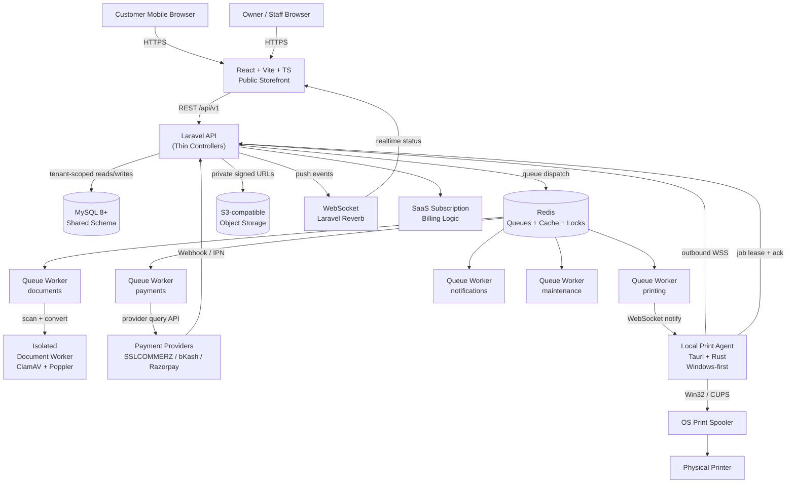
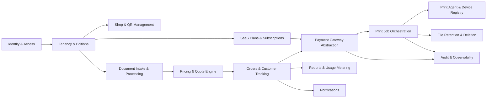
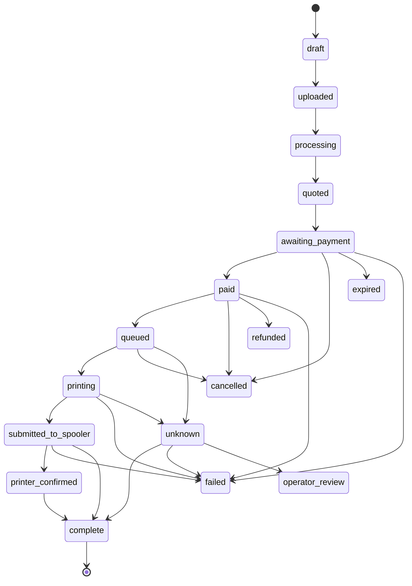
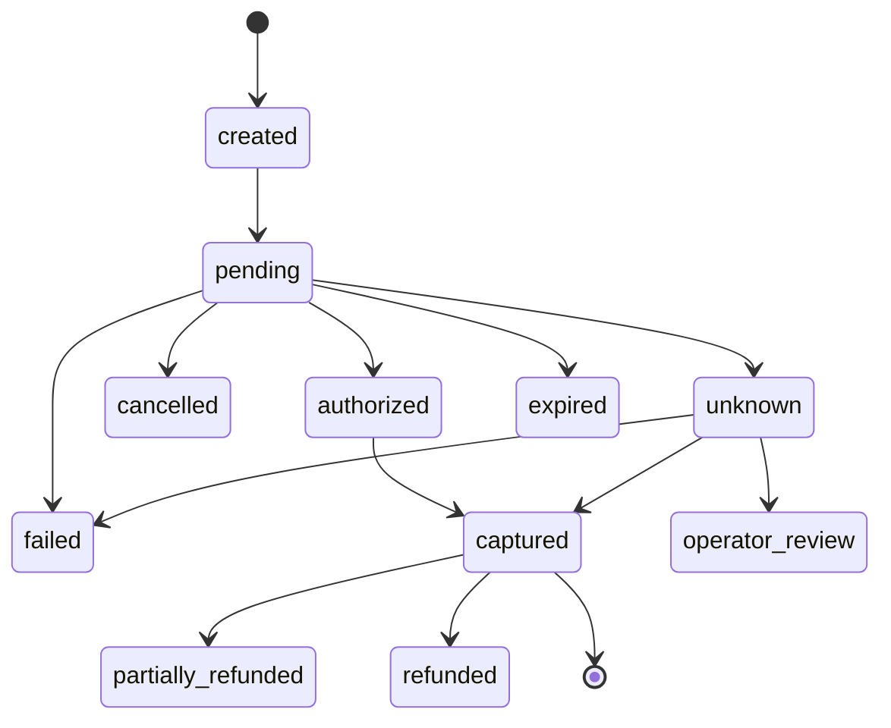
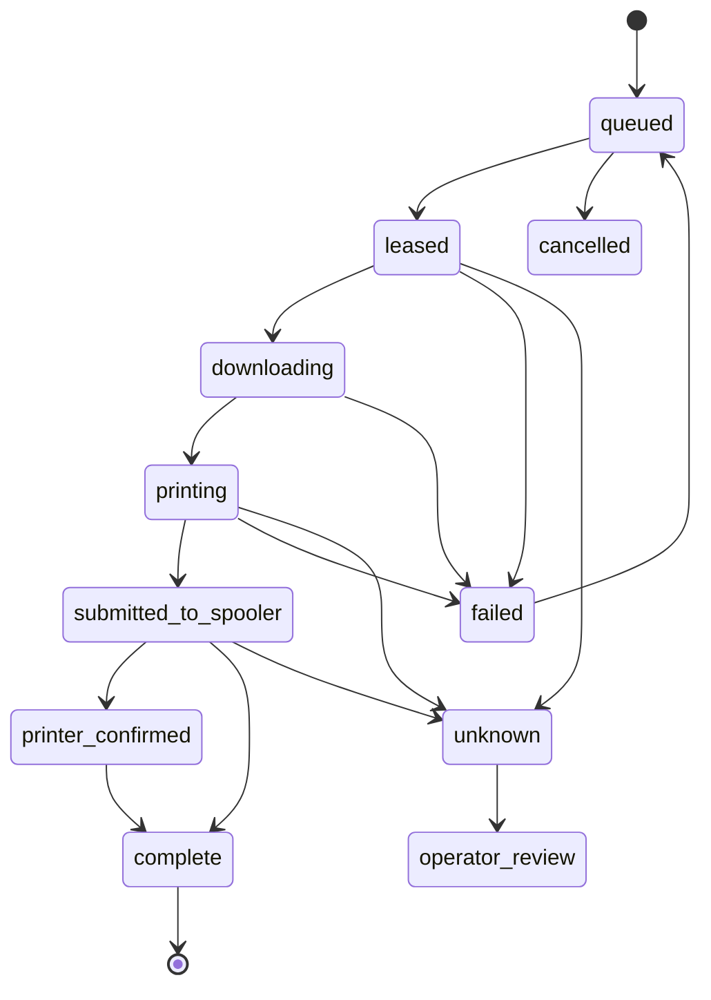

# 🏛️ PrintFlow — Architectural Blueprint & Governance Plan

> *"Before we touch a single line of code, let us understand the underlying state machine. The race condition exists because payment verification, job dispatch, and file deletion are entangled. Here is how mature systems solve this — and here is the 5-part blueprint to achieve universal equilibrium."*

**Author:** Master Plan Architect (agency-master-plan-architect)  
**Date:** 24 November 2026  
**Status:** Awaiting Human Approval

---

## Repository Discovery: Ground Truth Report

> [!IMPORTANT]
> The repository at `d:\PrintFlow` currently contains **documentation only** — no backend, frontend, database, or agent code exists yet. The structure is:
> ```
> d:\PrintFlow\
>   README.md
>   docs/
>     01_PRD.md
>     02_TRP.md
>     03_UI_UX_DESIGN.md
>     04_BACKEND_SCHEMA.md
>     05_AUTOMATION_INTEGRATION.md
>     06_PAYMENT_SETUP.md
>     08_RESEARCH_AND_DECISIONS.md
>     PrintFlow_Contextual_Development_Prompt.md
>     PrintFlow_Full_Project_Context.md
> ```
> This is a **greenfield project**. There are no existing migrations to preserve, no legacy API endpoints to honor, and no prior test suite to maintain. This is both a freedom and a responsibility: every architectural decision we make here becomes the law.

---

## 1. 🎓 Conceptual Masterclass: Philosophy, First Principles & Landscape

### The Core Problem

A physical print shop suffers from a **broken information and trust chain**:

```
Customer → WhatsApp file → Staff finds file → Manual price calc →
  Cash/UPI screenshot → Manual print → No receipt → No tracking
```

Each arrow is a manual handoff that can fail, lose the file, undercharge, double-print, or leave no audit record. PrintFlow's thesis: **replace every manual handoff with a verified, server-authoritative, asynchronous state transition**.

The five fundamental bottlenecks being resolved:

| Bottleneck | PrintFlow Solution |
|---|---|
| File transfer over chat/USB | Private presigned upload → server validation pipeline |
| Manual price calculation | Server-authoritative quote engine with immutable snapshot |
| Unverified cash/UPI payment | Gateway adapter + webhook verification; never trust client |
| Manual print dispatch | Local Print Agent with job lease + spooler submission |
| Zero audit trail | Immutable order events, payment ledger, file deletion log |

### Theoretical Foundations

**1. Event-Driven / Outbox Pattern (Payment → Print)**  
The most dangerous race condition in this system: "payment verified in DB but queue dispatch crashes before the job is enqueued." The Outbox pattern solves this: in a single DB transaction, we write `payment.captured` AND an outbox event record. A separate worker reads the outbox and enqueues the print job. If the worker crashes, it retries the outbox — idempotently. Zero paid orders can silently fail to print.

**2. State Machine Design**  
Orders, payments, and print jobs each follow a strict deterministic state machine. Invalid transitions are rejected at the service layer, not in a `switch` statement in a controller. This is how Erlang OTP's `gen_statem` and Linux kernel device states work — a state can only transition to known next states, and every transition emits an event.

**3. Adapter Pattern (Payment + Print)**  
The domain layer must never know whether the payment is SSLCOMMERZ or Razorpay, or whether the printer is a Windows Spooler or CUPS. The domain calls `PaymentGatewayDriver::verifyWebhook()` and `PrintSpoolerAdapter::submit()`. Adding a new gateway or new OS prints system means writing a new adapter, not changing business logic. This is the same design as Laravel's filesystem abstraction and PHPUnit's test double system.

**4. Tenant Isolation by Design**  
Shared-schema multi-tenancy (ADR-005) works at scale but only if `tenant_id` is not an afterthought — it must be in the schema constraints, model scopes, middleware context, and cross-tenant authorization tests. The pattern is identical to how GitHub implements organization isolation or Stripe implements account isolation: every resource is structurally owned by a context, and that context is verified on every read/write, not just at the route level.

**5. Idempotency as a First-Class Primitive**  
Payment webhooks arrive multiple times. Network failures cause retries. The idempotency key pattern — used by Stripe, Razorpay, and virtually every reliable payment system — means every stateful operation has a unique key, and processing a duplicate key returns the same result without side effects. This is not an optimization; it is a correctness requirement.

**6. Bounded Document Lifecycle**  
Document files are not data. They are temporary physical representations of a customer's intent. After safe handoff to the spooler, their existence is a liability: storage cost, privacy risk, and compliance exposure. The correct model is the same as AWS S3 object lifecycle policies: every uploaded object receives an `expires_at` at creation time, and a cleanup job is the enforcer, not the happy path.

### Comparative Precedents

| Challenge | How Battle-Tested Software Solves It | PrintFlow Equivalent |
|---|---|---|
| Payment idempotency | Stripe idempotency keys + event ID uniqueness | `webhook_events.provider_event_id` unique constraint |
| Print spooling | Windows Print Spooler / CUPS IPP | `PrintSpoolerAdapter` interface + agent local journal |
| Tenant isolation | Shopify Plus, Stripe Connect — context bound at middleware | `TenantContext` middleware + policy enforcement |
| File lifecycle | AWS S3 lifecycle rules, GCS object expiry | `file_deletion_events` + scheduled cleanup job |
| Payment-to-action pipeline | Stripe webhooks → fulfillment | Outbox pattern: `payment.captured` → `CreatePrintJobs` queue job |
| Agent heartbeat | Kubernetes node controller, IoT device shadow | Agent heartbeat + `last_heartbeat_at` + offline detection scheduler |

### Harmonic Efficiency

The design maximizes outcome while minimizing runtime waste:
- Heavy work (scanning, conversion, printing) is **always** off the HTTP request path.
- The HTTP layer does one thing: validate, authorize, persist minimal state, and return quickly.
- Queue workers are separated by concern so a flapping payment webhook cannot starve a document conversion.
- The Print Agent is an outbound-only client; the shop's computer never opens an inbound port.

---

## 2. 🔍 Surgical Critique & Red Teaming (What Could Break?)

### 🔴 Risk 1: Payment-to-Print Lost Event (P0 Existential Risk)

**Failure Vector:** Payment webhook is verified and DB is committed, but the queue dispatch fails (Redis down, worker crash, network partition). The order is marked `paid` but no print job is ever created. The customer paid but nothing prints. The owner sees a "paid" order with no print queue entry and no alert.

**Mitigation:**
- **Outbox pattern is mandatory**: Write an `outbox_events` record in the same DB transaction as the payment capture. A separate `OutboxProcessor` job reads and processes undelivered events.
- **Paid-without-print-job monitor**: Scheduled job every 5 minutes alerts on orders where `status=paid` and no `print_jobs` row exists older than 2 minutes.
- **Dead-letter queue**: Failed queue jobs must route to a monitored DLQ, not silently disappear.

---

### 🔴 Risk 2: Duplicate Physical Print (P0 Existential Risk)

**Failure Vector:** Network drops after agent submits to Windows Spooler but before the ack reaches the server. Server marks the job `unknown`. Owner panics and clicks "retry." A second physical copy prints. Customer gets 2 copies, shop loses paper/ink, owner is confused.

**Mitigation:**
- **Agent local journal is mandatory**: Agent writes `{job_id, attempt_id, status=submitted_to_spooler}` to a local SQLite/file journal before returning. On reconnect, it reconciles with the server.
- **`unknown` state is a wall**: No automatic retry from `unknown`. Only an operator action (after inspecting the physical printer) can create a new attempt.
- **Reprint creates a new attempt row**: Reprint is not a mutation of the original job; it is a new `print_job_attempts` row linked to the original, so the history is fully preserved.

---

### 🔴 Risk 3: Cross-Tenant Data Leakage (P0 Existential Risk)

**Failure Vector:** A malicious tenant owner POSTs `/api/v1/owner/orders/{id}` with an `id` from another tenant's order. If the query does not scope by `tenant_id`, the order is returned. This is an IDOR (Insecure Direct Object Reference) vulnerability.

**Mitigation:**
- **Eloquent global scopes are defense-in-depth, not the primary control**: The primary control is explicit `->where('tenant_id', $tenantContext->id)` in every domain service query, enforced by policy/authorization.
- **Cross-tenant penetration test suite is P0**: Not P1. Every resource type (orders, files, payments, agents, printers) must have a test that proves tenant B cannot access tenant A's records.
- **Never accept `tenant_id` from client request body**: It is always resolved from authenticated middleware context.

---

### 🔴 Risk 4: Webhook Signature Bypass

**Failure Vector:** An attacker POSTs a crafted payload to `/api/v1/webhooks/sslcommerz/{id}` claiming a payment was captured. If signature verification is lax or runs after JSON parsing, a fake payment could dispatch a free print job.

**Mitigation:**
- **Capture raw request bytes first**, verify signature against raw bytes before any JSON parsing.
- **Provider event ID unique constraint**: Even if a valid signature were somehow forged, re-delivery of a valid event must be idempotent.
- **Amount/currency/merchant triple-check** before marking captured.

---

### 🔴 Risk 5: File Storage Key Enumeration

**Failure Vector:** The object storage key for a customer document is guessable or derived from the order ID. An attacker who knows one order's reference can guess and fetch another customer's uploaded document.

**Mitigation:**
- **Object keys are random ULIDs/UUIDs**, never predictable from any user-visible reference.
- **Never public bucket**: All files in private storage only; access is through short-lived signed URLs issued after authorization checks.
- **Files deleted after handoff**: If the file is gone, it cannot be leaked.

---

### 🟡 Risk 6: Floating-Point Money Corruption

**Failure Vector:** `0.1 + 0.2 ≠ 0.3` in IEEE 754. If a PHP/JS calculation uses `float` for price, a 100-page color job could compute to ৳49.9999999 instead of ৳50. Stored as float, it round-trips differently. Provider receives 4999 paise instead of 5000. Amount mismatch triggers quarantine. Customer confused, print blocked.

**Mitigation:**
- **Integer minor units everywhere**: ৳50.00 is stored and transmitted as `5000` (BDT, 2 decimal places) or `50000` (JPY would be `50000` as 0 decimal places — always use ISO 4217 minor unit definition).
- **No `float` or `double` in money columns**: Use `unsignedBigInteger` in migrations.
- **Display-formatted amounts are derived at render time only**: Never round-trip a formatted string back into arithmetic.

---

### 🟡 Risk 7: Edition Bleed — SaaS Routes in Standalone Mode

**Failure Vector:** A standalone deployment unintentionally mounts platform admin routes. A sophisticated attacker discovers `/api/v1/platform/tenants` and can enumerate or manipulate tenant data.

**Mitigation:**
- **Route groups conditioned on `APP_EDITION`**: Platform routes are literally not registered in standalone mode.
- **`EditionContext` service is a singleton**: Edition is resolved once at bootstrap, not per-request.
- **Automated test**: A standalone-mode boot test asserts that platform routes return 404.

---

### 🟡 Risk 8: Agent Token Persistence

**Failure Vector:** A permanent plaintext API key is pasted into the Print Agent settings. If the agent machine is compromised, the key provides indefinite access to the tenant's print queue.

**Mitigation:**
- **One-time pairing code flow**: Short-lived (5–10 min), single-use, random code. Exchanged for a device identity and rotating credential.
- **Only the hash of credentials is stored server-side**: Never the plaintext token.
- **Revocation is instant**: Revoked device stops receiving jobs on the next heartbeat/poll cycle.

---

### 🟡 Risk 9: Conversion Worker Resource Exhaustion

**Failure Vector:** A malicious user uploads a "zip bomb" or a 10,000-page PDF. The document conversion worker attempts to rasterize all pages, exhausts RAM/disk, kills the worker process, and blocks the entire document queue.

**Mitigation:**
- **Hard limits before conversion begins**: Page count limit, file size limit, decompression ratio limit — checked on metadata before any parsing.
- **Worker runs in isolated container/sandbox with CPU/memory quotas**.
- **Conversion is timeboxed**: If conversion doesn't complete in N seconds, it is killed and the file is marked `processing_failed`.

---

### Anti-Scope Creep Filter: Explicitly Forbidden in This Build

The following items are **explicitly out of scope** for this implementation plan to prevent scope creep:

- ❌ WhatsApp bot intake (P2 optional integration, not MVP)
- ❌ AI document understanding, OCR editing, or graphic design suite
- ❌ Physical printer firmware management
- ❌ macOS agent (Windows-first MVP only)
- ❌ Marketplace/split-settlement without provider onboarding
- ❌ Automatic recurring billing (manual renewal only in MVP)
- ❌ Full GraphQL API (REST only)
- ❌ Mobile native apps (responsive web only for customers)
- ❌ Database-per-tenant architecture (shared schema MVP)

---

## 3. 🗺️ Implementation Blueprint (Architecture, File Map & State Contracts)

### System Architecture



### Domain Module Boundaries



### State Machines

**Order State Machine:**


**Payment State Machine:**


**Print Job State Machine:**


---

### Complete File Mutation Manifest

> [!NOTE]
> `[NEW]` = files to be created. `[MODIFY]` = existing files to be updated. `[DELETE]` = files to be removed.
> This is a greenfield project. ALL files below are `[NEW]`.

---

#### Phase 0 — Foundation & Repository Alignment

**Root Configuration**

- `[NEW]` `composer.json` — Laravel + Sanctum + Spatie RBAC + Laravel Horizon dependencies.
- `[NEW]` `package.json` — React + Vite + TypeScript + Tailwind CSS + React Query + Zustand dependencies.
- `[NEW]` `vite.config.ts` — Frontend build config with API proxy.
- `[NEW]` `.env.example` — All required environment variables documented with safe defaults.
- `[NEW]` `docker-compose.yml` — MySQL, Redis, MinIO, MailHog, Nginx, PHP-FPM, Reverb services.
- `[NEW]` `docker-compose.dev.yml` — Development-only overrides with volume mounts.
- `[NEW]` `.github/workflows/ci.yml` — Lint, typecheck, unit tests, MySQL integration tests, tenant isolation suite.
- `[NEW]` `phpunit.xml` — PHPUnit config with separate test suites (unit, feature, integration, isolation).

**Backend Foundation**

- `[NEW]` `backend/app/Http/Middleware/ResolveTenant.php` — Resolves `TenantContext` from host/route slug. Rejects tenant-switching in standalone mode.
- `[NEW]` `backend/app/Http/Middleware/EditionGate.php` — Blocks platform-admin routes in `APP_EDITION=standalone`.
- `[NEW]` `backend/app/Services/Edition/EditionContext.php` — Singleton; exposes `isSaas()`, `isStandalone()`, `currentEdition()`.
- `[NEW]` `backend/app/Services/Tenancy/TenantContext.php` — Immutable tenant context value object resolved per request.
- `[NEW]` `backend/app/Services/Tenancy/TenantResolver.php` — Resolves tenant from host, slug, or configuration.
- `[NEW]` `backend/app/Support/ApiResponse.php` — Consistent JSON envelope: `{data, meta, errors}`.
- `[NEW]` `backend/app/Support/CorrelationId.php` — Generates and propagates correlation IDs in all requests and jobs.
- `[NEW]` `backend/app/Support/Money.php` — Value object: `int $amountMinor`, `string $currency`; arithmetic and formatting helpers.
- `[NEW]` `backend/app/Exceptions/Handler.php` — Structured error responses; never leak stack traces to production.
- `[NEW]` `backend/routes/api.php` — Route groups: `public`, `owner`, `agent`, `platform` (gated by edition).
- `[NEW]` `backend/app/Providers/AppServiceProvider.php` — Singleton registrations.
- `[NEW]` `backend/app/Providers/AuthServiceProvider.php` — RBAC policies.

**Frontend Foundation**

- `[NEW]` `frontend/src/lib/api.ts` — Axios client with CSRF, auth, error handling.
- `[NEW]` `frontend/src/lib/money.ts` — Currency formatting using `Intl.NumberFormat`.
- `[NEW]` `frontend/src/lib/i18n.ts` — i18n setup (react-i18next); English + Bangla.
- `[NEW]` `frontend/src/design-tokens.css` — CSS custom properties from the design spec.
- `[NEW]` `frontend/src/components/ui/` — Shared design system: Button, Badge, Toast, Modal, Skeleton, Table, Card, Timeline, StatusBadge.
- `[NEW]` `frontend/src/components/layout/AppShell.tsx` — Sidebar + top nav layout.

---

#### Phase 1 — Identity, Tenant & Shop Foundation

**Migrations (MySQL-first, SQLite-compatible except JSON/enum constraints)**

- `[NEW]` `backend/database/migrations/0001_create_tenants_table.php`
- `[NEW]` `backend/database/migrations/0002_create_tenant_domains_table.php`
- `[NEW]` `backend/database/migrations/0003_create_users_table.php`
- `[NEW]` `backend/database/migrations/0004_create_tenant_users_table.php`
- `[NEW]` `backend/database/migrations/0005_create_roles_permissions_tables.php` — Spatie permission tables
- `[NEW]` `backend/database/migrations/0006_create_shops_table.php`
- `[NEW]` `backend/database/migrations/0007_create_shop_user_assignments_table.php`

**Domain Services**

- `[NEW]` `backend/app/Domain/Identity/Actions/RegisterOwner.php` — Creates user + tenant + first shop in one transaction.
- `[NEW]` `backend/app/Domain/Identity/Actions/LoginOwner.php` — Issues Sanctum token with device fingerprint.
- `[NEW]` `backend/app/Domain/Tenancy/Actions/ProvisionTenant.php` — Creates tenant + default shop + default role set.
- `[NEW]` `backend/app/Domain/Shop/Actions/CreateShop.php` — Validates slug uniqueness; creates shop record.
- `[NEW]` `backend/app/Domain/Shop/Actions/UpdateShop.php` — Validates slug change implications.
- `[NEW]` `backend/app/Domain/Shop/Actions/GenerateShopQr.php` — Generates QR PNG/SVG/PDF using `chillerlan/php-qrcode` or equivalent.
- `[NEW]` `backend/app/Domain/Shop/Policies/ShopPolicy.php` — Authorizes owner/staff actions on shop resources.

**Controllers (thin)**

- `[NEW]` `backend/app/Http/Controllers/Auth/RegisterController.php`
- `[NEW]` `backend/app/Http/Controllers/Auth/LoginController.php`
- `[NEW]` `backend/app/Http/Controllers/Auth/LogoutController.php`
- `[NEW]` `backend/app/Http/Controllers/Owner/ShopController.php`
- `[NEW]` `backend/app/Http/Controllers/Owner/QrController.php`
- `[NEW]` `backend/app/Http/Controllers/Platform/TenantController.php` — Edition-gated.

**Models**

- `[NEW]` `backend/app/Models/Tenant.php` — ULID primary key, HasMany shops/users.
- `[NEW]` `backend/app/Models/User.php` — Global user; role via `tenant_users`.
- `[NEW]` `backend/app/Models/TenantUser.php` — Pivot with role scoping.
- `[NEW]` `backend/app/Models/Shop.php` — Belongs to tenant; slug index.

**Tests**

- `[NEW]` `backend/tests/Unit/Domain/Identity/RegisterOwnerTest.php`
- `[NEW]` `backend/tests/Feature/Auth/AuthFlowTest.php` — Register, login, logout, password reset.
- `[NEW]` `backend/tests/Feature/Shop/ShopCrudTest.php` — CRUD with tenant isolation.
- `[NEW]` `backend/tests/Feature/Isolation/CrossTenantShopAccessTest.php` — Tenant B cannot read Tenant A's shop.
- `[NEW]` `backend/tests/Integration/Migrations/Phase1MigrationTest.php` — Run all migrations on MySQL.

**Frontend**

- `[NEW]` `frontend/src/pages/auth/Register.tsx`
- `[NEW]` `frontend/src/pages/auth/Login.tsx`
- `[NEW]` `frontend/src/pages/owner/shops/ShopProfile.tsx`
- `[NEW]` `frontend/src/pages/owner/shops/QrDownload.tsx`

---

#### Phase 2 — Customer QR Storefront & Document Intake

**Migrations**

- `[NEW]` `backend/database/migrations/0008_create_orders_table.php`
- `[NEW]` `backend/database/migrations/0009_create_order_files_table.php`
- `[NEW]` `backend/database/migrations/0010_create_order_events_table.php`

**Domain Services**

- `[NEW]` `backend/app/Domain/Upload/Actions/AuthorizeUpload.php` — Validates shop active, subscription entitlement, rate limit; returns presigned URL.
- `[NEW]` `backend/app/Domain/Upload/Actions/CompleteUpload.php` — Verifies size/hash; dispatches `ScanAndProcessDocument` job.
- `[NEW]` `backend/app/Domain/Upload/Jobs/ScanAndProcessDocument.php` — ClamAV scan → Poppler page count → preview → update `order_files`.
- `[NEW]` `backend/app/Domain/Upload/Services/DocumentProcessor.php` — Coordinates scan, page count, preview generation with resource limits.
- `[NEW]` `backend/app/Domain/Upload/Services/MimeValidator.php` — Magic bytes detection; rejects filename-only MIME claims.
- `[NEW]` `backend/app/Storage/PrivateStorageService.php` — S3-compatible operations; generates short-lived signed URLs with expiry.

**Controllers**

- `[NEW]` `backend/app/Http/Controllers/Public/ShopLandingController.php` — Public shop info.
- `[NEW]` `backend/app/Http/Controllers/Public/UploadController.php` — Presign and complete upload.

**Jobs**

- `[NEW]` `backend/app/Jobs/Documents/ScanAndProcessDocument.php` — Queue: `documents`.
- `[NEW]` `backend/app/Jobs/Documents/DeleteOrderFile.php` — Queue: `maintenance`.

**Tests**

- `[NEW]` `backend/tests/Feature/Upload/UploadFlowTest.php` — Valid PDF, malformed PDF, password-protected PDF, oversized file, malware fixture.
- `[NEW]` `backend/tests/Feature/Upload/UploadRateLimitTest.php`
- `[NEW]` `backend/tests/Feature/Upload/FileExpiryTest.php` — Confirm `expires_at` is always set.

**Frontend**

- `[NEW]` `frontend/src/pages/customer/ShopLanding.tsx` — `/s/{shopSlug}`
- `[NEW]` `frontend/src/pages/customer/Upload.tsx` — `/s/{shopSlug}/upload`
- `[NEW]` `frontend/src/components/upload/FileUploader.tsx` — Multi-file, progress, cancel.
- `[NEW]` `frontend/src/components/upload/FileCard.tsx` — Per-file state: validating → scan → ready.

---

#### Phase 3 — Quote & Pricing Engine

**Migrations**

- `[NEW]` `backend/database/migrations/0011_create_price_profiles_table.php`
- `[NEW]` `backend/database/migrations/0012_create_price_rules_table.php`
- `[NEW]` `backend/database/migrations/0013_create_quotes_table.php`

**Domain Services**

- `[NEW]` `backend/app/Domain/Pricing/Services/QuoteCalculator.php` — Accepts file/settings selections + active price profile; returns `Quote` with line items. Integer arithmetic only.
- `[NEW]` `backend/app/Domain/Pricing/Services/PriceProfileService.php` — CRUD for price profiles; validates no overlapping rules.
- `[NEW]` `backend/app/Domain/Pricing/ValueObjects/LineItem.php` — `quantity`, `unit_price_minor`, `total_minor`, `service_code`.
- `[NEW]` `backend/app/Domain/Pricing/ValueObjects/QuoteResult.php` — `subtotal_minor`, `tax_minor`, `fee_minor`, `discount_minor`, `total_minor`, `line_items[]`, `expires_at`, `calculation_version`.

**Controllers**

- `[NEW]` `backend/app/Http/Controllers/Public/QuoteController.php` — `POST /api/v1/public/shops/{slug}/quotes`
- `[NEW]` `backend/app/Http/Controllers/Owner/PricingController.php` — CRUD price profiles + rules.

**Tests**

- `[NEW]` `backend/tests/Unit/Pricing/QuoteCalculatorTest.php` — Matrix of page counts × copies × color modes × paper sizes × duplex modes. Integer arithmetic assertions.
- `[NEW]` `backend/tests/Unit/Pricing/MinimumFeeTest.php`
- `[NEW]` `backend/tests/Unit/Pricing/TaxCalculationTest.php`
- `[NEW]` `backend/tests/Feature/Pricing/QuoteImmutabilityTest.php` — Confirm accepted quote cannot be mutated by price profile change.

**Frontend**

- `[NEW]` `frontend/src/pages/customer/Configure.tsx` — `/s/{shopSlug}/configure`
- `[NEW]` `frontend/src/components/pricing/PrintOptionsForm.tsx` — Per-file: copies, page range, color, paper, sides.
- `[NEW]` `frontend/src/components/pricing/QuoteSummary.tsx` — Live total; server-authoritative.

---

#### Phase 4 — Payment Abstraction

**Migrations**

- `[NEW]` `backend/database/migrations/0014_create_gateway_accounts_table.php`
- `[NEW]` `backend/database/migrations/0015_create_payments_table.php`
- `[NEW]` `backend/database/migrations/0016_create_webhook_events_table.php`
- `[NEW]` `backend/database/migrations/0017_create_outbox_events_table.php`

**Payment Gateway Interface & Adapters**

- `[NEW]` `backend/app/Domain/Payment/Contracts/PaymentGatewayDriver.php` — Interface: `createCheckout`, `verifyReturn`, `verifyWebhook`, `fetchTransaction`, `refund`, `capabilities`.
- `[NEW]` `backend/app/Domain/Payment/Adapters/SslCommerzDriver.php` — SSLCOMMERZ session API, IPN, Order Validation API.
- `[NEW]` `backend/app/Domain/Payment/Adapters/BkashCheckoutDriver.php` — Token grant/refresh, create payment, execute, query.
- `[NEW]` `backend/app/Domain/Payment/Adapters/RazorpayDriver.php` — Orders API, signature verify, capture, webhooks.
- `[NEW]` `backend/app/Domain/Payment/Adapters/SandboxDriver.php` — Test-only; clearly labeled; uses no real provider.
- `[NEW]` `backend/app/Domain/Payment/Services/GatewayResolver.php` — Resolves correct driver from `gateway_accounts` for a given tenant/order.
- `[NEW]` `backend/app/Domain/Payment/Services/PaymentService.php` — Orchestrates: create attempt → checkout → webhook processing → capture → outbox event.
- `[NEW]` `backend/app/Domain/Payment/Services/WebhookProcessor.php` — Raw-bytes signature verify → provider event ID uniqueness → DB transaction: payment capture + order status + outbox write.
- `[NEW]` `backend/app/Domain/Payment/Services/OutboxProcessor.php` — Reads `outbox_events`, dispatches `CreatePrintJobsForPaidOrder` job.

**Controllers**

- `[NEW]` `backend/app/Http/Controllers/Public/PaymentController.php` — Create session; return redirect.
- `[NEW]` `backend/app/Http/Controllers/Webhooks/SslCommerzWebhookController.php`
- `[NEW]` `backend/app/Http/Controllers/Webhooks/BkashWebhookController.php`
- `[NEW]` `backend/app/Http/Controllers/Webhooks/RazorpayWebhookController.php`

**Jobs**

- `[NEW]` `backend/app/Jobs/Payments/CreatePrintJobsForPaidOrder.php` — Idempotent: checks if print jobs already exist for this order. Queue: `printing`.
- `[NEW]` `backend/app/Jobs/Payments/ReconcilePayment.php` — Calls `fetchTransaction` for `pending`/`unknown` payments. Queue: `payments`.

**Tests**

- `[NEW]` `backend/tests/Feature/Payment/PaymentFlowTest.php` — Full happy-path with sandbox adapter.
- `[NEW]` `backend/tests/Feature/Payment/WebhookIdempotencyTest.php` — Same event ID twice = no duplicate job/capture.
- `[NEW]` `backend/tests/Feature/Payment/WebhookSignatureTest.php` — Invalid signature = 400, no DB mutation.
- `[NEW]` `backend/tests/Feature/Payment/AmountMismatchTest.php` — Wrong amount = quarantine, no print.
- `[NEW]` `backend/tests/Feature/Payment/CrossPurposeTest.php` — SaaS subscription payment cannot create print job and vice versa.
- `[NEW]` `backend/tests/Feature/Payment/OutboxReliabilityTest.php` — Simulate queue failure after payment capture; outbox retries and job is eventually created.
- `[NEW]` `backend/tests/Feature/Payment/SslCommerzContractTest.php` — Signed webhook fixtures.
- `[NEW]` `backend/tests/Feature/Payment/RazorpayContractTest.php` — Signed webhook fixtures.

**Frontend**

- `[NEW]` `frontend/src/pages/customer/Checkout.tsx` — `/s/{shopSlug}/checkout`
- `[NEW]` `frontend/src/pages/customer/OrderStatus.tsx` — `/order/{publicToken}`
- `[NEW]` `frontend/src/components/payment/PaymentMethodChooser.tsx`
- `[NEW]` `frontend/src/components/payment/PaymentPending.tsx` — "Verifying payment…" state.

---

#### Phase 5 — Local Print Agent & Print Queue

**Print Agent (Tauri + Rust — `print-agent/`)**

- `[NEW]` `print-agent/src-tauri/Cargo.toml` — Tauri + tokio + serde + reqwest + winprint/windows-sys + rusqlite.
- `[NEW]` `print-agent/src-tauri/src/main.rs` — Entry point; system tray; app lifecycle.
- `[NEW]` `print-agent/src/enrollment/` — Pairing code submission; device identity storage.
- `[NEW]` `print-agent/src/connection/` — WSS connection manager; reconnect with exponential backoff + jitter.
- `[NEW]` `print-agent/src/heartbeat/` — Sends heartbeat at configurable interval with jitter.
- `[NEW]` `print-agent/src/printer_discovery/` — Win32 `EnumPrinters` wrapper; capability report.
- `[NEW]` `print-agent/src/job_lease/` — Requests next eligible job; validates tenant/shop/device binding.
- `[NEW]` `print-agent/src/download/` — Downloads to restricted temp dir; SHA-256 verify.
- `[NEW]` `print-agent/src/spooler/windows.rs` — Windows Spooler adapter: open printer, send print job, monitor status.
- `[NEW]` `print-agent/src/spooler/adapter.rs` — `PrintSpoolerAdapter` trait: `submit`, `query_status`, `cancel`.
- `[NEW]` `print-agent/src/journal/` — SQLite local journal: persists `{job_id, attempt_id, state}` before submission.
- `[NEW]` `print-agent/src/cleanup/` — Deletes temp files after spooler handoff.
- `[NEW]` `print-agent/src/updater/` — Signed release verification; download + restart.
- `[NEW]` `print-agent/tests/simulator.rs` — Agent simulator for CI: accepts job requests, responds with predetermined outcomes.

**Backend — Print Agent & Job Orchestration**

- `[NEW]` `backend/database/migrations/0018_create_print_agents_table.php`
- `[NEW]` `backend/database/migrations/0019_create_printers_table.php`
- `[NEW]` `backend/database/migrations/0020_create_print_jobs_table.php`
- `[NEW]` `backend/database/migrations/0021_create_print_job_attempts_table.php`
- `[NEW]` `backend/database/migrations/0022_create_file_deletion_events_table.php`
- `[NEW]` `backend/app/Domain/Agent/Actions/GenerateEnrollmentCode.php` — Cryptographically random, single-use, TTL 10 min.
- `[NEW]` `backend/app/Domain/Agent/Actions/EnrollAgent.php` — Validates code; binds device to tenant/shop; issues credential.
- `[NEW]` `backend/app/Domain/Agent/Actions/RecordHeartbeat.php` — Updates `last_heartbeat_at`; updates printer list.
- `[NEW]` `backend/app/Domain/Agent/Actions/RevokeAgent.php` — Sets status to revoked; stops job delivery.
- `[NEW]` `backend/app/Domain/PrintJob/Actions/LeasePrintJob.php` — Atomic: sets lease token + `lease_expires_at` for one eligible job.
- `[NEW]` `backend/app/Domain/PrintJob/Actions/AcknowledgePrintJob.php` — Records agent acknowledgement and spooler job ID.
- `[NEW]` `backend/app/Domain/PrintJob/Actions/ReconcileLeases.php` — Finds expired leases; transitions to `unknown` or `failed` with reconciliation flag.
- `[NEW]` `backend/app/Domain/PrintJob/Actions/GenerateJobDownloadUrl.php` — Issues short-lived signed URL scoped to the leasing agent.
- `[NEW]` `backend/app/Domain/FileDeletion/Actions/DeleteOrderFileRemotely.php` — Deletes from S3; writes `file_deletion_events`.
- `[NEW]` `backend/app/Jobs/Printing/ReconcileStaleLeases.php` — Queue: `printing`; runs every 5 min.
- `[NEW]` `backend/app/Jobs/Maintenance/CleanupExpiredFiles.php` — Queue: `maintenance`.
- `[NEW]` `backend/app/Http/Controllers/Agent/EnrollmentController.php`
- `[NEW]` `backend/app/Http/Controllers/Agent/HeartbeatController.php`
- `[NEW]` `backend/app/Http/Controllers/Agent/JobController.php` — Lease, ack, events.
- `[NEW]` `backend/app/Http/Controllers/Agent/PrinterSyncController.php`

**Tests**

- `[NEW]` `backend/tests/Feature/Agent/EnrollmentFlowTest.php` — Valid code, expired code, already-used code, wrong tenant.
- `[NEW]` `backend/tests/Feature/Agent/RevocationTest.php` — Revoked agent cannot lease jobs.
- `[NEW]` `backend/tests/Feature/PrintJob/JobLeaseTest.php` — Atomic lease; two agents cannot both lease the same job.
- `[NEW]` `backend/tests/Feature/PrintJob/DuplicatePrintPreventionTest.php` — Idempotency key on print job creation.
- `[NEW]` `backend/tests/Feature/PrintJob/ReconcileUnknownTest.php` — Expired lease with unknown outcome cannot auto-retry.
- `[NEW]` `backend/tests/Feature/FileDeletion/DeletionAuditTest.php` — Every deleted file has a `file_deletion_events` record.
- `[NEW]` `print-agent/tests/simulator_integration_test.rs` — Full pairing → lease → download → submit → ack cycle.

**Frontend**

- `[NEW]` `frontend/src/pages/owner/agents/AgentList.tsx`
- `[NEW]` `frontend/src/pages/owner/agents/PairingWizard.tsx`
- `[NEW]` `frontend/src/pages/owner/printers/PrinterList.tsx`
- `[NEW]` `frontend/src/components/agents/AgentStatusCard.tsx`

---

#### Phase 6 — Owner Console

**Domain Services**

- `[NEW]` `backend/app/Domain/Dashboard/Services/DashboardMetricsService.php` — Today's orders, revenue, failed jobs, agent status. No hardcoded/mocked values.
- `[NEW]` `backend/app/Domain/Reports/Services/ReportBuilder.php` — Date-range, paginated, filterable.

**Controllers**

- `[NEW]` `backend/app/Http/Controllers/Owner/DashboardController.php`
- `[NEW]` `backend/app/Http/Controllers/Owner/OrderController.php` — List, detail, hold, cancel, retry-print.
- `[NEW]` `backend/app/Http/Controllers/Owner/TransactionController.php`

**Tests**

- `[NEW]` `backend/tests/Feature/Owner/DashboardTest.php` — Metrics are computed from real records; no fakes.
- `[NEW]` `backend/tests/Feature/Owner/OrderActionsTest.php` — Hold, cancel, retry with permission checks and audit log entries.

**Frontend**

- `[NEW]` `frontend/src/pages/owner/dashboard/Overview.tsx` — Real KPIs; no mock charts.
- `[NEW]` `frontend/src/pages/owner/orders/OrderList.tsx`
- `[NEW]` `frontend/src/pages/owner/orders/OrderDetail.tsx` — Full timeline.
- `[NEW]` `frontend/src/pages/owner/orders/ActiveQueue.tsx`
- `[NEW]` `frontend/src/pages/owner/payments/GatewaySettings.tsx` — Write-only credential fields.
- `[NEW]` `frontend/src/pages/owner/payments/TransactionHistory.tsx`

---

#### Phase 7 — SaaS Control Plane & Billing

**Migrations**

- `[NEW]` `backend/database/migrations/0023_create_plans_table.php`
- `[NEW]` `backend/database/migrations/0024_create_subscriptions_table.php`
- `[NEW]` `backend/database/migrations/0025_create_subscription_invoices_table.php`
- `[NEW]` `backend/database/migrations/0026_create_usage_events_table.php`

**Domain Services**

- `[NEW]` `backend/app/Domain/Subscription/Actions/CreateSubscription.php`
- `[NEW]` `backend/app/Domain/Subscription/Actions/RenewSubscription.php` — Manual renewal only in MVP.
- `[NEW]` `backend/app/Domain/Subscription/Actions/ExpireSubscription.php` — Applies grace/read-only policy; never deletes records.
- `[NEW]` `backend/app/Domain/Entitlement/Services/EntitlementService.php` — Checks tenant's current plan limits before allowing upload, order, agent pairing, etc.
- `[NEW]` `backend/app/Domain/Subscription/Services/UsageMeteringService.php` — Writes idempotent `usage_events` from real source records.

**Tests**

- `[NEW]` `backend/tests/Feature/Subscription/SubscriptionLifecycleTest.php` — Active → grace → suspended; records preserved.
- `[NEW]` `backend/tests/Feature/Subscription/PaymentPurposeSeparationTest.php` — SaaS subscription payment cannot create print job.
- `[NEW]` `backend/tests/Feature/Entitlement/PlanLimitTest.php` — Tenant at max shops/agents is blocked from creating more.

**Frontend**

- `[NEW]` `frontend/src/pages/platform/TenantDirectory.tsx`
- `[NEW]` `frontend/src/pages/platform/PlanEditor.tsx`
- `[NEW]` `frontend/src/pages/platform/PlatformHealth.tsx`
- `[NEW]` `frontend/src/pages/owner/subscription/BillingPage.tsx`

---

#### Phase 8 — Reporting, Localization, Hardening & Release

- `[NEW]` `frontend/src/locales/en.json`
- `[NEW]` `frontend/src/locales/bn.json` — Bangla translations.
- `[NEW]` `backend/lang/en/` — Laravel translation keys.
- `[NEW]` `backend/lang/bn/` — Bangla Laravel translations.
- `[NEW]` `backend/app/Http/Controllers/Owner/ReportController.php` — CSV/PDF export.
- `[NEW]` `backend/app/Http/Controllers/Owner/AuditLogController.php`
- `[NEW]` `deployment/docker-compose.prod.yml`
- `[NEW]` `deployment/nginx.conf`
- `[NEW]` `deployment/DEPLOYMENT.md` — Step-by-step VPS deployment guide.
- `[NEW]` `deployment/BACKUP.md` — DB backup + restore drills.
- `[NEW]` `backend/tests/Integration/SmokeSuite/EndToEndSmokeTest.php` — Full happy path: shop → upload → quote → sandbox payment → print agent simulator → deletion audit.

---

## 4. 🧪 Validation Protocol & Ground Truth Verification

### Automated Tests

```bash
# Backend unit tests (SQLite — fast)
php artisan test --testsuite=unit

# Backend feature tests (SQLite)
php artisan test --testsuite=feature

# Backend MySQL integration tests (requires MySQL service)
php artisan test --testsuite=integration --env=testing.mysql

# Tenant isolation security suite
php artisan test --testsuite=isolation

# Payment adapter contract tests
php artisan test --testsuite=payment-contracts

# Frontend type check
pnpm typecheck

# Frontend lint
pnpm lint

# Frontend unit/component tests
pnpm test

# Print agent tests (Rust)
cargo test --workspace

# CI full pipeline (all of the above)
gh workflow run ci.yml
```

### Edge Cases to Validate in Each Phase

| Phase | Edge Case | Expected Behavior |
|---|---|---|
| 2 | Password-protected PDF | Rejected with user-friendly error |
| 2 | 1.5 GB ZIP bomb | Rejected at page-count limit before decompression |
| 2 | Polyglot file (JPEG that is also a PDF) | MIME detected as JPEG; treated as JPEG |
| 3 | Price profile changes after quote accepted | Historical quote immutable; new quote required |
| 3 | Customer-submitted total in body | Ignored; server always uses quote total |
| 4 | SSLCOMMERZ IPN arrives 3 times | Idempotent; only one payment captured |
| 4 | Provider reports ₹100 but expected ₹200 | Quarantine; no print dispatch |
| 5 | Agent crashes after spooler submission but before ack | Job marked `unknown`; operator decision required |
| 5 | Two agents simultaneously request the same job | Only one gets the atomic lease; other gets empty response |
| 5 | Agent from Tenant B requests Tenant A job | Rejected; 403 |
| 7 | SaaS invoice payment | Subscription renewed only; no print job created |
| 7 | Tenant suspension | New uploads blocked; existing order records accessible for export |

### Manual Verification Checklist (Before Pilot Launch)

1. **End-to-end flow**: Owner creates shop → customer scans QR → uploads PDF → quotes → sandbox payment → agent leases job → prints → deletion event recorded.
2. **Cross-tenant IDOR test**: Log in as Tenant B; try to access Tenant A's order ID directly in the API.
3. **Payment security**: Send a webhook with an invalid HMAC signature; confirm it is rejected with 400 and no DB mutation.
4. **Duplicate webhook**: Send the same valid webhook event ID twice; confirm one payment captured, one print job created.
5. **Agent offline**: Pay for an order while agent is offline; confirm order stays in `queued` state and owner sees offline alert.
6. **Unknown state**: Disconnect agent mid-job after spooler submission; confirm job moves to `unknown` and retry requires operator action.
7. **File deletion audit**: Upload → process → pay → print → confirm `file_deletion_events` record exists for the original file.
8. **Standalone mode**: Boot app with `APP_EDITION=standalone`; confirm `/api/v1/platform/tenants` returns 404.
9. **SaaS tenant isolation**: Create two tenants in SaaS mode; confirm neither can see the other's data via any API.
10. **Physical printer test**: USB laser + network laser + inkjet; test mono, color, duplex, A4 — record outcomes in the hardware acceptance matrix.

---

## 5. 🔄 Rollback Strategy & Failure Containment

### Instant Rollback Path (< 60 seconds)

Each phase is a separate set of migrations with no destructive operations on previous data. Rolling back a phase:

```bash
# Roll back all migrations in Phase N
php artisan migrate:rollback --step=N_migration_count

# Redeploy previous Docker image tag
docker service update --image printflow-api:PREVIOUS_TAG api_service

# Frontend: revert to previous CDN deployment / static build
```

### Database Rollback Safety Rules

- **No `DROP TABLE` or `DROP COLUMN` on financial data**: All financial tables (`payments`, `subscription_invoices`, `audit_logs`) are immutable and append-only. Rolling back a migration must only add/remove indexes or add nullable columns with safe defaults.
- **Migration is always additive for Phases 1–7**: New columns nullable with defaults; no existing column type changes.
- **Soft deletes only**: Tenants, shops, and users use soft deletes. No cascade hard deletes on financial records.

### Circuit Breakers

| Downstream Dependency | Degradation Mode |
|---|---|
| Redis (queue) unavailable | API still accepts uploads + quotes; payments and prints are queued in-memory (bounded); alert fired if Redis down > 2 min |
| Payment provider API timeout | Payment stays `pending`; scheduled reconciliation job retries provider query; customer sees "Verifying payment…" |
| Print Agent offline | Paid job stays `queued`; owner notified; job held until agent reconnects within retention window |
| Object storage unavailable | Upload endpoint returns 503; no data loss; customer informed to retry |
| Document worker unavailable | Files stay in `processing` state; alert fires; operator can manually mark as processing_failed with refund workflow |
| ClamAV unavailable | Fail safe (not fail open): reject upload until scanner is available; never accept unscanned files in production |

### Emergency Contacts & Escalation

- **Paid order with no print job alert**: Fires after 2 minutes → auto-retry outbox → page on-call after 10 minutes.
- **Duplicate physical print detected**: Log CRITICAL event; suspend automatic retry on that order; require operator confirmation.
- **Cross-tenant data access detected in logs**: Immediate security incident; freeze affected tenant endpoints; audit trail preserved.

---

## Open Questions Requiring User Decision Before Phase 1

> [!IMPORTANT]
> The following decisions impact core schema, routing, and pricing logic. They must be resolved before coding begins.

1. **Launch geography**: Bangladesh-first (BDT + SSLCOMMERZ/bKash primary) or India-first (INR + Razorpay primary) or dual? This determines default currency in `tenants`, which gateway adapters to build in Phase 4 MVP scope, and which locale/language is prioritized.

2. **Pricing basis**: Per printed **side** or per physical **sheet**? For example, a 10-page duplex job: is it 10 sides or 5 sheets? This is a core schema decision in `price_rules.unit_basis` and the `QuoteCalculator`. It must be explicit before the pricing migration.

3. **Customer contact requirement**: Should the checkout flow require customer phone/name, or is anonymous checkout allowed? Impacts `orders.customer_phone` nullable strategy, receipt delivery, and order lookup UX.

4. **Multiple outlets at launch**: Does Phase 1 need multi-outlet (multiple shops per tenant) support, or can it start with one-shop-per-tenant and migrate later? This affects the complexity of route resolution and agent binding.

5. **SaaS vs. Standalone priority**: Should the first build target SaaS mode (multi-tenant) or Standalone mode (single-tenant, simpler)? Standalone is simpler to validate; SaaS requires the full tenant isolation suite from day one.

> [!WARNING]
> **BREAKING DESIGN DECISION — Standalone vs. SaaS First:**
> If Standalone is built first, tenant isolation tests will likely be written as an afterthought when SaaS mode is added. The correct approach is to build with tenant isolation enforced from Phase 1 even if only one tenant exists. This is non-negotiable for a product that will eventually run in SaaS mode. Do not defer isolation to "when we add multi-tenancy."

> [!CAUTION]
> **bKash Credentials**: Do not begin Phase 4 bKash integration without real sandbox credentials from the bKash merchant portal. Public code/blog example credentials are invalid and may expose the application to security risk. This is a hard dependency on merchant onboarding that must be tracked separately from development.

---

## Implementation Phasing Summary

| Phase | Key Deliverable | Estimated Scope | P-Level |
|---|---|---|---|
| 0 | Foundation: conventions, CI, Docker, tenant middleware, design system | High setup cost, pays dividends every phase | P0 |
| 1 | Auth, tenant, shop, QR — first working endpoint | Medium | P0 |
| 2 | Customer upload: presign, scan, process, preview | High (ClamAV + Poppler integration) | P0 |
| 3 | Quote engine: pricing profiles, immutable snapshots | Medium | P0 |
| 4 | Payment adapters: sandbox + first real provider | High (security-critical) | P0 |
| 5 | Print Agent (Rust/Tauri) + print job orchestration | Very High (new language, OS integration) | P0 |
| 6 | Owner console: dashboard, orders, settings, QR | High (UI-heavy) | P0 |
| 7 | SaaS control plane + subscription billing | Medium | P0 MVP |
| 8 | Reports, localization, hardening, deployment docs | Medium | P0 Release |

---

*This plan was authored by Master Plan Architect under the agency-master-plan-architect skill. Zero production code was executed or modified during this planning turn. This document is the intellectual blueprint and governance contract for the PrintFlow implementation.*
